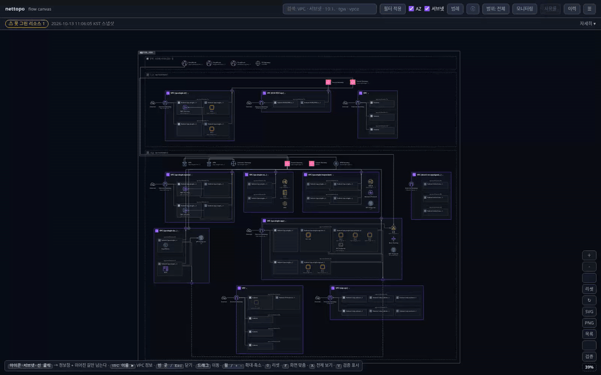
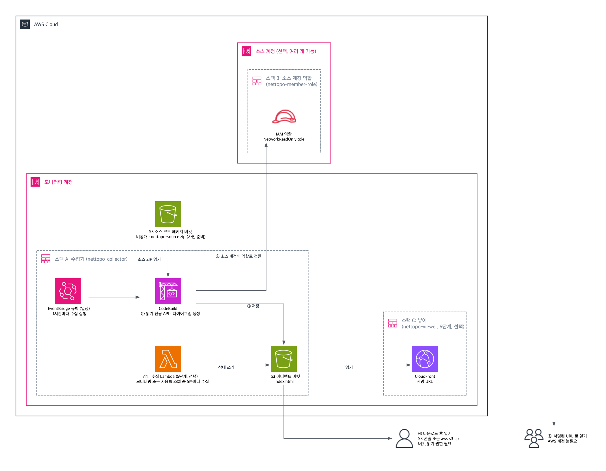

# NetworkTopology

[English](README.md)

여러 AWS 계정과 리전의 네트워크 구성을 읽기 전용 API 로 수집해 다이어그램 하나로 보여 주는 툴입니다. 모니터링 계정에 CloudFormation 스택 하나를 올리면 수집기가 한 시간마다 돌고, 결과는 그 계정의 비공개 S3 버킷에 HTML 파일 하나로 저장됩니다. 서버, API, 데이터베이스가 없습니다. 대상 계정에는 `Describe*`, `Get*`, `List*`, `Search*` 호출만 합니다.

> [!NOTE]
> 이 저장소는 운영 환경용이 아닌 샘플 코드입니다. 배포하기 전에 보안·법무 팀과 함께 조직의 보안·규제·컴플라이언스 요구 사항을 충족하는지 확인하세요.



테스트 계정을 실제로 수집한 화면이며 계정 ID 와 공인 IP 만 바꿨습니다. 가상의 다계정 구성 3종 스크린샷은 [시연 시나리오](docs/demo/scenario-finance.md)에 있습니다.

## 아키텍처



모니터링 계정은 수집기가 도는 계정이고, 소스 계정은 다이어그램에 넣을 리소스가 있는 계정들입니다. 수집기는 EventBridge 스케줄로 한 시간마다 실행되는 CodeBuild 프로젝트입니다. 비공개 S3 버킷에서 배포 패키지를 읽고, 소스 계정마다 만들어 둔 읽기 전용 IAM 역할로 전환해 수집한 뒤, 생성한 HTML 을 별도의 비공개 S3 버킷에 저장합니다.

| CloudFormation 스택 | 올리는 계정 | 하는 일 | 필수 |
|---|---|---|---|
| **A 수집기** `nettopo-collector` | 모니터링 계정 | 수집, 다이어그램 생성, S3 저장. 1시간마다 | 예 |
| **B 소스 계정 역할** `nettopo-member-role` | 소스 계정마다 | 수집기가 쓰는 읽기 전용 역할 | 소스 계정이 있을 때 |
| **C 뷰어** `nettopo-viewer` | 모니터링 계정 | AWS 계정 없는 사람에게 서명된 보는 링크 | 아니요 |

## 주요 기능

- **네트워크 다이어그램.** 계정 > 리전 > VPC > AZ > 서브넷 순으로 중첩해 그리고, Transit Gateway·피어링·VPN·Direct Connect 연결을 선으로 잇습니다. 같은 종류가 많으면 「<종류> ×N」 아이콘 하나로 묶습니다.
- **다계정·다리전.** 소스 계정마다 읽기 전용 역할 하나만 둡니다. 소스 계정은 모니터링 계정의 Transit Gateway 연결에서 자동 발견하거나 직접 지정합니다.
- **못 읽은 영역 표시.** 읽지 못한 곳은 화면 위 배너에 어느 계정·리전의 어떤 리소스인지와 조치 방법을 함께 띄웁니다.
- **실시간 모니터링** (선택). 화면을 열어 둔 동안 5분마다 리소스 상태를 다시 읽습니다. 모드는 둘입니다. 「구조 조회만」은 `Describe*` 로 상태만, 「지표까지」는 CloudWatch 트래픽 지표까지 봅니다. 서비스 한도 대비 사용률은 별도 토글입니다. 배포 가이드 [5단계](docs/install-guide.md#5-모니터링사용률-추가-배포-스택-a-갱신)를 보세요.
- **공유 링크** (선택). AWS 계정이 없는 사람을 위한 CloudFront 배포와 서명 URL 입니다. [6단계](docs/install-guide.md#6-cloudfront로-공유하기-스택-c-배포링크-발급)를 보세요.

생성된 HTML 은 외부로 나가는 요청이 없습니다. 모니터링 또는 사용률을 켠 경우에만 같은 계정의 S3 를 서명된 URL 로 읽고 씁니다.

<details>
<summary>수집하는 리소스</summary>

- **VPC:** VPC, 서브넷, 라우팅 테이블, 인터넷 게이트웨이, NAT 게이트웨이, VPC 피어링, VPC 엔드포인트, 보안 그룹, 네트워크 ACL, 탄력적 IP, EC2 Instance Connect 엔드포인트
- **연결:** Transit Gateway(연결·Connect·라우팅 테이블), Cloud WAN 코어 네트워크, VPC Lattice(서비스 네트워크·서비스), VPN(가상 프라이빗 게이트웨이·고객 게이트웨이·연결), Direct Connect(연결·가상 인터페이스·게이트웨이)
- **엣지·보안:** 로드 밸런서, Network Firewall, CloudFront, WAF 웹 ACL(보호하는 CloudFront·ALB·API Gateway 까지 선), Global Accelerator, API Gateway, Route 53 호스팅 영역
- **컴퓨팅·데이터:** EC2, Auto Scaling 그룹, EKS, ECS, Lambda, RDS(DB 인스턴스·Aurora 클러스터·프록시), ElastiCache, OpenSearch, MSK, SageMaker

소스 계정에 부여되는 권한은 `infra/stack-b-member-role.yaml` 의 정책 그대로이며 모두 읽기 액션입니다. 액션별 설명: [필요한 IAM 권한](docs/required-permissions.md).

</details>

## 사전 요구사항

- **AWS CLI v2**, **bash**(macOS·Linux·AWS CloudShell 기본), **git**
- **모니터링 계정 자격 증명**: IAM 역할, S3 버킷, CodeBuild, EventBridge, Lambda, CloudWatch Logs, SQS, CloudFront 를 만들 수 있어야 합니다. IAM Identity Center 프로필(`aws configure sso`)을 권장하며 장기 액세스 키는 만들지 않습니다. 액션 단위 목록: [필요한 IAM 권한 §6](docs/required-permissions.md#6-배포하는-사람에게-필요한-권한)
- **소스 계정 자격 증명**: 계정마다 IAM 역할 하나를 만들 수 있어야 합니다 (스택 B 를 올릴 때만)
- 선택: **python3 + pip** (실시간 모니터링), **openssl** (공유 링크)

## 배포

저장소 최상위 폴더에서, 모니터링 계정 프로필로 실행합니다.

```sh
./deploy.sh --profile my-hub --region ap-northeast-2 \
  --bucket nettopo-pkg-111122223333 \
  --regions ap-northeast-2,ap-northeast-1
```

패키지 버킷(비공개, 이름은 전 세계 유일)을 만들고, 배포 패키지를 올리고, 스택 A 를 배포하고, 수집을 한 번 돌린 뒤 다이어그램을 `out/index.html` 로 내려받습니다. 스택 A 는 수 분, 첫 수집은 보통 2~5분 걸립니다. 같은 명령을 다시 실행하면 갱신입니다.

- `--regions` 는 수집할 리전 목록입니다. 적지 않은 리전은 수집하지 않고, 화면에도 빠졌다는 표시가 없습니다.
- 소스 계정을 넣으려면 그 계정마다 스택 B 를 올립니다. 스크립트가 끝에 스택 B 명령을 출력합니다. 모니터링 계정의 Transit Gateway 에 연결되지 않은 계정은 `--accounts <계정 ID>` 도 필요합니다.
- 실시간 모니터링·사용률은 `--monitoring`, 공유 링크는 `--viewer --days N` 을 더합니다.

`aws` 명령으로 단계별로 하는 방법, 스택 B 와 StackSet 절차, 파라미터 전체, 문제 해결은 [배포 가이드](docs/install-guide.md)에 있습니다.

## 사용

수집기는 한 시간마다 S3 의 다이어그램을 갱신합니다. 받아 오거나 지금 다시 수집하려면:

```sh
./deploy.sh --profile my-hub --region ap-northeast-2 --download   # 최신 다이어그램 -> out/index.html
./deploy.sh --profile my-hub --region ap-northeast-2 --collect    # 수집 1회 후 내려받기
```

`out/index.html` 을 브라우저로 엽니다. 이 파일을 공개된 곳에 두지 마세요. [보안](#보안)을 보세요.

## 비용

템플릿 기본값으로 월 약 $7 ~ $18 입니다. 거의 전부 CodeBuild 실행 시간입니다(한 시간마다, 보통 회당 2~5분). 실시간 모니터링·CloudFront·S3 이력·로그는 사용량만큼 더해집니다. 소스 계정은 트래픽 모니터링이나 사용률을 켜지 않으면 요금이 없고, 켜면 자기 계정의 CloudWatch `GetMetricData` 요청 요금만 냅니다. 항목별 내역과 청구 계정: [비용](docs/costs.md). 실제 리전과 설정은 [AWS Pricing Calculator](https://calculator.aws/) 에서 확인하세요.

## 삭제

```sh
./deploy.sh --profile my-hub --region ap-northeast-2 --destroy
```

확인 입력을 받은 뒤 모니터링 계정의 스택 C, 스택 A, 로그·산출물·패키지 버킷의 모든 객체 버전을 지웁니다. `--dry-run` 을 붙이면 대상만 보여 줍니다. 소스 계정의 스택 B 는 지우지 않으므로 그 계정에서 `nettopo-member-role` 을 직접 지우세요. StackSet 을 포함한 수동 절차는 배포 가이드의 [삭제](docs/install-guide.md#삭제)에 있습니다.

## 프로젝트 구조

```
.
├── deploy.sh          # 모니터링 계정 설치·갱신·수집·내려받기·삭제
├── buildspec.yml      # 수집 1회의 CodeBuild 단계
├── infra/             # CloudFormation 템플릿(스택 A·B·C), 모니터링 Lambda, 보조 스크립트
├── engine/            # 수집기 (Python). 배포 패키지에 포함
├── renderer/          # 다이어그램 생성 (JavaScript). 배포 패키지에 포함
├── schema/            # 수집 스냅샷의 JSON 스키마
├── fixtures/          # 테스트용 스크럽된 샘플 스냅샷
└── docs/              # 배포 가이드, 권한, 비용, 시연 시나리오
```

## 문서

- [배포 가이드](docs/install-guide.md) · [English](docs/install-guide.en.md): 배포 옵션, 단계별 설치, 스택 B 와 StackSet, 새 버전, 삭제, 문제 해결, 파라미터, 보안
- [비용](docs/costs.md) · [English](docs/costs.en.md)
- [필요한 IAM 권한](docs/required-permissions.md): 세 스택의 모든 액션과 그 이유
- [화면 공유 경로](docs/viewer-sharing.md): 사람이 다이어그램을 열 수 있는 다섯 가지 길, 보안 검토자용
- 시연 시나리오: [금융](docs/demo/scenario-finance.md), [게임](docs/demo/scenario-game.md), [이커머스](docs/demo/scenario-ecommerce.md). 각각 샘플 스냅샷과 스크린샷 포함

## 보안

다이어그램 HTML 에는 계정 ID, CIDR 블록, 공인 IP 주소, 리소스 태그가 들어 있습니다. 공개 S3 버킷·공개 저장소·공개 웹 페이지처럼 누구나 볼 수 있는 곳에 두지 마세요. 공유할 때는 배포 가이드의 서명 링크만 쓰세요.

선택 보강(기본 꺼짐): 소스 계정 역할에 외부 ID 와 AWS Organizations 조건을 걸 수 있고, 버킷 CORS 와 CloudFront 읽기 권한을 스택 C 배포 하나로 좁힐 수 있습니다. [선택 보강](docs/install-guide.md#선택-보강)을 보세요. 보안 설계 요약은 [SECURITY.md](SECURITY.md) 에 있습니다.

보안 문제 신고는 [CONTRIBUTING](CONTRIBUTING.md#security-issue-notifications)을 보세요.

## 기여

[CONTRIBUTING](CONTRIBUTING.md) 과 [행동 강령](CODE_OF_CONDUCT.md)을 보세요.

## 라이선스

이 라이브러리는 MIT-0 라이선스입니다. [LICENSE](LICENSE) 파일을 보세요.
