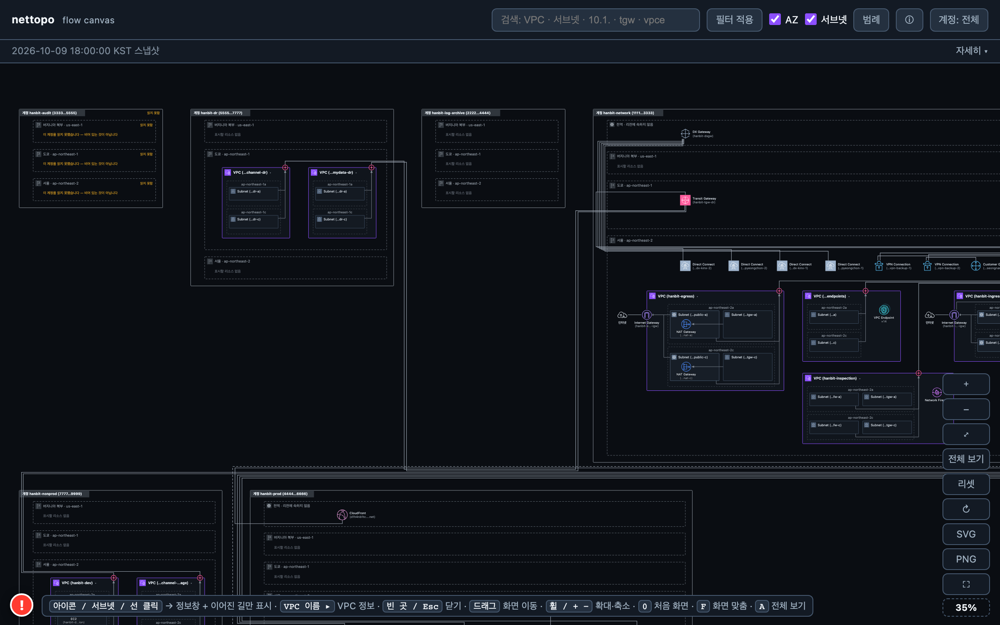
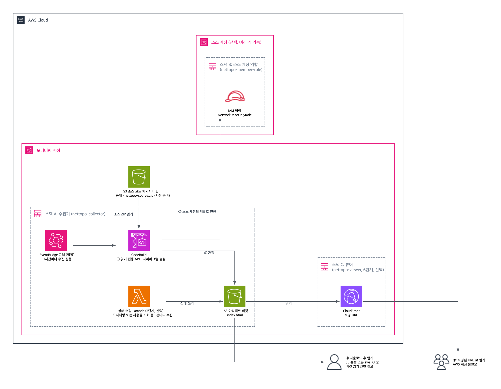

# NetworkTopology

[English](README.md)

여러 AWS 계정과 리전의 네트워크 구성을 **읽기 전용**으로 수집해 다이어그램 하나로 보여 주는 툴입니다. 모니터링 계정에 CloudFormation 스택 하나로 수집기를 올리면 한 시간마다 다이어그램이 갱신되고, 결과는 그 계정의 비공개 S3 버킷에 HTML 파일 하나로 저장됩니다. 서버, API, 데이터베이스가 없습니다. 대상 계정에는 `Describe*`, `Get*`, `List*`, `Search*` 호출만 하고 어떤 변경도 하지 않습니다.

> 이 저장소는 운영 환경용이 아닌 샘플 코드입니다. 배포하기 전에 보안·법무 팀과 함께 조직의 보안·규제·컴플라이언스 요구 사항을 충족하는지 확인하세요.



---

## 아키텍처



모니터링 계정은 수집기가 배포된 계정이고, 소스 계정은 다이어그램에 넣을 리소스가 있는 계정들입니다. 소스 코드 패키지(`nettopo-source.zip`)는 배포 전에 준비한 비공개 S3 패키지 버킷(`PKG_BUCKET`)에 저장합니다. 수집기(CodeBuild)는 이 패키지를 읽어 EventBridge 스케줄로 한 시간마다 실행되고, 소스 계정마다 만들어 둔 IAM 역할로 전환해 읽기 API만 호출합니다. 생성한 다이어그램 HTML은 별도의 S3 아티팩트 버킷에 저장합니다.

| CloudFormation 스택 | 올리는 계정 | 하는 일 | 필수 |
|---|---|---|---|
| **A 수집기** `nettopo-collector` | 모니터링 계정 | 수집, 다이어그램 생성, S3 저장. 1시간 스케줄 | 예 |
| **B 소스 계정 역할** `nettopo-member-role` | 소스 계정마다 | 수집기에 이 계정의 읽기 권한을 줌 | 소스 계정이 있을 때 |
| **C 뷰어** `nettopo-viewer` | 모니터링 계정 | AWS 계정 없는 사람에게 서명된 보는 링크 | 아니요 |

## 주요 기능

| 기능 | 설명 | 필요한 것 |
|---|---|---|
| **네트워크 다이어그램** | 계정 > 리전 > VPC > AZ > 서브넷 순으로 중첩해 그리고, Transit Gateway·피어링·VPN·Direct Connect 연결을 선으로 잇습니다. 같은 종류가 많으면 「<종류> ×N」 하나로 묶습니다 — 누르면 목록, 목록에서 하나를 누르면 그 리소스 정보. 1시간마다 자동 갱신 | 스택 A |
| **다계정·다리전** | 소스 계정에 읽기 전용 역할만 두면 한 다이어그램에 모입니다. 모니터링 계정의 Transit Gateway 연결에서 소스 계정을 자동 발견하거나 직접 지정 | 스택 B |
| **못 읽은 영역 표시** | 권한이 없어 읽지 못한 곳은 빈 그림으로 넘기지 않습니다. 화면 위 배너에 어느 계정·리전의 무엇을 못 읽었는지와 조치 방법을 함께 띄웁니다 | 기본 |
| **실시간 모니터링** (선택) | 리소스 상태를 기본 5분 간격으로 수집하고, CloudWatch 지표를 이용한 트래픽 모니터링을 선택적으로 활성화합니다 | 스택 A 파라미터 1개 |
| **공유 링크** (선택) | AWS 계정이 없는 사람도 서명된 URL 하나로 다이어그램을 엽니다 | 스택 C |

수집하는 리소스: VPC, 서브넷, 라우팅 테이블, 인터넷 게이트웨이, NAT 게이트웨이, Transit Gateway(연결·Connect·라우팅 테이블), Cloud WAN 코어 네트워크, VPC Lattice(서비스 네트워크·서비스), VPC 피어링, VPC 엔드포인트, 보안 그룹, 네트워크 ACL, 로드 밸런서, VPN(가상 프라이빗 게이트웨이·고객 게이트웨이·연결), Direct Connect(연결·가상 인터페이스·게이트웨이), Network Firewall, CloudFront, WAF 웹 ACL(보호하는 CloudFront·ALB·API Gateway 까지 선), EC2, Auto Scaling 그룹, EKS, ECS, RDS(DB 인스턴스·Aurora 클러스터·프록시), ElastiCache, OpenSearch, MSK, Lambda 함수, Route 53 호스팅 영역, 탄력적 IP, API Gateway, Global Accelerator, SageMaker, EC2 Instance Connect 엔드포인트. 소스 계정에 부여되는 권한은 `infra/stack-b-member-role.yaml` 의 정책 그대로이며 읽기 액션입니다(액션별 설명: [필요한 IAM 권한](docs/required-permissions.md)).

> 생성된 HTML 은 파일 하나이고 외부로 나가는 요청이 없습니다. 모니터링 또는 사용률 조회를 켠 경우에만 같은 계정의 S3 를 서명된 URL 로 읽고 씁니다.

## 모니터링과 사용률 조회

모니터링과 사용률 조회는 모두 선택 기능입니다. CloudFormation 스택 A의 `StateLambdaSourceKey`를 설정해 함께 배포합니다.

모니터링은 2가지 옵션을 제공합니다.

| | 리소스 상태 모니터링 | 상태 및 트래픽 모니터링 |
|---|---|---|
| **설명** | AWS Describe API 등으로 리소스의 실행·연결·대상 건강 상태를 확인 | 리소스 상태와 CloudWatch 트래픽·드롭 지표를 함께 확인 |
| **화면** | 리소스·연결의 정상/이상 상태와 이상 테두리 | 상태 표시와 관측 근거가 있는 구간의 초록 흐름 선·판정 등급 |
| **예시** | EC2 정지, VPN 터널 DOWN, LB 대상 비정상 확인 | TGW attachment를 통해 전달된 트래픽과 패킷 드롭 확인 |

현재 화면의 모드 선택에서는 리소스 상태 모니터링을 「구조 조회만」, 상태 및 트래픽 모니터링을 「지표까지」로 표시합니다.

### 사용률 조회

사용률(Utilization)은 리소스 사용량과 한도 대비 비율을 표시합니다. 리소스 상태 모니터링에서도 사용률을 활성화하면 CloudWatch 지표와 서비스 한도를 조회합니다. 사용률 수치는 모니터링의 상태·흐름 판정과 별도로 표시됩니다.

## 사전 요구사항

- **AWS CLI v2**, **bash**(macOS·Linux·AWS CloudShell 기본), **git**(저장소를 clone 한 경우)
- **모니터링 계정 자격 증명**: IAM 역할, S3 버킷, CodeBuild, EventBridge, Lambda, CloudWatch Logs, SQS, CloudFront 를 만들 수 있어야 합니다. IAM Identity Center 프로필(`aws configure sso`)을 권장하며 장기 액세스 키는 만들지 않습니다. 액션 단위 목록은 [필요한 IAM 권한 §6](docs/required-permissions.md#6-배포하는-사람에게-필요한-권한)에 있습니다
- **소스 계정 자격 증명**: 계정마다 IAM 역할 하나를 만들 수 있어야 합니다 (스택 B 를 올릴 때만)
- 선택: **python3 + pip** (실시간 모니터링), **openssl** (공유 링크)

## 빠른 시작

계정 하나의 기본 다이어그램을 그리는 가장 짧은 경로입니다. 명령은 저장소 최상위 폴더에서 실행합니다. 처음부터 모니터링·사용률 또는 CloudFront 공유를 사용하려면 먼저 배포 가이드의 [배포 옵션](docs/install-guide.md#배포-옵션)을 확인합니다. 소스 계정 추가는 가이드 [4-B](docs/install-guide.md#4-b-소스-계정에-직접-스택-b-올리기)·[4-C](docs/install-guide.md#4-c-aws-organizations-에-stackset-으로-배포하기) 단계에 있습니다.

아래 명령을 한 번에 실행하는 `deploy.sh` 도 있습니다: `./deploy.sh --profile my-hub --region ap-northeast-2 --bucket nettopo-pkg-111122223333 --regions ap-northeast-2,ap-northeast-1`. 옵션과 실패 시 조치는 가이드의 [한 번에 설치하기](docs/install-guide.md#한-번에-설치하기-deploysh)에 있습니다.

```sh
# 0. 값 정하기
PROFILE=my-hub                              # 모니터링 계정 프로필
REGION=ap-northeast-2                       # 스택을 둘 리전 (아무 리전이나 가능)
PKG_BUCKET=nettopo-pkg-111122223333         # 배포 패키지를 둘 새 비공개 버킷. 전 세계에서 유일해야 함
REGIONS=ap-northeast-2,ap-northeast-1       # 수집할 리전 목록 (쉼표 구분)

# 1. 배포 패키지(engine/ + renderer/ + buildspec.yml)를 비공개 버킷에 올리기
#    REGION 이 us-east-1 이면 --create-bucket-configuration 옵션을 뺍니다
mkdir -p out
git archive --format=zip -o out/nettopo-source.zip HEAD engine renderer buildspec.yml
aws s3api create-bucket --bucket "$PKG_BUCKET" \
  --create-bucket-configuration LocationConstraint="$REGION" \
  --profile "$PROFILE" --region "$REGION"
aws s3api put-public-access-block --bucket "$PKG_BUCKET" \
  --public-access-block-configuration BlockPublicAcls=true,IgnorePublicAcls=true,BlockPublicPolicy=true,RestrictPublicBuckets=true \
  --profile "$PROFILE" --region "$REGION"
aws s3 cp out/nettopo-source.zip "s3://$PKG_BUCKET/nettopo-source.zip" \
  --sse AES256 --profile "$PROFILE" --region "$REGION"

# 2. 스택 A(수집기) 올리기 (약 15분)
aws cloudformation deploy \
  --template-file infra/stack-a-collector.yaml \
  --stack-name nettopo-collector \
  --capabilities CAPABILITY_IAM \
  --parameter-overrides \
      SourceLocation="$PKG_BUCKET/nettopo-source.zip" \
      TargetRegions="$REGIONS" \
  --profile "$PROFILE" --region "$REGION"

# 3. 스케줄을 기다리지 않고 첫 수집을 한 번 돌리고, 끝날 때까지 기다리기 (보통 2~5분)
BUILD_ID=$(aws codebuild start-build --project-name nettopo-collector-collector \
  --query build.id --output text --profile "$PROFILE" --region "$REGION")
until STATUS=$(aws codebuild batch-get-builds --ids "$BUILD_ID" --query "builds[0].buildStatus" --output text --profile "$PROFILE" --region "$REGION"); [ "$STATUS" != "IN_PROGRESS" ]; do sleep 20; done
echo "수집 결과: $STATUS"   # SUCCEEDED 가 아니면(FAILED · STOPPED 등) 여기서 멈추고 CodeBuild 콘솔의 빌드 로그를 확인합니다

# 4. 다이어그램 내려받기 — out/index.html 을 브라우저로 엽니다 (수집이 SUCCEEDED 로 끝났을 때만)
if [ "$STATUS" = "SUCCEEDED" ]; then
  ARTIFACT_BUCKET=$(aws cloudformation describe-stacks --stack-name nettopo-collector \
    --query "Stacks[0].Outputs[?OutputKey=='ArtifactBucketName'].OutputValue" --output text \
    --profile "$PROFILE" --region "$REGION")
  aws s3 cp "s3://$ARTIFACT_BUCKET/index.html" out/index.html --profile "$PROFILE" --region "$REGION"
fi
```

- 소스 계정이 있으면 계정마다 스택 B 를 올리고(직접 = [4-B](docs/install-guide.md#4-b-소스-계정에-직접-스택-b-올리기) · StackSet = [4-C](docs/install-guide.md#4-c-aws-organizations-에-stackset-으로-배포하기)), 모니터링 계정의 Transit Gateway 에 연결되지 않은 소스 계정이 있으면 2단계 명령에 `TargetAccounts=<소스 계정 ID>,…` 를 추가해 다시 올립니다. 적어도 자동 발견은 그대로 돌고, 적은 계정이 발견한 계정에 더해집니다. 그래서 Transit Gateway 에 연결되지 않은 계정만 적으면 됩니다. 모니터링 계정은 항상 포함됩니다.
- `REGIONS` 에 적지 않은 리전은 수집하지 않습니다. 화면에 그 리전 칸이 아예 나타나지 않고 따로 안내도 없으니, 보려는 리전은 빠뜨리지 말고 모두 적어 주세요.
- 템플릿은 영어로 되어 있습니다. CloudFormation 이 한글 설명을 `?` 로 저장하기 때문입니다. 파라미터의 한글 설명은 배포 가이드 파라미터 표에 있습니다.

> 기존 설치에 기능을 추가하려면 [5단계: 모니터링·사용률 (스택 A 갱신)](docs/install-guide.md#5-모니터링사용률-추가-배포-스택-a-갱신), [6단계: CloudFront 공유 (스택 C 배포·링크 발급)](docs/install-guide.md#6-cloudfront로-공유하기-스택-c-배포링크-발급)을 진행합니다. 전체 절차는 [배포 가이드](docs/install-guide.md)에 있습니다.

## 프로젝트 구조

```
sample-network-topology-visualizer/
├── deploy.sh                           # 모니터링 계정 설치·갱신·삭제를 한 번에
├── infra/
│   ├── stack-a-collector.yaml          # 스택 A 수집기
│   ├── stack-b-member-role.yaml        # 스택 B 소스 계정 읽기 전용 역할
│   ├── stack-c-viewer.yaml             # 스택 C 뷰어 (선택)
│   ├── state-lambda/                   # 실시간 모니터링 Lambda 코드
│   ├── build-state-lambda.sh           # 실시간 모니터링 Lambda 배포 패키지 만들기
│   └── issue-viewer-link.sh            # 스택 C 보는 링크 발급
├── engine/                             # 수집기 (Python). 배포 패키지에 포함
├── renderer/                           # 다이어그램 생성 (JavaScript). 배포 패키지에 포함
└── docs/
    └── install-guide.md                # 배포 가이드 (영어판 install-guide.en.md)
```

## 비용

실측값이 아니라 템플릿 기본값으로 계산한 추정치입니다. 가격은 리전과 시점에 따라 다릅니다. 실제 리전과 설정으로 [AWS Pricing Calculator](https://calculator.aws/) 에서 확인하세요.

| 항목 | 비용을 정하는 것 | 월 비용(대략) |
|---|---|---|
| CodeBuild 수집 (`BUILD_GENERAL1_SMALL`, 기본 1시간마다) | 빌드 분당 단가 × 회당 분 × 월 720회. 분당 $0.005(us-east-1·ap-northeast-2, 2026-09-11 AWS 가격표)에 보통 회당 2~5분이면 $0.005 × 2 × 720 = $7.20 ~ $0.005 × 5 × 720 = $18 | 약 $7 ~ $18 |
| Lambda (실시간 모니터링을 켠 경우): 함수 2개 — 상태 관측(1,024MB, arm64)과 화면 서명(256MB, arm64). 각각 5분마다, 그리고 이벤트가 있을 때 실행 | 호출 수 × 실행 시간 × 메모리 | 실행 시간에 따름 |
| S3 저장과 요청 | 시간이 지나면 늘어납니다. 빌드마다 스냅샷이 쌓이고, 산출물 버킷은 이전 버전을 남깁니다(`index.html` 과 `unsigned/` 의 이전 버전만 1일 뒤 만료). `deploy.sh` 가 만든 패키지 버킷도 이전 버전을 남깁니다 | 이력이 쌓일수록 늘어남 |
| CloudWatch Logs | 로그 그룹 3개(수집기·상태·서명), 기본 30일 보관(`LogRetentionDays`) | 수집·저장 GB 당 |
| SQS 실패 대기열 (실시간 모니터링) | 실패한 상태 관측만 담깁니다. 보통 비어 있음 | 약 $0 |
| CloudFront (스택 C) | 전송량과 요청 수, 그리고 로그 버킷에 쌓이는 접근 로그(기본 90일 보관) | 보는 사람 수에 따름 |
| CloudWatch 지표 조회 (트래픽 모니터링 또는 사용률) | 조회하는 지표 수 | 리소스 수에 따름 |
| 구조 수집 API 호출 (`Describe*` 등) | 과금되지 않음 | 없음 |

비용은 거의 전부 CodeBuild 실행 시간입니다. 계정·리전·리소스가 늘어 수집 1회가 1분 길어지면 월 약 $3.60($0.005 × 720) 늘어납니다. `Schedule` 을 늘리면 그만큼 줄어듭니다.

## 유용한 명령어

| 명령어 | 설명 |
|---|---|
| `aws codebuild start-build --project-name nettopo-collector-collector --profile "$PROFILE" --region "$REGION"` | 수집 1회 실행 |
| `aws codebuild batch-get-builds --ids <빌드 ID> --query "builds[0].buildStatus" --output text --profile "$PROFILE" --region "$REGION"` | 수집 상태 확인 (`SUCCEEDED` 면 끝) |
| `aws s3 cp "s3://$ARTIFACT_BUCKET/index.html" out/index.html --profile "$PROFILE" --region "$REGION"` | 최신 다이어그램 내려받기 |
| `./deploy.sh --profile "$PROFILE" --region "$REGION"` (처음 설치한 옵션 그대로) | 새 버전으로 올리기. 직접 할 때는 빠른 시작 1단계의 zip 만들기·`aws s3 cp` 와 2단계를 다시 실행(버킷 생성 두 명령은 건너뜀). 적지 않은 파라미터는 유지됨. 이번 버전은 소스 계정의 스택 B 도 갱신해야 함([새 버전으로 올리기](docs/install-guide.md#새-버전으로-올리기)) |
| `./deploy.sh --profile "$PROFILE" --region "$REGION" --collect` | 수집 1회 + `out/index.html` 내려받기(끝날 때까지 기다림) |
| `infra/issue-viewer-link.sh --stack nettopo-viewer --key out/viewer-k1.pem --days 30 --profile "$PROFILE" --region "$REGION"` | 보는 링크 발급 (스택 C) |
| `aws cloudformation delete-stack --stack-name nettopo-collector --profile "$PROFILE" --region "$REGION"` | 스택 A 삭제. 아티팩트 버킷은 남으므로 [삭제 절](docs/install-guide.md#삭제) 순서로 |

## 보안

보안 문제 신고 방법과 보안 설계 요약은 [SECURITY.md](SECURITY.md) 에 있습니다.

다이어그램 HTML 에는 계정 ID, CIDR 블록, 공인 IP 주소, 리소스 태그가 들어 있습니다. 공개 S3 버킷·공개 저장소·공개 웹 페이지처럼 누구나 볼 수 있는 곳에 두지 마세요. 공유할 때는 [배포 가이드](docs/install-guide.md) 의 서명 링크만 쓰세요.

선택 보강(기본 꺼짐): 소스 계정 역할에 외부 ID 와 AWS Organizations 조건을 걸 수 있고, 버킷 CORS 와 CloudFront 읽기 권한을 스택 C 배포 하나로 좁힐 수 있습니다. [선택 보강](docs/install-guide.md#선택-보강) 을 보세요.

## 삭제

`deploy.sh` 로 설치했다면 `./deploy.sh --profile "$PROFILE" --region "$REGION" --destroy` 가 확인 입력을 받은 뒤 모니터링 계정의 스택 C, 스택 A, 로그·산출물·패키지 버킷의 모든 객체 버전을 지웁니다(`--dry-run` 을 붙이면 대상만 보여 줍니다). 소스 계정의 스택 B 는 지우지 않으므로 아래 2단계를 직접 하세요. `--bucket` 으로 준 패키지 버킷은 직접 만든 버킷이어도 지웁니다.

직접 지울 때는 아래 순서를 따릅니다. 스택 A 의 산출물 버킷과 스택 C 의 로그 버킷은 스택을 지워도 남습니다(`DeletionPolicy: Retain`). 산출물 버킷과 `deploy.sh` 가 만든 패키지 버킷은 버전 관리가 켜져 있어서, 이전 객체 버전과 삭제 마커까지 모두 지워야 버킷을 지울 수 있습니다. `aws s3 rb --force` 는 이전 버전을 지우지 않습니다.

```sh
PROFILE=my-hub              # 모니터링 계정 프로필
REGION=ap-northeast-2       # 스택을 올린 리전
empty_and_delete_bucket() {   # every object version and delete marker, then the bucket
  local batch out
  while :; do
    batch=$(aws s3api list-object-versions --bucket "$1" --max-items 1000 \
      --query '{Objects: [(Versions || `[]`)[].{Key: Key, VersionId: VersionId}, (DeleteMarkers || `[]`)[].{Key: Key, VersionId: VersionId}][], Quiet: `true`}' \
      --output json --profile "$PROFILE" --region "$REGION") || return 1
    printf '%s' "$batch" | grep -q '"Key"' || break
    out=$(aws s3api delete-objects --bucket "$1" --delete "$batch" --profile "$PROFILE" --region "$REGION") || return 1
    if printf '%s' "$out" | grep -q '"Errors"'; then printf '%s\n' "$out"; return 1; fi
  done
  aws s3api delete-bucket --bucket "$1" --profile "$PROFILE" --region "$REGION"
}

# 버킷 이름을 먼저 받아 둔다 — 스택을 지우면 출력값도 사라진다
LOG_BUCKET=$(aws cloudformation describe-stacks --stack-name nettopo-viewer \
  --query "Stacks[0].Outputs[?OutputKey=='AccessLogBucketName'].OutputValue" --output text \
  --profile "$PROFILE" --region "$REGION")
ARTIFACT_BUCKET=$(aws cloudformation describe-stacks --stack-name nettopo-collector \
  --query "Stacks[0].Outputs[?OutputKey=='ArtifactBucketName'].OutputValue" --output text \
  --profile "$PROFILE" --region "$REGION")
PKG_BUCKET=$(aws cloudformation describe-stacks --stack-name nettopo-collector \
  --query "Stacks[0].Parameters[?ParameterKey=='SourceLocation'].ParameterValue" --output text \
  --profile "$PROFILE" --region "$REGION" | cut -d/ -f1)

# 1. 스택 C(배포한 경우) → 그 스택이 남기는 접근 로그 버킷
aws cloudformation delete-stack --stack-name nettopo-viewer --profile "$PROFILE" --region "$REGION"
aws cloudformation wait stack-delete-complete --stack-name nettopo-viewer --profile "$PROFILE" --region "$REGION"
[ -z "$LOG_BUCKET" ] || [ "$LOG_BUCKET" = None ] || empty_and_delete_bucket "$LOG_BUCKET"

# 2. 각 소스 계정의 스택 B(직접 배포한 경우)
aws cloudformation delete-stack --stack-name nettopo-member-role \
  --profile <source-account-profile> --region <stack-b-region>
#    Organizations StackSet 이면: 인스턴스 먼저, 그다음 StackSet(위임 관리자 계정이면 --call-as DELEGATED_ADMIN 추가)
aws cloudformation delete-stack-instances --stack-set-name nettopo-member-role \
  --deployment-targets OrganizationalUnitIds=<OU ID> --regions <stackset-region> --no-retain-stacks \
  --profile <management-account-profile> --region <stackset-region>
aws cloudformation list-stack-set-operations --stack-set-name nettopo-member-role --max-results 1 \
  --query "Summaries[0].Status" --output text \
  --profile <management-account-profile> --region <stackset-region>      # SUCCEEDED 가 될 때까지 반복
aws cloudformation delete-stack-set --stack-set-name nettopo-member-role \
  --profile <management-account-profile> --region <stackset-region>

# 3. 스택 A
aws cloudformation delete-stack --stack-name nettopo-collector --profile "$PROFILE" --region "$REGION"
aws cloudformation wait stack-delete-complete --stack-name nettopo-collector --profile "$PROFILE" --region "$REGION"

# 4. 산출물 버킷(스택 A 가 남긴다 · 버전 관리가 켜져 있어 모든 버전을 지운다)
empty_and_delete_bucket "$ARTIFACT_BUCKET"

# 5. 배포 패키지 버킷(스택이 만든 것이 아니다)
empty_and_delete_bucket "$PKG_BUCKET"
```

내 컴퓨터의 파일은 지워지지 않습니다: `out/`(다이어그램·템플릿·서명 비밀키 `viewer-k*.pem`)와 링크 발급 기록 `~/.local/state/nettopo/viewer-links.log`. 필요 없으면 직접 지우세요. CloudWatch Logs 로그 그룹은 스택의 일부라 스택과 함께 지워집니다.

## 문서

- [배포 가이드](docs/install-guide.md) · [English](docs/install-guide.en.md) — 세 가지 배포 방식(단일 계정 / 소스 계정 직접 / Organizations StackSet), 파라미터, 새 버전, 삭제, 문제 해결, 보안

## 라이선스

MIT-0 ([`LICENSE`](LICENSE))
