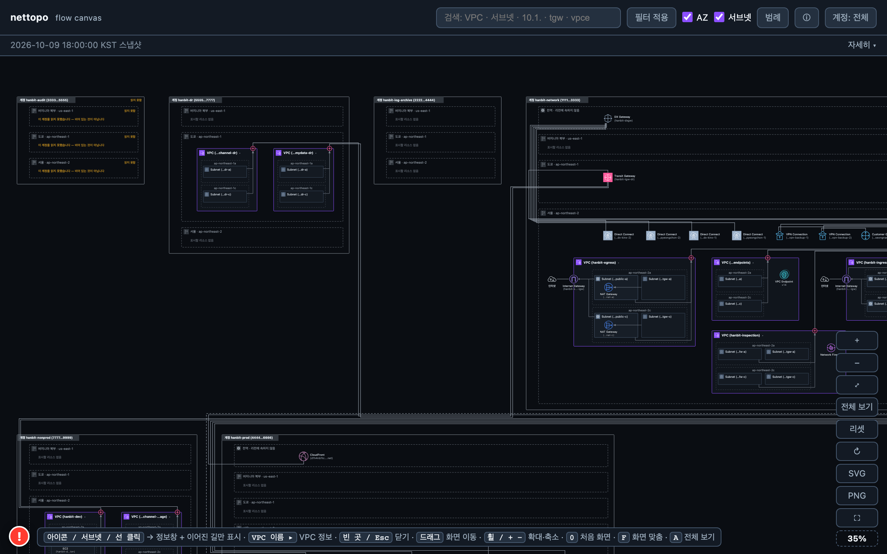
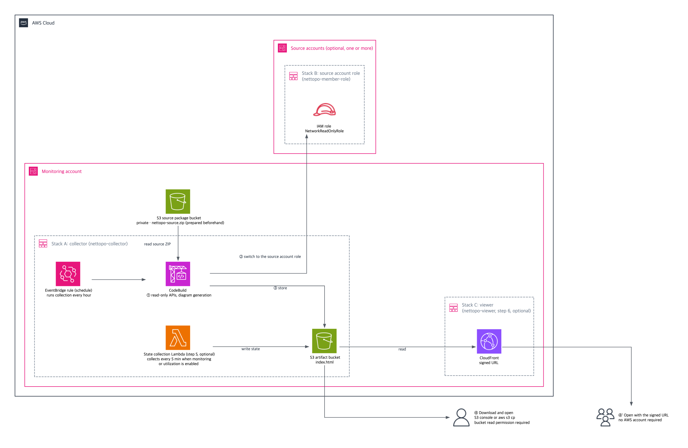

# NetworkTopology

[한국어](README.ko.md)

NetworkTopology collects the network configuration of multiple AWS accounts and Regions with **read-only** API calls and renders it as a single diagram. Deploy the collector with one CloudFormation stack in a monitoring account, and the diagram refreshes every hour as a single HTML file stored in a private S3 bucket in that account. There is no server, API, or database. In the target accounts it only calls `Describe*`, `Get*`, `List*`, and `Search*` APIs and never changes anything.

> This is sample code, for non-production usage. You should work with your security and legal teams to meet your organizational security, regulatory, and compliance requirements before deployment.



> The diagram's on-screen text is in Korean. English covers the CloudFormation templates and this documentation.

---

## Architecture



The monitoring account is where the collector runs. Source accounts are the accounts whose resources appear in the diagram. The source package (`nettopo-source.zip`) is stored in a private S3 package bucket (`PKG_BUCKET`) prepared before deployment. The collector (CodeBuild) reads this package, runs on an hourly EventBridge schedule, and assumes a read-only IAM role in each source account to collect resource data. It writes the generated diagram HTML to a separate S3 artifact bucket.

| CloudFormation stack | Account | Purpose | Required |
|---|---|---|---|
| **A Collector** `nettopo-collector` | Monitoring account | Collect, render, store to S3. Hourly schedule | Yes |
| **B Source account role** `nettopo-member-role` | Each source account | Grant the collector read access to the account | When you have source accounts |
| **C Viewer** `nettopo-viewer` | Monitoring account | Signed viewing link for people without an AWS account | No |

## Key Features

| Feature | Description | Requires |
|---|---|---|
| **Network diagram** | Nested as account > Region > VPC > AZ > subnet, with Transit Gateway, peering, VPN, and Direct Connect connections drawn as lines. When there are many resources of one type, they fold into a single "<type> ×N" icon — click it for the list, then click an entry for that resource. Refreshed hourly | Stack A |
| **Multi-account, multi-Region** | One read-only role per source account brings it into the same diagram. Source accounts are discovered from the monitoring account's Transit Gateway attachments or listed explicitly | Stack B |
| **Visible gaps** | Areas that could not be read are never drawn silently empty. A banner at the top of the screen names the account, Region, and resource types that were missed, together with what to do about it | Built in |
| **Live monitoring** (optional) | Collect resource state every 5 minutes by default, with optional traffic monitoring through CloudWatch metrics | One Stack A parameter |
| **Viewing link** (optional) | People without an AWS account open the diagram with a single signed URL | Stack C |

Collected resources: VPC, subnet, route table, internet gateway, NAT gateway, Transit Gateway (attachments, Connect, and route tables), Cloud WAN core network, VPC Lattice (service networks and services), VPC peering, VPC endpoint, security group, network ACL, load balancer, VPN (virtual private gateway, customer gateway, connection), Direct Connect (connection, virtual interface, gateway), Network Firewall, CloudFront, WAF web ACL (with lines to the CloudFront, ALB, and API Gateway it protects), EC2, Auto Scaling group, EKS, ECS, RDS (DB instances, Aurora clusters, proxies), ElastiCache, OpenSearch, MSK, Lambda functions, Route 53 hosted zones, Elastic IP, API Gateway, Global Accelerator, SageMaker, EC2 Instance Connect Endpoint. The permissions granted in a source account are exactly the policy in `infra/stack-b-member-role.yaml`, all read actions (per-action notes: [Required IAM permissions](docs/required-permissions.md), Korean).

> The generated HTML is a single file and makes no outbound requests. Only when monitoring or utilization is on does it read from and write to S3 in the same account through signed URLs.

## Monitoring and Utilization Queries

Monitoring and utilization queries are optional features. Deploy them by configuring `StateLambdaSourceKey` in CloudFormation Stack A.

Monitoring provides two options.

| | Resource state monitoring | State and traffic monitoring |
|---|---|---|
| **Description** | Check resource execution state, connection state, and target health through AWS Describe and other read APIs | Check resource state together with CloudWatch traffic and drop metrics |
| **Display** | Normal/abnormal resource and connection state, with abnormal borders | State overlays, green flow lines, and verdict badges for segments with evidence |
| **Examples** | Identify stopped EC2 instances, VPN tunnels that are DOWN, or unhealthy LB targets | Check traffic forwarded through a TGW attachment and packet drops |

The current diagram labels these modes 「구조 조회만」 (resource state monitoring) and 「지표까지」 (state and traffic monitoring).

### Utilization Queries

Utilization displays resource usage and usage relative to a limit. Enabling utilization with resource state monitoring still queries CloudWatch metrics and service quotas. Utilization values are displayed separately from resource state and traffic flow verdicts.

## Prerequisites

- **AWS CLI v2**, **bash** (default on macOS, Linux, and AWS CloudShell), **git** (if you cloned the repository)
- **Monitoring account credentials** that can create IAM roles, S3 buckets, CodeBuild, EventBridge, Lambda, CloudWatch Logs, SQS, and CloudFront. An IAM Identity Center profile (`aws configure sso`) is recommended; do not create long-term access keys. The action-level list is in [Required IAM permissions §6](docs/required-permissions.md#6-배포하는-사람에게-필요한-권한) (Korean)
- **Source account credentials** that can create one IAM role per account (only when deploying Stack B)
- Optional: **python3 + pip** (live monitoring), **openssl** (viewing link)

## Quick Start

The shortest path to a basic diagram of a single account. Run the commands from the repository root. To use monitoring and utilization or CloudFront sharing from the start, first read [Deployment options](docs/install-guide.en.md#deployment-options) in the deployment guide. Adding source accounts is covered in steps [4-B](docs/install-guide.en.md#4-b-deploy-stack-b-in-each-source-account) and [4-C](docs/install-guide.en.md#4-c-deploy-with-stacksets-in-aws-organizations).

`deploy.sh` runs the commands below in one go: `./deploy.sh --profile my-hub --region ap-northeast-2 --bucket nettopo-pkg-111122223333 --regions ap-northeast-2,ap-northeast-1`. `deploy.sh` prints its progress and error messages in Korean; the [Troubleshooting](docs/install-guide.en.md#troubleshooting) section of the deployment guide explains each failure in English. Options and what to do on failure are in [One-command install](docs/install-guide.en.md#one-command-install-deploysh) in the guide.

```sh
# 0. Set your values
PROFILE=my-hub                              # monitoring account profile
REGION=ap-northeast-2                       # Region for the stacks (any Region works)
PKG_BUCKET=nettopo-pkg-111122223333         # new private bucket for the deployment package; globally unique
REGIONS=ap-northeast-2,ap-northeast-1       # Regions to collect (comma-separated)

# 1. Upload the deployment package (engine/ + renderer/ + buildspec.yml) to a private bucket
#    If REGION is us-east-1, drop the --create-bucket-configuration option
mkdir -p out
git archive --format=zip -o out/nettopo-source.zip HEAD engine renderer buildspec.yml
aws s3api create-bucket --bucket "$PKG_BUCKET" \
  --create-bucket-configuration LocationConstraint="$REGION" \
  --profile "$PROFILE" --region "$REGION"
aws s3api put-public-access-block --bucket "$PKG_BUCKET" \
  --public-access-block-configuration BlockPublicAcls=true,IgnorePublicAcls=true,BlockPublicPolicy=true,RestrictPublicBuckets=true \
  --profile "$PROFILE" --region "$REGION"
aws s3 cp out/nettopo-source.zip "s3://$PKG_BUCKET/nettopo-source.zip" \
  --sse AES256 --profile "$PROFILE" --region "$REGION"

# 2. Deploy Stack A (collector), about 15 minutes
aws cloudformation deploy \
  --template-file infra/stack-a-collector.yaml \
  --stack-name nettopo-collector \
  --capabilities CAPABILITY_IAM \
  --parameter-overrides \
      SourceLocation="$PKG_BUCKET/nettopo-source.zip" \
      TargetRegions="$REGIONS" \
  --profile "$PROFILE" --region "$REGION"

# 3. Run the first collection now instead of waiting for the schedule, and wait for it to finish (usually 2 to 5 minutes)
BUILD_ID=$(aws codebuild start-build --project-name nettopo-collector-collector \
  --query build.id --output text --profile "$PROFILE" --region "$REGION")
until STATUS=$(aws codebuild batch-get-builds --ids "$BUILD_ID" --query "builds[0].buildStatus" --output text --profile "$PROFILE" --region "$REGION"); [ "$STATUS" != "IN_PROGRESS" ]; do sleep 20; done
echo "Collection: $STATUS"   # anything other than SUCCEEDED (FAILED, STOPPED, ...): stop and check the build log in the CodeBuild console

# 4. Download the diagram and open out/index.html in a browser (only after the collection SUCCEEDED)
if [ "$STATUS" = "SUCCEEDED" ]; then
  ARTIFACT_BUCKET=$(aws cloudformation describe-stacks --stack-name nettopo-collector \
    --query "Stacks[0].Outputs[?OutputKey=='ArtifactBucketName'].OutputValue" --output text \
    --profile "$PROFILE" --region "$REGION")
  aws s3 cp "s3://$ARTIFACT_BUCKET/index.html" out/index.html --profile "$PROFILE" --region "$REGION"
fi
```

- If you have source accounts, deploy Stack B in each of them (directly — [step 4-B](docs/install-guide.en.md#4-b-deploy-stack-b-in-each-source-account) — or with StackSets — [step 4-C](docs/install-guide.en.md#4-c-deploy-with-stacksets-in-aws-organizations)). If any source account is not attached to the monitoring account's Transit Gateway, add `TargetAccounts=<source account ID>,…` to the step 2 command and deploy again. Auto-discovery still runs and the listed accounts are added to the discovered ones, so list only the accounts not attached to the Transit Gateway. The monitoring account is always included.
- Regions you do not list in `REGIONS` are not collected at all. They do not appear on the screen and nothing says they are missing, so list every Region you want to see.
- The templates are in English because CloudFormation stores Korean description text as `?`.

> To add features to an existing installation, follow [step 5: monitoring and utilization (update Stack A)](docs/install-guide.en.md#5-add-monitoring-and-utilization-update-stack-a) or [step 6: CloudFront sharing (deploy Stack C and issue a link)](docs/install-guide.en.md#6-share-through-cloudfront-deploy-stack-c-and-issue-a-link). The full procedure is in the [deployment guide](docs/install-guide.en.md).

## Project Structure

```
sample-network-topology-visualizer/
├── deploy.sh                           # install, update, and delete in the monitoring account in one go
├── infra/
│   ├── stack-a-collector.yaml          # Stack A collector
│   ├── stack-b-member-role.yaml        # Stack B read-only role for source accounts
│   ├── stack-c-viewer.yaml             # Stack C viewer (optional)
│   ├── state-lambda/                   # Live monitoring Lambda code
│   ├── build-state-lambda.sh           # Build the live monitoring Lambda package
│   └── issue-viewer-link.sh            # Issue a Stack C viewing link
├── engine/                             # Collector (Python). Included in the deployment package
├── renderer/                           # Diagram generator (JavaScript). Included in the deployment package
└── docs/
    └── install-guide.en.md             # Deployment guide (Korean: install-guide.md)
```

## Estimated Costs

These are estimates calculated from the template defaults, not measurements. Prices vary by Region and change over time; use the [AWS Pricing Calculator](https://calculator.aws/) with your Region and settings.

| Item | What the cost depends on | Approximate monthly cost |
|---|---|---|
| CodeBuild collection (`BUILD_GENERAL1_SMALL`, once an hour by default) | price per build minute × minutes per build × 720 builds a month. At $0.005 per minute (us-east-1 and ap-northeast-2, AWS price list of 2026-09-11) and the usual 2 to 5 minutes per build: $0.005 × 2 × 720 = $7.20 to $0.005 × 5 × 720 = $18 | About $7 to $18 |
| Lambda (live monitoring, if enabled): two functions, state observation (1,024 MB, arm64) and page signing (256 MB, arm64), each every 5 minutes and also on events | invocations × run time × memory | Depends on run time |
| S3 storage and requests | Grows over time: every build adds a snapshot, and the artifact bucket keeps previous versions (only previous versions of `index.html` and `unsigned/` expire, after 1 day). A package bucket created by `deploy.sh` also keeps previous versions | Grows with history |
| CloudWatch Logs | Three log groups (collector, state, signer), kept 30 days by default (`LogRetentionDays`) | Per GB ingested and stored |
| SQS dead-letter queue (live monitoring) | Holds only failed state runs; normally empty | About $0 |
| CloudFront (Stack C) | Data transfer and requests, plus the access logs stored in the log bucket (kept 90 days by default) | Depends on viewers |
| CloudWatch metric queries (traffic monitoring or utilization) | Number of metrics requested | Depends on resources |
| Structure collection API calls (`Describe*` and similar) | Not billed | None |

Almost all of it is CodeBuild run time. Each extra minute per build (more accounts, Regions, or resources) adds about $3.60 a month ($0.005 × 720); a longer `Schedule` reduces it proportionally.

## Useful Commands

| Command | Description |
|---|---|
| `aws codebuild start-build --project-name nettopo-collector-collector --profile "$PROFILE" --region "$REGION"` | Run one collection |
| `aws codebuild batch-get-builds --ids <build ID> --query "builds[0].buildStatus" --output text --profile "$PROFILE" --region "$REGION"` | Check collection status (`SUCCEEDED` means done) |
| `aws s3 cp "s3://$ARTIFACT_BUCKET/index.html" out/index.html --profile "$PROFILE" --region "$REGION"` | Download the latest diagram |
| `./deploy.sh --profile "$PROFILE" --region "$REGION"` (with the options of the first installation) | Deploy a new version. To do it yourself, rerun the zip build and `aws s3 cp` of Quick Start step 1 and step 2 (skip the two bucket creation commands). Parameters you do not pass are kept. This version also requires a Stack B update in source accounts ([Updating](docs/install-guide.en.md#updating)) |
| `./deploy.sh --profile "$PROFILE" --region "$REGION" --collect` | Collect once and download `out/index.html` (waits until done) |
| `infra/issue-viewer-link.sh --stack nettopo-viewer --key out/viewer-k1.pem --days 30 --profile "$PROFILE" --region "$REGION"` | Issue a viewing link (Stack C) |
| `aws cloudformation delete-stack --stack-name nettopo-collector --profile "$PROFILE" --region "$REGION"` | Delete Stack A. The artifact bucket is retained; follow the [Cleanup section](docs/install-guide.en.md#cleanup) |

## Security

See [SECURITY.md](SECURITY.md) for how to report a security issue and for a summary of the security design.

The diagram HTML contains AWS account IDs, CIDR blocks, public IP addresses, and resource tags from your environment. Do not put it in a public location (for example a public S3 bucket, a public repository, or a public web page). Share it only through the signed links described in the [deployment guide](docs/install-guide.en.md).

Optional hardening, off by default: an external ID and an AWS Organizations condition on the source account role, and narrowing the bucket CORS rule and CloudFront read access to your Stack C distribution. See [Optional hardening](docs/install-guide.en.md#optional-hardening).

## Clean up

If you installed with `deploy.sh`, `./deploy.sh --profile "$PROFILE" --region "$REGION" --destroy` deletes Stack C, Stack A, and every object version in the log, artifact, and package buckets of the monitoring account after you type a confirmation (`--dry-run` lists the targets first). It does not delete Stack B in source accounts; do step 2 below yourself. It also deletes the package bucket you passed with `--bucket`, even if you created that bucket yourself.

To clean up by hand, delete in this order. Stack A's artifact bucket and Stack C's log bucket are kept when their stacks are deleted (`DeletionPolicy: Retain`). The artifact bucket has versioning enabled, and a package bucket created by `deploy.sh` does too, so every previous object version and delete marker must be removed before the bucket can be deleted; `aws s3 rb --force` does not remove previous versions.

```sh
PROFILE=my-hub              # monitoring account profile
REGION=ap-northeast-2       # Region of the stacks
empty_and_delete_bucket() {   # every object version and delete marker, then the bucket
  local batch out
  while :; do
    batch=$(aws s3api list-object-versions --bucket "$1" --max-items 1000 \
      --query '{Objects: [(Versions || `[]`)[].{Key: Key, VersionId: VersionId}, (DeleteMarkers || `[]`)[].{Key: Key, VersionId: VersionId}][], Quiet: `true`}' \
      --output json --profile "$PROFILE" --region "$REGION") || return 1
    printf '%s' "$batch" | grep -q '"Key"' || break
    out=$(aws s3api delete-objects --bucket "$1" --delete "$batch" --profile "$PROFILE" --region "$REGION") || return 1
    if printf '%s' "$out" | grep -q '"Errors"'; then printf '%s\n' "$out"; return 1; fi
  done
  aws s3api delete-bucket --bucket "$1" --profile "$PROFILE" --region "$REGION"
}

# Capture the bucket names first; the stack outputs disappear when the stacks are deleted
LOG_BUCKET=$(aws cloudformation describe-stacks --stack-name nettopo-viewer \
  --query "Stacks[0].Outputs[?OutputKey=='AccessLogBucketName'].OutputValue" --output text \
  --profile "$PROFILE" --region "$REGION")
ARTIFACT_BUCKET=$(aws cloudformation describe-stacks --stack-name nettopo-collector \
  --query "Stacks[0].Outputs[?OutputKey=='ArtifactBucketName'].OutputValue" --output text \
  --profile "$PROFILE" --region "$REGION")
PKG_BUCKET=$(aws cloudformation describe-stacks --stack-name nettopo-collector \
  --query "Stacks[0].Parameters[?ParameterKey=='SourceLocation'].ParameterValue" --output text \
  --profile "$PROFILE" --region "$REGION" | cut -d/ -f1)

# 1. Stack C (if deployed), then its access-log bucket (kept by the stack)
aws cloudformation delete-stack --stack-name nettopo-viewer --profile "$PROFILE" --region "$REGION"
aws cloudformation wait stack-delete-complete --stack-name nettopo-viewer --profile "$PROFILE" --region "$REGION"
[ -z "$LOG_BUCKET" ] || [ "$LOG_BUCKET" = None ] || empty_and_delete_bucket "$LOG_BUCKET"

# 2. Stack B in each source account (direct deployment)
aws cloudformation delete-stack --stack-name nettopo-member-role \
  --profile <source-account-profile> --region <stack-b-region>
#    or, for an Organizations StackSet: instances first, then the StackSet (add --call-as DELEGATED_ADMIN from a delegated administrator)
aws cloudformation delete-stack-instances --stack-set-name nettopo-member-role \
  --deployment-targets OrganizationalUnitIds=<OU ID> --regions <stackset-region> --no-retain-stacks \
  --profile <management-account-profile> --region <stackset-region>
aws cloudformation list-stack-set-operations --stack-set-name nettopo-member-role --max-results 1 \
  --query "Summaries[0].Status" --output text \
  --profile <management-account-profile> --region <stackset-region>      # repeat until SUCCEEDED
aws cloudformation delete-stack-set --stack-set-name nettopo-member-role \
  --profile <management-account-profile> --region <stackset-region>

# 3. Stack A
aws cloudformation delete-stack --stack-name nettopo-collector --profile "$PROFILE" --region "$REGION"
aws cloudformation wait stack-delete-complete --stack-name nettopo-collector --profile "$PROFILE" --region "$REGION"

# 4. Artifact bucket (kept by Stack A; versioned, so every version is deleted)
empty_and_delete_bucket "$ARTIFACT_BUCKET"

# 5. Deployment package bucket (not created by a stack)
empty_and_delete_bucket "$PKG_BUCKET"
```

Files on your computer are not deleted: `out/` (the diagram, templates, and the signing keys `viewer-k*.pem`) and the link log `~/.local/state/nettopo/viewer-links.log`. Remove them yourself if you no longer need them. CloudWatch Logs groups are part of the stacks and are deleted with them.

## Documentation

- [Deployment guide](docs/install-guide.en.md) · [한국어](docs/install-guide.md) — three deployment options (single account / source accounts directly / Organizations StackSets), parameters, updating, cleanup, troubleshooting, security

## License

MIT-0 ([`LICENSE`](LICENSE))
