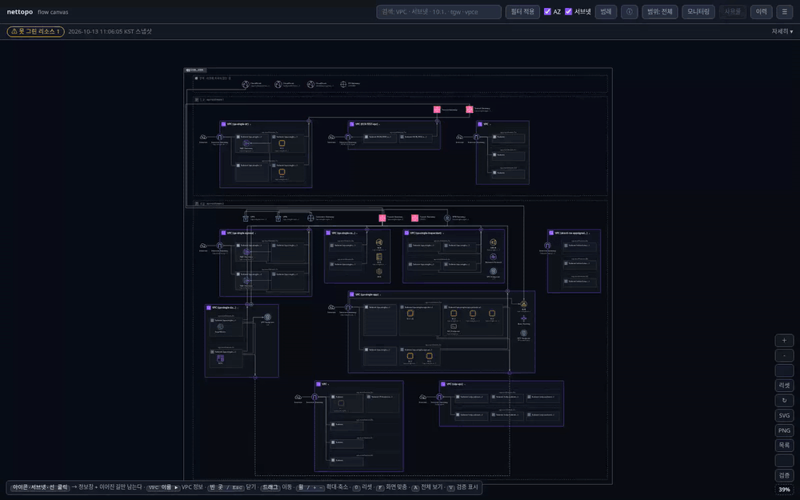
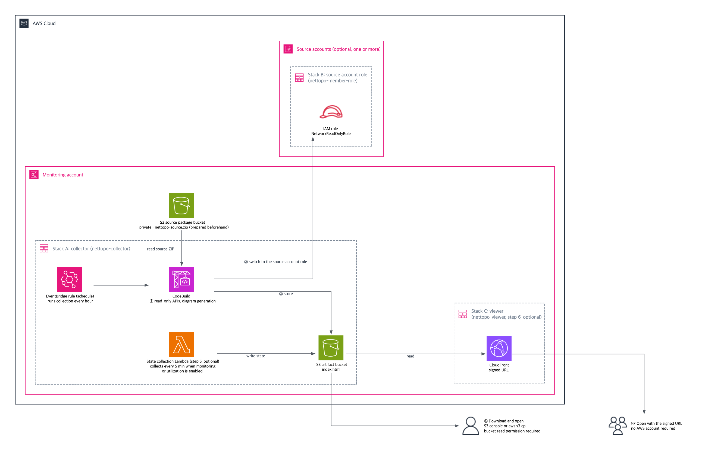

# NetworkTopology

[한국어](README.ko.md)

NetworkTopology collects the network configuration of multiple AWS accounts and Regions with read-only API calls and renders it as one diagram. One CloudFormation stack in a monitoring account runs the collector every hour and writes the diagram, a single HTML file, to a private S3 bucket in that account. There is no server, API, or database. In the target accounts it calls only `Describe*`, `Get*`, `List*`, and `Search*` APIs.

> [!NOTE]
> This is sample code, for non-production usage. You should work with your security and legal teams to meet your organizational security, regulatory, and compliance requirements before deployment.



The recording is a collection from a test account with the account ID and public IP addresses replaced. Static screenshots of three fictional multi-account setups are in the [demo scenarios](docs/demo/scenario-finance.md).

The diagram's on-screen text is in Korean. The CloudFormation templates and this documentation are in English. `deploy.sh` prints its messages in Korean; the [Troubleshooting](docs/install-guide.en.md#troubleshooting) section of the deployment guide explains each one in English.

## Architecture



The monitoring account runs the collector. Source accounts are the accounts whose resources appear in the diagram. The collector is a CodeBuild project on an hourly EventBridge schedule. It reads the deployment package from a private S3 bucket, assumes a read-only IAM role in each source account, and writes the generated HTML to a separate private S3 bucket.

| CloudFormation stack | Account | Purpose | Required |
|---|---|---|---|
| **A Collector** `nettopo-collector` | Monitoring account | Collect, render, store to S3, every hour | Yes |
| **B Source account role** `nettopo-member-role` | Each source account | Read-only role for the collector | When you have source accounts |
| **C Viewer** `nettopo-viewer` | Monitoring account | Signed viewing link for people without an AWS account | No |

## Features

- **Network diagram.** Nested as account > Region > VPC > AZ > subnet, with Transit Gateway, peering, VPN, and Direct Connect connections drawn as lines. Many resources of one type fold into a single "<type> ×N" icon.
- **Multi-account, multi-Region.** One read-only role per source account. Source accounts are discovered from the monitoring account's Transit Gateway attachments or listed explicitly.
- **Visible gaps.** Anything that could not be read is named in a banner at the top of the screen, with the account, Region, resource type, and what to do about it.
- **Live monitoring** (optional). Re-reads resource state every 5 minutes while the screen is open. Two modes: 구조 조회만 (state only, from `Describe*` calls) and 지표까지 (state plus CloudWatch traffic metrics). Utilization against service quotas is a separate toggle. See [step 5](docs/install-guide.en.md#5-add-monitoring-and-utilization-update-stack-a) of the deployment guide.
- **Viewing link** (optional). A CloudFront distribution with signed URLs for people without an AWS account. See [step 6](docs/install-guide.en.md#6-share-through-cloudfront-deploy-stack-c-and-issue-a-link).

The generated HTML makes no outbound requests. Only when monitoring or utilization is on does it read from and write to S3 in the same account through signed URLs.

<details>
<summary>Collected resources</summary>

- **VPC:** VPC, subnet, route table, internet gateway, NAT gateway, VPC peering, VPC endpoint, security group, network ACL, Elastic IP, EC2 Instance Connect Endpoint
- **Connectivity:** Transit Gateway (attachments, Connect, route tables), Cloud WAN core network, VPC Lattice (service networks, services), VPN (virtual private gateway, customer gateway, connection), Direct Connect (connection, virtual interface, gateway)
- **Edge and security:** load balancer, Network Firewall, CloudFront, WAF web ACL (with lines to the CloudFront, ALB, and API Gateway it protects), Global Accelerator, API Gateway, Route 53 hosted zones
- **Compute and data:** EC2, Auto Scaling group, EKS, ECS, Lambda, RDS (DB instances, Aurora clusters, proxies), ElastiCache, OpenSearch, MSK, SageMaker

The permissions granted in a source account are exactly the policy in `infra/stack-b-member-role.yaml`, all read actions. Per-action notes: [Required IAM permissions](docs/required-permissions.md) (Korean).

</details>

## Prerequisites

- **AWS CLI v2**, **bash** (default on macOS, Linux, and AWS CloudShell), **git**
- **Monitoring account credentials** that can create IAM roles, S3 buckets, CodeBuild, EventBridge, Lambda, CloudWatch Logs, SQS, and CloudFront. An IAM Identity Center profile (`aws configure sso`) is recommended; do not create long-term access keys. Action-level list: [Required IAM permissions §6](docs/required-permissions.md#6-배포하는-사람에게-필요한-권한) (Korean)
- **Source account credentials** that can create one IAM role per account (only when deploying Stack B)
- Optional: **python3 + pip** (live monitoring), **openssl** (viewing link)

## Deployment

From the repository root, with a monitoring account profile:

```sh
./deploy.sh --profile my-hub --region ap-northeast-2 \
  --bucket nettopo-pkg-111122223333 \
  --regions ap-northeast-2,ap-northeast-1
```

This creates the package bucket (private; the name must be globally unique), uploads the deployment package, deploys Stack A, runs one collection, and downloads the diagram to `out/index.html`. Stack A takes a few minutes and the first collection usually 2 to 5. Running the same command again updates the installation.

- `--regions` is the list of Regions to collect. Regions not listed are not collected and nothing on the screen says they are missing.
- To include source accounts, deploy Stack B in each of them. The script prints the Stack B command at the end. Accounts not attached to the monitoring account's Transit Gateway also need `--accounts <account IDs>`.
- Add `--monitoring` for live monitoring and utilization, and `--viewer --days N` for a viewing link.

The step-by-step equivalent with plain `aws` commands, the Stack B and StackSets procedures, all parameters, and troubleshooting are in the [deployment guide](docs/install-guide.en.md).

## Usage

The collector refreshes the diagram in S3 every hour. To fetch it, or to collect again now:

```sh
./deploy.sh --profile my-hub --region ap-northeast-2 --download   # latest diagram -> out/index.html
./deploy.sh --profile my-hub --region ap-northeast-2 --collect    # collect once, then download
```

Open `out/index.html` in a browser. Do not put this file anywhere public; see [Security](#security).

## Estimated costs

About $7 to $18 a month at the template defaults. Almost all of it is CodeBuild run time (once an hour, usually 2 to 5 minutes per build). Live monitoring, CloudFront, S3 history, and logs add usage-based costs. Source accounts pay nothing unless traffic monitoring or utilization is on, in which case they pay for their own CloudWatch `GetMetricData` requests. Item-by-item breakdown and billing accounts: [Estimated Costs](docs/costs.en.md). Check your Region and settings with the [AWS Pricing Calculator](https://calculator.aws/).

## Cleanup

```sh
./deploy.sh --profile my-hub --region ap-northeast-2 --destroy
```

After a confirmation prompt this deletes Stack C, Stack A, and every object version in the log, artifact, and package buckets of the monitoring account. Add `--dry-run` to list the targets first. It does not delete Stack B in source accounts; delete `nettopo-member-role` there yourself. The manual procedure, including StackSets, is in [Cleanup](docs/install-guide.en.md#cleanup) in the deployment guide.

## Project structure

```
.
├── deploy.sh          # install, update, collect, download, and delete in the monitoring account
├── buildspec.yml      # CodeBuild steps for one collection run
├── infra/             # CloudFormation templates (stacks A, B, C), monitoring Lambda, helper scripts
├── engine/            # Collector (Python); part of the deployment package
├── renderer/          # Diagram generator (JavaScript); part of the deployment package
├── schema/            # JSON schema of the collected snapshot
├── fixtures/          # Scrubbed sample snapshots for tests
└── docs/              # Deployment guide, permissions, costs, demo scenarios
```

## Documentation

- [Deployment guide](docs/install-guide.en.md) · [한국어](docs/install-guide.md): deployment options, step-by-step install, Stack B and StackSets, updating, cleanup, troubleshooting, parameters, security
- [Estimated Costs](docs/costs.en.md) · [한국어](docs/costs.md)
- [Required IAM permissions](docs/required-permissions.md) (Korean): every action in the three stacks and why
- [Sharing the diagram](docs/viewer-sharing.md) (Korean): the five ways a person can open the diagram, for security reviewers
- Demo scenarios (Korean): [finance](docs/demo/scenario-finance.md), [game](docs/demo/scenario-game.md), [e-commerce](docs/demo/scenario-ecommerce.md), each with a sample snapshot and screenshots

## Security

The diagram HTML contains AWS account IDs, CIDR blocks, public IP addresses, and resource tags from your environment. Do not put it in a public location such as a public S3 bucket, a public repository, or a public web page. Share it only through the signed links described in the deployment guide.

Optional hardening, off by default: an external ID and an AWS Organizations condition on the source account role, and narrowing the bucket CORS rule and CloudFront read access to your Stack C distribution. See [Optional hardening](docs/install-guide.en.md#optional-hardening). A summary of the security design is in [SECURITY.md](SECURITY.md).

See [CONTRIBUTING](CONTRIBUTING.md#security-issue-notifications) for more information on reporting security issues.

## Contributing

See [CONTRIBUTING](CONTRIBUTING.md) and the [Code of Conduct](CODE_OF_CONDUCT.md).

## License

This library is licensed under the MIT-0 License. See the [LICENSE](LICENSE) file.
