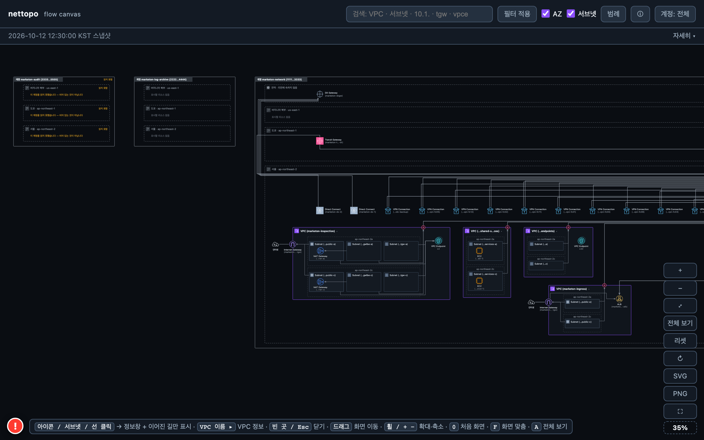
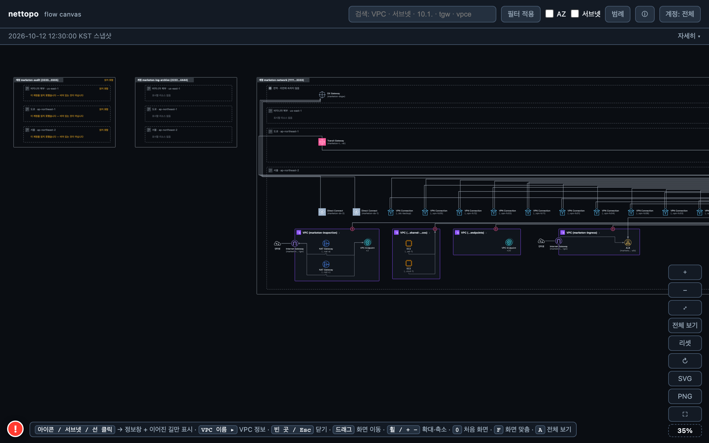

# 시나리오 C — 이커머스 「마켓온」 (국내 이커머스 + 물류)

시연·QA 용 **가상 고객 구성**입니다. 회사·계정·주소는 모두 가상이고(계정 ID 는 AWS 문서 예시 계열, IP 는 문서용 대역), 구성 모양은 AWS 공개 참조 아키텍처(Multi-VPC 백서, Security Reference Architecture 의 네트워크 계정, Transit Gateway 인터리전 피어링 블로그)와 국내 기업 관행을 따랐습니다. 리전당 VPC 를 가진 계정은 최대 3개입니다.

하루 주문 수백만 건을 처리하는 국내 이커머스입니다. 서울이 주 리전이고, 주문·결제만 도쿄에 웜 스탠바이 DR 을 둡니다. **풀필먼트 센터 12곳**이 각자 인터넷 회선으로 Site-to-Site VPN 을 맺고, 레거시 ERP·정산은 상암 IDC 에 남아 Direct Connect 로 연결됩니다.

트래픽 검사는 Network Firewall 대신 **Gateway Load Balancer** 뒤의 서드파티 IDS 어플라이언스로 하고, 그 어플라이언스는 Security 계정이 소유합니다.

- 수집 결과 JSON(화면의 입력): `scenario-ecommerce.json` — 아래 §4 의 리소스 목록은 이 파일에서 뽑았습니다.
- 기대 결과 화면: `scenario-ecommerce.html`(브라우저에서 더블클릭으로 열림) · 스크린샷 `scenario-ecommerce-overview.png`(전체) · `scenario-ecommerce-compact.png`(AZ·서브넷 접기) — §6.

## 1. 계정

| 계정 이름 | 계정 ID | 역할 |
|---|---|---|
| marketon-network | 111122223333 | 네트워크 허브. Transit Gateway(서울·도쿄), Inspection VPC(Gateway Load Balancer 엔드포인트 + NAT·IGW), Ingress VPC(ALB+WAF), 중앙 VPC 엔드포인트 20개, 공유 서비스(AD·CI/CD), Direct Connect, VPN 14개 |
| marketon-security | 555566667777 | 보안 도구. Gateway Load Balancer 와 IDS 어플라이언스 2대가 있는 어플라이언스 VPC. Workloads 데이터 VPC 와 로그 수집용 VPC 피어링 |
| marketon-workloads | 444455556666 | 서비스 전부. 커머스(주문·검색·결제) · 물류(WMS·TMS) · 데이터 · 스테이지 · 셀러 포털 VPC, 도쿄 DR VPC, CloudFront |
| marketon-log-archive | 222233334444 | 로그 보관 전용. VPC 없음 |
| marketon-audit | 333344445555 | 감사 전용. 읽기 역할 미배포 — 전부 읽지 못함 |

## 2. 리전

| 리전 | 코드 | 역할 |
|---|---|---|
| 서울 | ap-northeast-2 | 주 리전. VPC 11개(Network 4 · Security 1 · Workloads 5) + 허브 |
| 도쿄 | ap-northeast-1 | DR. Network Transit Gateway 1대 + Workloads DR VPC 1개. 서울과 피어링 |
| 버지니아 북부 | us-east-1 | VPC 없음. CloudFront 가 속한 글로벌 자리 |

## 3. 구성 의도

- **Transit Gateway 라우팅 테이블 5개** — prod · logistics · nonprod · shared · onprem. 주문→WMS 는 prod 테이블에 물류 대역 경로가 있지만, logistics 테이블에서 커머스·데이터 대역은 블랙홀이라 **한 방향**만 통합니다.
- **Gateway Load Balancer 로 검사** — Security 계정 어플라이언스 VPC 의 GWLB 가 VPC 엔드포인트 서비스로 제공되고, Network 계정 Inspection VPC 에 Gateway Load Balancer 엔드포인트 2개가 있습니다. Transit Gateway 서브넷의 기본 경로가 이 엔드포인트를 가리키고, 검사 후 같은 VPC 의 NAT 게이트웨이로 인터넷에 나갑니다(북-남 검사). 엔드포인트와 GWLB 사이의 엔드포인트 서비스 연결은 수집 대상이 아니라 화면에 선으로 나오지 않습니다.
- **Direct Connect LAG** — 로케이션 1곳(LG U+ 평촌) × 10Gbps 2회선을 Link Aggregation Group 하나로 묶었습니다(각 연결의 `lag_id` 가 같습니다). transit 가상 인터페이스 2개 → Direct Connect 게이트웨이 → Transit Gateway.
- **VPN 14개** — 풀필먼트 센터 12곳(고객 게이트웨이 12대, 센터 대역 192.168.N.0/24), 상암 IDC 백업 1, 결제사 C 와의 VPN 1. 전부 Transit Gateway 에 연결됩니다. 터널 UP/DOWN 은 구성이 아니라 상태라서 이 스냅샷에는 없고, 모니터링 층에서 보입니다.
- **결제사 연동 3가지 모양** — 결제사 A·B 는 PrivateLink 인터페이스 엔드포인트(커머스 VPC), 결제사 C 는 IPsec VPN. 같은 「결제」인데 선 종류가 다릅니다.
- **다른 계정과의 연결** — Workloads 의 VPC 6개는 Network 계정의 Transit Gateway 에 붙습니다. Workloads 데이터 VPC 와 Security 어플라이언스 VPC 사이 VPC 피어링 1개. Workloads 소유 CloudFront 의 원본은 Network 계정의 Ingress ALB 입니다.

**이 스냅샷에 없는 것(아직 수집 대상이 아닌 종류)**

- VPC 엔드포인트 서비스(GWLB 를 제공하는 쪽) — GWLB 와 엔드포인트는 보이지만 둘 사이 선은 없습니다.
- Direct Connect LAG 자체(연결의 `lag_id` 속성으로만 보임), VPN 터널 상태(모니터링 층).
- Resource Access Manager 공유 자체, Route 53 Resolver, AWS WAF web ACL(ALB·CloudFront 한 줄).

## 4. 리소스 목록 (수집 결과 JSON 과 같은 내용)

| 종류 | 개수 |
|---|---|
| VPC | 11 |
| 서브넷 | 26 |
| 라우팅 테이블 | 15 |
| 인터넷 게이트웨이 | 2 |
| NAT 게이트웨이 | 2 |
| VPC 엔드포인트 | 25 |
| 로드 밸런서 | 3 |
| EC2 인스턴스 | 13 |
| 보안 그룹 | 11 |
| 네트워크 ACL | 11 |
| Transit Gateway | 2 |
| Transit Gateway 연결(attachment) | 26 |
| Transit Gateway 라우팅 테이블 | 6 |
| VPC 피어링 연결 | 1 |
| Direct Connect 연결 | 2 |
| Direct Connect 가상 인터페이스 | 2 |
| Direct Connect 게이트웨이 | 1 |
| 고객 게이트웨이 | 14 |
| Site-to-Site VPN 연결 | 14 |
| CloudFront 배포 | 1 |

### 4.1 계정 marketon-network (111122223333)

#### 글로벌 (리전에 속하지 않음)

**Direct Connect 게이트웨이**

| 이름 | Amazon 쪽 ASN | 연결된 Transit Gateway | 연결된 VGW | 상대 리전 | 상대 계정 |
|---|---|---|---|---|---|
| marketon-dxgw | 64601 | marketon-tgw | - | ap-northeast-2 | marketon-network |

#### 서울 (ap-northeast-2)

**VPC** (4)

| 이름 | CIDR | 서브넷 | 라우팅 테이블 | 보안 그룹 | 네트워크 ACL |
|---|---|---|---|---|---|
| marketon-endpoints | 10.0.12.0/22 | 2 | 1 | 1 | 1 |
| marketon-ingress | 10.0.8.0/22 | 2 | 1 | 1 | 1 |
| marketon-inspection | 10.0.0.0/22 | 6 | 5 | 0 | 1 |
| marketon-shared-services | 10.0.16.0/22 | 2 | 1 | 1 | 1 |

**서브넷** (12)

| 이름 | VPC | 가용 영역 | CIDR | 퍼블릭 IP 자동 할당 |
|---|---|---|---|---|
| marketon-endpoints-a | marketon-endpoints | ap-northeast-2a | 10.0.12.0/24 | 아니오 |
| marketon-endpoints-c | marketon-endpoints | ap-northeast-2c | 10.0.13.0/24 | 아니오 |
| marketon-ingress-public-a | marketon-ingress | ap-northeast-2a | 10.0.8.0/24 | 예 |
| marketon-ingress-public-c | marketon-ingress | ap-northeast-2c | 10.0.9.0/24 | 예 |
| marketon-inspection-gwlbe-a | marketon-inspection | ap-northeast-2a | 10.0.1.0/25 | 아니오 |
| marketon-inspection-gwlbe-c | marketon-inspection | ap-northeast-2c | 10.0.1.128/25 | 아니오 |
| marketon-inspection-public-a | marketon-inspection | ap-northeast-2a | 10.0.2.0/25 | 예 |
| marketon-inspection-public-c | marketon-inspection | ap-northeast-2c | 10.0.2.128/25 | 예 |
| marketon-inspection-tgw-a | marketon-inspection | ap-northeast-2a | 10.0.0.0/25 | 아니오 |
| marketon-inspection-tgw-c | marketon-inspection | ap-northeast-2c | 10.0.0.128/25 | 아니오 |
| marketon-shared-services-a | marketon-shared-services | ap-northeast-2a | 10.0.16.0/24 | 아니오 |
| marketon-shared-services-c | marketon-shared-services | ap-northeast-2c | 10.0.17.0/24 | 아니오 |

**라우팅 테이블** (8)

| 이름 | VPC | 메인 | 연결된 서브넷 | 라우트 (목적지 → 대상) |
|---|---|---|---|---|
| marketon-endpoints-rtb | marketon-endpoints |  | marketon-endpoints-c, marketon-endpoints-a | 10.0.0.0/8 → Transit Gateway marketon-tgw |
| marketon-ingress-public-rtb | marketon-ingress |  | marketon-ingress-public-c, marketon-ingress-public-a | 0.0.0.0/0 → 인터넷 게이트웨이 marketon-ingress-igw<br>10.0.0.0/8 → Transit Gateway marketon-tgw |
| marketon-inspection-gwlbe-a-rtb | marketon-inspection |  | marketon-inspection-gwlbe-a | 0.0.0.0/0 → NAT 게이트웨이 marketon-egress-nat-a<br>10.0.0.0/8 → Transit Gateway marketon-tgw |
| marketon-inspection-gwlbe-c-rtb | marketon-inspection |  | marketon-inspection-gwlbe-c | 0.0.0.0/0 → NAT 게이트웨이 marketon-egress-nat-c<br>10.0.0.0/8 → Transit Gateway marketon-tgw |
| marketon-inspection-public-rtb | marketon-inspection |  | marketon-inspection-public-a, marketon-inspection-public-c | 0.0.0.0/0 → 인터넷 게이트웨이 marketon-inspection-igw<br>10.0.0.0/8 → VPC 엔드포인트 marketon-gwlbe-a |
| marketon-inspection-tgw-a-rtb | marketon-inspection |  | marketon-inspection-tgw-a | 0.0.0.0/0 → VPC 엔드포인트 marketon-gwlbe-a |
| marketon-inspection-tgw-c-rtb | marketon-inspection |  | marketon-inspection-tgw-c | 0.0.0.0/0 → VPC 엔드포인트 marketon-gwlbe-c |
| marketon-shared-services-rtb | marketon-shared-services |  | marketon-shared-services-c, marketon-shared-services-a | 10.0.0.0/8 → Transit Gateway marketon-tgw |

**인터넷 게이트웨이** (2)

| 이름 | 연결된 VPC | 상태 |
|---|---|---|
| marketon-ingress-igw | marketon-ingress | attached |
| marketon-inspection-igw | marketon-inspection | attached |

**NAT 게이트웨이** (2)

| 이름 | 서브넷 | 탄력적 IP | 종류 |
|---|---|---|---|
| marketon-egress-nat-a | marketon-inspection-public-a | 192.0.2.110 | public |
| marketon-egress-nat-c | marketon-inspection-public-c | 192.0.2.111 | public |

**VPC 엔드포인트** (22)

| 이름 | VPC | 종류 | 서비스 | 서브넷 / 라우팅 테이블 | 상태 |
|---|---|---|---|---|---|
| marketon-gwlbe-a | marketon-inspection | GatewayLoadBalancer | com.amazonaws.vpce.ap-northeast-2.vpce-svc-8888cbbbbf9999d66 | marketon-inspection-gwlbe-a | available |
| marketon-gwlbe-c | marketon-inspection | GatewayLoadBalancer | com.amazonaws.vpce.ap-northeast-2.vpce-svc-8888cbbbbf9999d66 | marketon-inspection-gwlbe-c | available |
| marketon-vpce-autoscaling | marketon-endpoints | Interface | com.amazonaws.ap-northeast-2.autoscaling | marketon-endpoints-c, marketon-endpoints-a | available |
| marketon-vpce-dynamodb | marketon-endpoints | Interface | com.amazonaws.ap-northeast-2.dynamodb | marketon-endpoints-c, marketon-endpoints-a | available |
| marketon-vpce-ec2messages | marketon-endpoints | Interface | com.amazonaws.ap-northeast-2.ec2messages | marketon-endpoints-c, marketon-endpoints-a | available |
| marketon-vpce-ecr.api | marketon-endpoints | Interface | com.amazonaws.ap-northeast-2.ecr.api | marketon-endpoints-c, marketon-endpoints-a | available |
| marketon-vpce-ecr.dkr | marketon-endpoints | Interface | com.amazonaws.ap-northeast-2.ecr.dkr | marketon-endpoints-c, marketon-endpoints-a | available |
| marketon-vpce-eks | marketon-endpoints | Interface | com.amazonaws.ap-northeast-2.eks | marketon-endpoints-c, marketon-endpoints-a | available |
| marketon-vpce-elasticloadbalancing | marketon-endpoints | Interface | com.amazonaws.ap-northeast-2.elasticloadbalancing | marketon-endpoints-c, marketon-endpoints-a | available |
| marketon-vpce-events | marketon-endpoints | Interface | com.amazonaws.ap-northeast-2.events | marketon-endpoints-c, marketon-endpoints-a | available |
| marketon-vpce-kinesis-streams | marketon-endpoints | Interface | com.amazonaws.ap-northeast-2.kinesis-streams | marketon-endpoints-c, marketon-endpoints-a | available |
| marketon-vpce-kms | marketon-endpoints | Interface | com.amazonaws.ap-northeast-2.kms | marketon-endpoints-c, marketon-endpoints-a | available |
| marketon-vpce-lambda | marketon-endpoints | Interface | com.amazonaws.ap-northeast-2.lambda | marketon-endpoints-c, marketon-endpoints-a | available |
| marketon-vpce-logs | marketon-endpoints | Interface | com.amazonaws.ap-northeast-2.logs | marketon-endpoints-c, marketon-endpoints-a | available |
| marketon-vpce-monitoring | marketon-endpoints | Interface | com.amazonaws.ap-northeast-2.monitoring | marketon-endpoints-c, marketon-endpoints-a | available |
| marketon-vpce-s3 | marketon-endpoints | Interface | com.amazonaws.ap-northeast-2.s3 | marketon-endpoints-c, marketon-endpoints-a | available |
| marketon-vpce-secretsmanager | marketon-endpoints | Interface | com.amazonaws.ap-northeast-2.secretsmanager | marketon-endpoints-c, marketon-endpoints-a | available |
| marketon-vpce-sns | marketon-endpoints | Interface | com.amazonaws.ap-northeast-2.sns | marketon-endpoints-c, marketon-endpoints-a | available |
| marketon-vpce-sqs | marketon-endpoints | Interface | com.amazonaws.ap-northeast-2.sqs | marketon-endpoints-c, marketon-endpoints-a | available |
| marketon-vpce-ssm | marketon-endpoints | Interface | com.amazonaws.ap-northeast-2.ssm | marketon-endpoints-c, marketon-endpoints-a | available |
| marketon-vpce-ssmmessages | marketon-endpoints | Interface | com.amazonaws.ap-northeast-2.ssmmessages | marketon-endpoints-c, marketon-endpoints-a | available |
| marketon-vpce-sts | marketon-endpoints | Interface | com.amazonaws.ap-northeast-2.sts | marketon-endpoints-c, marketon-endpoints-a | available |

**로드 밸런서** (1)

| 이름 | 종류 | 스킴 | VPC | 서브넷 | 리스너 | 대상 그룹 | WAF |
|---|---|---|---|---|---|---|---|
| marketon-ingress-alb | ALB | internet-facing | marketon-ingress | marketon-ingress-public-c, marketon-ingress-public-a | HTTPS:443 | marketon-openapi-tg, marketon-seller-tg | 있음 |

**EC2 인스턴스** (2)

| 이름 | 인스턴스 유형 | 서브넷 | 가용 영역 | 사설 IP | 상태 |
|---|---|---|---|---|---|
| marketon-ad-1 | m6i.large | marketon-shared-services-a | ap-northeast-2a | 10.0.16.21 | running |
| marketon-cicd-1 | m6i.xlarge | marketon-shared-services-c | ap-northeast-2c | 10.0.17.21 | running |

**보안 그룹** (3)

| 이름 | VPC | 설명 | 인바운드 규칙 | 아웃바운드 규칙 | 다른 보안 그룹 참조 |
|---|---|---|---|---|---|
| marketon-endpoints-app-sg | marketon-endpoints | marketon-endpoints application tier | 2 | 1 | - |
| marketon-ingress-alb-sg | marketon-ingress | internet-facing ALB (seller portal · open API) | 2 | 1 | - |
| marketon-shared-services-app-sg | marketon-shared-services | marketon-shared-services application tier | 2 | 1 | - |

**네트워크 ACL** (4)

| ID | VPC | 기본 | 규칙 수 | 연결된 서브넷 수 |
|---|---|---|---|---|
| acl-2222f4444f6666e66 | marketon-ingress | 기본 | 4 | 2 |
| acl-4444d7777faaaae55 | marketon-endpoints | 기본 | 4 | 2 |
| acl-4444deeeee8888f22 | marketon-shared-services | 기본 | 4 | 2 |
| acl-cccce8888baaaab44 | marketon-inspection | 기본 | 4 | 6 |

**Transit Gateway** (1)

| 이름 | Amazon 쪽 ASN | 연결 수 | 라우팅 테이블 수 |
|---|---|---|---|
| marketon-tgw | 64512 | 25 | 5 |

**Transit Gateway 연결(attachment)** (19)

| 이름 | 종류 | 대상 | Transit Gateway | 상태 | 비고 |
|---|---|---|---|---|---|
| att-dxgw | Direct Connect 게이트웨이 | marketon-dxgw | marketon-tgw | available | - |
| att-endpoints | VPC | marketon-endpoints | marketon-tgw | available | - |
| att-ingress | VPC | marketon-ingress | marketon-tgw | available | - |
| att-inspection | VPC | marketon-inspection | marketon-tgw | available | - |
| att-shared | VPC | marketon-shared-services | marketon-tgw | available | - |
| att-vpn-fc01 | VPN | marketon-vpn-fc01 | marketon-tgw | available | - |
| att-vpn-fc02 | VPN | marketon-vpn-fc02 | marketon-tgw | available | - |
| att-vpn-fc03 | VPN | marketon-vpn-fc03 | marketon-tgw | available | - |
| att-vpn-fc04 | VPN | marketon-vpn-fc04 | marketon-tgw | available | - |
| att-vpn-fc05 | VPN | marketon-vpn-fc05 | marketon-tgw | available | - |
| att-vpn-fc06 | VPN | marketon-vpn-fc06 | marketon-tgw | available | - |
| att-vpn-fc07 | VPN | marketon-vpn-fc07 | marketon-tgw | available | - |
| att-vpn-fc08 | VPN | marketon-vpn-fc08 | marketon-tgw | available | - |
| att-vpn-fc09 | VPN | marketon-vpn-fc09 | marketon-tgw | available | - |
| att-vpn-fc10 | VPN | marketon-vpn-fc10 | marketon-tgw | available | - |
| att-vpn-fc11 | VPN | marketon-vpn-fc11 | marketon-tgw | available | - |
| att-vpn-fc12 | VPN | marketon-vpn-fc12 | marketon-tgw | available | - |
| att-vpn-idc-backup | VPN | marketon-vpn-idc-backup | marketon-tgw | available | - |
| att-vpn-pg-c | VPN | marketon-vpn-pg-c | marketon-tgw | available | - |

**Transit Gateway 라우팅 테이블** (5)

| 이름 | Transit Gateway | 연결(association) | 전파(propagation) | 라우트 (목적지 → 연결) | 블랙홀 |
|---|---|---|---|---|---|
| marketon-tgw-rtb-logistics | marketon-tgw | att-vpn-fc10, att-vpn-fc01, att-vpn-fc04, att-vpn-fc09, att-vpn-fc08, att-vpn-fc11, att-vpn-fc03, att-vpn-fc05, att-logistics, att-vpn-fc06, att-vpn-fc12, att-vpn-fc07, att-vpn-fc02 | att-vpn-fc10, att-vpn-fc01, att-vpn-fc04, att-vpn-fc09, att-vpn-fc08, att-vpn-fc11, att-vpn-fc03, att-vpn-fc05, att-vpn-fc06, att-vpn-fc12, att-vpn-fc07, att-vpn-fc02 | 192.168.10.0/24 → att-vpn-fc10<br>192.168.1.0/24 → att-vpn-fc01<br>192.168.4.0/24 → att-vpn-fc04<br>10.0.12.0/22 → att-endpoints<br>192.168.9.0/24 → att-vpn-fc09<br>0.0.0.0/0 (정적) → att-inspection<br>192.168.8.0/24 → att-vpn-fc08<br>192.168.11.0/24 → att-vpn-fc11<br>192.168.3.0/24 → att-vpn-fc03<br>192.168.5.0/24 → att-vpn-fc05<br>192.168.6.0/24 → att-vpn-fc06<br>192.168.12.0/24 → att-vpn-fc12<br>192.168.7.0/24 → att-vpn-fc07<br>192.168.2.0/24 → att-vpn-fc02 | 10.10.0.0/20, 10.12.0.0/20 |
| marketon-tgw-rtb-nonprod | marketon-tgw | att-stage | att-shared, att-endpoints | 10.0.16.0/22 → att-shared<br>10.0.12.0/22 → att-endpoints<br>0.0.0.0/0 (정적) → att-inspection | 10.10.0.0/20, 10.11.0.0/20, 10.12.0.0/20 |
| marketon-tgw-rtb-onprem | marketon-tgw | att-dxgw, att-vpn-idc-backup, att-vpn-pg-c | att-shared, att-commerce, att-data | 10.50.0.0/20 (정적) → att-peer-sel-tyo<br>10.0.16.0/22 → att-shared<br>10.10.0.0/20 → att-commerce<br>10.12.0.0/20 → att-data | 10.11.0.0/20, 10.13.0.0/20 |
| marketon-tgw-rtb-prod | marketon-tgw | att-commerce, att-data, att-seller | att-shared, att-endpoints, att-dxgw, att-vpn-idc-backup, att-ingress | 10.50.0.0/20 (정적) → att-peer-sel-tyo<br>10.0.16.0/22 → att-shared<br>10.0.12.0/22 → att-endpoints<br>0.0.0.0/0 (정적) → att-inspection<br>172.16.0.0/12 → att-dxgw<br>172.16.0.0/12 → att-vpn-idc-backup<br>10.0.8.0/22 → att-ingress<br>10.200.0.0/16 (정적) → att-vpn-pg-c<br>10.11.0.0/20 (정적) → att-logistics | 10.13.0.0/20 |
| marketon-tgw-rtb-shared | marketon-tgw | att-shared, att-endpoints, att-inspection, att-ingress | att-commerce, att-data, att-seller, att-dxgw, att-stage, att-logistics, att-vpn-idc-backup | 10.50.0.0/20 (정적) → att-peer-sel-tyo<br>172.16.0.0/12 → att-dxgw<br>172.16.0.0/12 → att-vpn-idc-backup<br>10.10.0.0/20 → att-commerce<br>10.12.0.0/20 → att-data<br>10.14.0.0/22 → att-seller<br>10.13.0.0/20 → att-stage<br>10.11.0.0/20 → att-logistics | - |

**Direct Connect 연결** (2)

| 이름 | 로케이션 | 대역폭 | 제공자 | AWS 장비 | LAG | 상태 |
|---|---|---|---|---|---|---|
| marketon-dx-1 | LG U+ Pyeongchon, Seoul | 10Gbps | LG U+ | ICN50-A | dxlag-9999e444 | available |
| marketon-dx-2 | LG U+ Pyeongchon, Seoul | 10Gbps | LG U+ | ICN50-B | dxlag-9999e444 | available |

**Direct Connect 가상 인터페이스** (2)

| 이름 | 종류 | 연결 | VLAN | 고객 ASN | Amazon ASN | MTU | DX 게이트웨이 | VGW | 상태 |
|---|---|---|---|---|---|---|---|---|---|
| marketon-transit-vif-1 | transit | marketon-dx-1 | 300 | 65100 | 64601 | 8500 | marketon-dxgw | - | available |
| marketon-transit-vif-2 | transit | marketon-dx-2 | 301 | 65100 | 64601 | 8500 | marketon-dxgw | - | available |

**고객 게이트웨이** (14)

| 이름 | IP 주소 | BGP ASN | 장비 | 상태 |
|---|---|---|---|---|
| marketon-cgw-fc01 | 203.0.113.101 | 65201 | fc01-router | available |
| marketon-cgw-fc02 | 203.0.113.102 | 65202 | fc02-router | available |
| marketon-cgw-fc03 | 203.0.113.103 | 65203 | fc03-router | available |
| marketon-cgw-fc04 | 203.0.113.104 | 65204 | fc04-router | available |
| marketon-cgw-fc05 | 203.0.113.105 | 65205 | fc05-router | available |
| marketon-cgw-fc06 | 203.0.113.106 | 65206 | fc06-router | available |
| marketon-cgw-fc07 | 203.0.113.107 | 65207 | fc07-router | available |
| marketon-cgw-fc08 | 203.0.113.108 | 65208 | fc08-router | available |
| marketon-cgw-fc09 | 203.0.113.109 | 65209 | fc09-router | available |
| marketon-cgw-fc10 | 203.0.113.110 | 65210 | fc10-router | available |
| marketon-cgw-fc11 | 203.0.113.111 | 65211 | fc11-router | available |
| marketon-cgw-fc12 | 203.0.113.112 | 65212 | fc12-router | available |
| marketon-cgw-idc-backup | 203.0.113.50 | 65100 | sangam-idc-fw | available |
| marketon-cgw-pg-c | 203.0.113.80 | 65300 | pg-c-ipsec | available |

**Site-to-Site VPN 연결** (14)

| 이름 | 고객 게이트웨이 | 연결 대상 | 터널 수 | 터널 바깥 IP | 라우팅 | 상태 |
|---|---|---|---|---|---|---|
| marketon-vpn-fc01 | marketon-cgw-fc01 | Transit Gateway marketon-tgw | 2 | 198.51.100.102, 198.51.100.103 | BGP | available |
| marketon-vpn-fc02 | marketon-cgw-fc02 | Transit Gateway marketon-tgw | 2 | 198.51.100.104, 198.51.100.105 | BGP | available |
| marketon-vpn-fc03 | marketon-cgw-fc03 | Transit Gateway marketon-tgw | 2 | 198.51.100.106, 198.51.100.107 | BGP | available |
| marketon-vpn-fc04 | marketon-cgw-fc04 | Transit Gateway marketon-tgw | 2 | 198.51.100.108, 198.51.100.109 | BGP | available |
| marketon-vpn-fc05 | marketon-cgw-fc05 | Transit Gateway marketon-tgw | 2 | 198.51.100.110, 198.51.100.111 | BGP | available |
| marketon-vpn-fc06 | marketon-cgw-fc06 | Transit Gateway marketon-tgw | 2 | 198.51.100.112, 198.51.100.113 | BGP | available |
| marketon-vpn-fc07 | marketon-cgw-fc07 | Transit Gateway marketon-tgw | 2 | 198.51.100.114, 198.51.100.115 | BGP | available |
| marketon-vpn-fc08 | marketon-cgw-fc08 | Transit Gateway marketon-tgw | 2 | 198.51.100.116, 198.51.100.117 | BGP | available |
| marketon-vpn-fc09 | marketon-cgw-fc09 | Transit Gateway marketon-tgw | 2 | 198.51.100.118, 198.51.100.119 | BGP | available |
| marketon-vpn-fc10 | marketon-cgw-fc10 | Transit Gateway marketon-tgw | 2 | 198.51.100.120, 198.51.100.121 | BGP | available |
| marketon-vpn-fc11 | marketon-cgw-fc11 | Transit Gateway marketon-tgw | 2 | 198.51.100.122, 198.51.100.123 | BGP | available |
| marketon-vpn-fc12 | marketon-cgw-fc12 | Transit Gateway marketon-tgw | 2 | 198.51.100.124, 198.51.100.125 | BGP | available |
| marketon-vpn-idc-backup | marketon-cgw-idc-backup | Transit Gateway marketon-tgw | 2 | 198.51.100.51, 198.51.100.52 | BGP | available |
| marketon-vpn-pg-c | marketon-cgw-pg-c | Transit Gateway marketon-tgw | 2 | 198.51.100.81, 198.51.100.82 | BGP | available |

#### 도쿄 (ap-northeast-1)

**Transit Gateway** (1)

| 이름 | Amazon 쪽 ASN | 연결 수 | 라우팅 테이블 수 |
|---|---|---|---|
| marketon-tgw-dr | 64513 | 2 | 1 |

**Transit Gateway 연결(attachment)** (1)

| 이름 | 종류 | 대상 | Transit Gateway | 상태 | 비고 |
|---|---|---|---|---|---|
| att-peer-sel-tyo | Transit Gateway 피어링 | 상대 Transit Gateway marketon-tgw (ap-northeast-2) | marketon-tgw-dr | available | 상대 리전 응답에도 나옴: 111122223333/ap-northeast-2 |

**Transit Gateway 라우팅 테이블** (1)

| 이름 | Transit Gateway | 연결(association) | 전파(propagation) | 라우트 (목적지 → 연결) | 블랙홀 |
|---|---|---|---|---|---|
| marketon-tgw-rtb-dr | marketon-tgw-dr | att-commerce-dr, att-peer-sel-tyo | att-commerce-dr | 10.0.0.0/8 (정적) → att-peer-sel-tyo<br>10.50.0.0/20 → att-commerce-dr | - |

### 4.2 계정 marketon-log-archive (222233334444)

리소스 없음 — 모든 리전에서 수집은 성공했고(`ok`) 개수가 0 입니다. 화면에서는 빈 리전 3개로 나옵니다.

### 4.3 계정 marketon-audit (333344445555)

모든 리전·종류를 **읽지 못했습니다** — 사유: `sts:AssumeRole` access_denied ("role NetworkReadOnlyRole is not deployed in this account"). 화면에서는 이 계정의 세 리전이 「읽지 못함」으로 표시됩니다.

### 4.4 계정 marketon-workloads (444455556666)

#### 글로벌 (리전에 속하지 않음)

**CloudFront 배포**

| 배포 도메인 | 대체 도메인 | 원본 | WAF | 가격 클래스 |
|---|---|---|---|---|
| d1m4rk3t0nw3b.cloudfront.net | img.marketon.example, www.marketon.example | marketon-ingress-alb-7777ceeeea.ap-northeast-2.elb.amazonaws.com = 로드 밸런서 marketon-ingress-alb (marketon-network 계정) | 있음 | PriceClass_200 |

#### 서울 (ap-northeast-2)

**VPC** (5)

| 이름 | CIDR | 서브넷 | 라우팅 테이블 | 보안 그룹 | 네트워크 ACL |
|---|---|---|---|---|---|
| marketon-commerce | 10.10.0.0/20 | 2 | 1 | 2 | 1 |
| marketon-data | 10.12.0.0/20 | 2 | 1 | 1 | 1 |
| marketon-logistics | 10.11.0.0/20 | 2 | 1 | 1 | 1 |
| marketon-seller | 10.14.0.0/22 | 2 | 1 | 1 | 1 |
| marketon-stage | 10.13.0.0/20 | 2 | 1 | 1 | 1 |

**서브넷** (10)

| 이름 | VPC | 가용 영역 | CIDR | 퍼블릭 IP 자동 할당 |
|---|---|---|---|---|
| marketon-commerce-a | marketon-commerce | ap-northeast-2a | 10.10.0.0/24 | 아니오 |
| marketon-commerce-c | marketon-commerce | ap-northeast-2c | 10.10.1.0/24 | 아니오 |
| marketon-data-a | marketon-data | ap-northeast-2a | 10.12.0.0/24 | 아니오 |
| marketon-data-c | marketon-data | ap-northeast-2c | 10.12.1.0/24 | 아니오 |
| marketon-logistics-a | marketon-logistics | ap-northeast-2a | 10.11.0.0/24 | 아니오 |
| marketon-logistics-c | marketon-logistics | ap-northeast-2c | 10.11.1.0/24 | 아니오 |
| marketon-seller-a | marketon-seller | ap-northeast-2a | 10.14.0.0/24 | 아니오 |
| marketon-seller-c | marketon-seller | ap-northeast-2c | 10.14.1.0/24 | 아니오 |
| marketon-stage-a | marketon-stage | ap-northeast-2a | 10.13.0.0/24 | 아니오 |
| marketon-stage-c | marketon-stage | ap-northeast-2c | 10.13.1.0/24 | 아니오 |

**라우팅 테이블** (5)

| 이름 | VPC | 메인 | 연결된 서브넷 | 라우트 (목적지 → 대상) |
|---|---|---|---|---|
| marketon-commerce-rtb | marketon-commerce |  | marketon-commerce-a, marketon-commerce-c | 0.0.0.0/0 → Transit Gateway marketon-tgw (marketon-network 계정)<br>pl-78a54011 → VPC 엔드포인트 marketon-commerce-s3 |
| marketon-data-rtb | marketon-data |  | marketon-data-c, marketon-data-a | 0.0.0.0/0 → Transit Gateway marketon-tgw (marketon-network 계정)<br>10.0.20.0/22 → VPC 피어링 연결 marketon-data-security-peering |
| marketon-logistics-rtb | marketon-logistics |  | marketon-logistics-c, marketon-logistics-a | 0.0.0.0/0 → Transit Gateway marketon-tgw (marketon-network 계정) |
| marketon-seller-rtb | marketon-seller |  | marketon-seller-c, marketon-seller-a | 0.0.0.0/0 → Transit Gateway marketon-tgw (marketon-network 계정) |
| marketon-stage-rtb | marketon-stage |  | marketon-stage-c, marketon-stage-a | 0.0.0.0/0 → Transit Gateway marketon-tgw (marketon-network 계정) |

**VPC 엔드포인트** (3)

| 이름 | VPC | 종류 | 서비스 | 서브넷 / 라우팅 테이블 | 상태 |
|---|---|---|---|---|---|
| marketon-commerce-s3 | marketon-commerce | Gateway | com.amazonaws.ap-northeast-2.s3 | marketon-commerce-rtb | available |
| marketon-vpce-pg-a | marketon-commerce | Interface | com.amazonaws.vpce.ap-northeast-2.vpce-svc-eeeed8888c4444bdd | marketon-commerce-a, marketon-commerce-c | available |
| marketon-vpce-pg-b | marketon-commerce | Interface | com.amazonaws.vpce.ap-northeast-2.vpce-svc-5555abbbbb7777a66 | marketon-commerce-a, marketon-commerce-c | available |

**로드 밸런서** (1)

| 이름 | 종류 | 스킴 | VPC | 서브넷 | 리스너 | 대상 그룹 | WAF |
|---|---|---|---|---|---|---|---|
| marketon-api-alb | ALB | internal | marketon-commerce | marketon-commerce-a, marketon-commerce-c | HTTPS:443 | marketon-order-tg, marketon-payment-tg, marketon-search-tg | 없음 |

**EC2 인스턴스** (7)

| 이름 | 인스턴스 유형 | 서브넷 | 가용 영역 | 사설 IP | 상태 |
|---|---|---|---|---|---|
| marketon-etl-1 | r6i.4xlarge | marketon-data-a | ap-northeast-2a | 10.12.0.21 | running |
| marketon-order-1 | c6i.2xlarge | marketon-commerce-a | ap-northeast-2a | 10.10.0.21 | running |
| marketon-payment-1 | c6i.2xlarge | marketon-commerce-a | ap-northeast-2a | 10.10.0.31 | running |
| marketon-search-1 | c6i.2xlarge | marketon-commerce-c | ap-northeast-2c | 10.10.1.21 | running |
| marketon-seller-portal-1 | m6i.large | marketon-seller-a | ap-northeast-2a | 10.14.0.21 | running |
| marketon-tms-1 | m6i.xlarge | marketon-logistics-c | ap-northeast-2c | 10.11.1.21 | running |
| marketon-wms-1 | m6i.2xlarge | marketon-logistics-a | ap-northeast-2a | 10.11.0.21 | running |

**보안 그룹** (6)

| 이름 | VPC | 설명 | 인바운드 규칙 | 아웃바운드 규칙 | 다른 보안 그룹 참조 |
|---|---|---|---|---|---|
| marketon-api-alb-sg | marketon-commerce | internal API ALB | 1 | 1 | egress → marketon-commerce-app-sg: tcp/8443-8443 |
| marketon-commerce-app-sg | marketon-commerce | marketon-commerce application tier | 2 | 1 | - |
| marketon-data-app-sg | marketon-data | marketon-data application tier | 2 | 1 | - |
| marketon-logistics-app-sg | marketon-logistics | marketon-logistics application tier | 2 | 1 | - |
| marketon-seller-app-sg | marketon-seller | marketon-seller application tier | 2 | 1 | - |
| marketon-stage-app-sg | marketon-stage | marketon-stage application tier | 2 | 1 | - |

**네트워크 ACL** (5)

| ID | VPC | 기본 | 규칙 수 | 연결된 서브넷 수 |
|---|---|---|---|---|
| acl-7777beeeecffffd00 | marketon-commerce | 기본 | 4 | 2 |
| acl-aaaaf9999b1111a55 | marketon-data | 기본 | 4 | 2 |
| acl-cccca6666c5555ebb | marketon-seller | 기본 | 4 | 2 |
| acl-cccca9999d0000abb | marketon-logistics | 기본 | 4 | 2 |
| acl-eeeea8888aaaaaaaa | marketon-stage | 기본 | 4 | 2 |

**Transit Gateway 연결(attachment)** (5)

| 이름 | 종류 | 대상 | Transit Gateway | 상태 | 비고 |
|---|---|---|---|---|---|
| att-commerce | VPC | marketon-commerce | marketon-tgw | available | Transit Gateway 는 marketon-network 계정 소유(RAM 공유) |
| att-data | VPC | marketon-data | marketon-tgw | available | Transit Gateway 는 marketon-network 계정 소유(RAM 공유) |
| att-logistics | VPC | marketon-logistics | marketon-tgw | available | Transit Gateway 는 marketon-network 계정 소유(RAM 공유) |
| att-seller | VPC | marketon-seller | marketon-tgw | available | Transit Gateway 는 marketon-network 계정 소유(RAM 공유) |
| att-stage | VPC | marketon-stage | marketon-tgw | available | Transit Gateway 는 marketon-network 계정 소유(RAM 공유) |

**VPC 피어링 연결** (1)

| 이름 | 요청자 VPC (계정 · 리전) | 요청자 CIDR | 수락자 VPC (계정 · 리전) | 수락자 CIDR | 상태 |
|---|---|---|---|---|---|
| marketon-data-security-peering | marketon-data (marketon-workloads · ap-northeast-2) | 10.12.0.0/20 | marketon-appliance (marketon-security · ap-northeast-2) | 10.0.20.0/22 | active |

#### 도쿄 (ap-northeast-1)

**VPC** (1)

| 이름 | CIDR | 서브넷 | 라우팅 테이블 | 보안 그룹 | 네트워크 ACL |
|---|---|---|---|---|---|
| marketon-commerce-dr | 10.50.0.0/20 | 2 | 1 | 1 | 1 |

**서브넷** (2)

| 이름 | VPC | 가용 영역 | CIDR | 퍼블릭 IP 자동 할당 |
|---|---|---|---|---|
| marketon-commerce-dr-a | marketon-commerce-dr | ap-northeast-1a | 10.50.0.0/24 | 아니오 |
| marketon-commerce-dr-c | marketon-commerce-dr | ap-northeast-1c | 10.50.1.0/24 | 아니오 |

**라우팅 테이블** (1)

| 이름 | VPC | 메인 | 연결된 서브넷 | 라우트 (목적지 → 대상) |
|---|---|---|---|---|
| marketon-commerce-dr-rtb | marketon-commerce-dr |  | marketon-commerce-dr-a, marketon-commerce-dr-c | 10.0.0.0/8 → Transit Gateway marketon-tgw-dr (marketon-network 계정) |

**EC2 인스턴스** (2)

| 이름 | 인스턴스 유형 | 서브넷 | 가용 영역 | 사설 IP | 상태 |
|---|---|---|---|---|---|
| marketon-order-dr-1 | c6i.xlarge | marketon-commerce-dr-a | ap-northeast-1a | 10.50.0.21 | running |
| marketon-payment-dr-1 | c6i.xlarge | marketon-commerce-dr-c | ap-northeast-1c | 10.50.1.21 | running |

**보안 그룹** (1)

| 이름 | VPC | 설명 | 인바운드 규칙 | 아웃바운드 규칙 | 다른 보안 그룹 참조 |
|---|---|---|---|---|---|
| marketon-commerce-dr-app-sg | marketon-commerce-dr | marketon-commerce-dr application tier | 2 | 1 | - |

**네트워크 ACL** (1)

| ID | VPC | 기본 | 규칙 수 | 연결된 서브넷 수 |
|---|---|---|---|---|
| acl-cccca5555aaaaad66 | marketon-commerce-dr | 기본 | 4 | 2 |

**Transit Gateway 연결(attachment)** (1)

| 이름 | 종류 | 대상 | Transit Gateway | 상태 | 비고 |
|---|---|---|---|---|---|
| att-commerce-dr | VPC | marketon-commerce-dr | marketon-tgw-dr | available | Transit Gateway 는 marketon-network 계정 소유(RAM 공유) |

### 4.5 계정 marketon-security (555566667777)

#### 서울 (ap-northeast-2)

**VPC** (1)

| 이름 | CIDR | 서브넷 | 라우팅 테이블 | 보안 그룹 | 네트워크 ACL |
|---|---|---|---|---|---|
| marketon-appliance | 10.0.20.0/22 | 2 | 1 | 1 | 1 |

**서브넷** (2)

| 이름 | VPC | 가용 영역 | CIDR | 퍼블릭 IP 자동 할당 |
|---|---|---|---|---|
| marketon-appliance-a | marketon-appliance | ap-northeast-2a | 10.0.20.0/24 | 아니오 |
| marketon-appliance-c | marketon-appliance | ap-northeast-2c | 10.0.21.0/24 | 아니오 |

**라우팅 테이블** (1)

| 이름 | VPC | 메인 | 연결된 서브넷 | 라우트 (목적지 → 대상) |
|---|---|---|---|---|
| marketon-appliance-rtb | marketon-appliance |  | marketon-appliance-a, marketon-appliance-c | local 만 |

**로드 밸런서** (1)

| 이름 | 종류 | 스킴 | VPC | 서브넷 | 리스너 | 대상 그룹 | WAF |
|---|---|---|---|---|---|---|---|
| marketon-ids-gwlb | GWLB | - | marketon-appliance | marketon-appliance-a, marketon-appliance-c | - | marketon-ids-tg | - |

**EC2 인스턴스** (2)

| 이름 | 인스턴스 유형 | 서브넷 | 가용 영역 | 사설 IP | 상태 |
|---|---|---|---|---|---|
| marketon-ids-1 | c6in.2xlarge | marketon-appliance-a | ap-northeast-2a | 10.0.20.11 | running |
| marketon-ids-2 | c6in.2xlarge | marketon-appliance-c | ap-northeast-2c | 10.0.21.11 | running |

**보안 그룹** (1)

| 이름 | VPC | 설명 | 인바운드 규칙 | 아웃바운드 규칙 | 다른 보안 그룹 참조 |
|---|---|---|---|---|---|
| marketon-appliance-app-sg | marketon-appliance | marketon-appliance application tier | 2 | 1 | - |

**네트워크 ACL** (1)

| ID | VPC | 기본 | 규칙 수 | 연결된 서브넷 수 |
|---|---|---|---|---|
| acl-8888daaaac1111c99 | marketon-appliance | 기본 | 4 | 2 |

## 5. 계정과 리전을 넘는 연결

이 시나리오가 특별히 보여 주려는 것입니다. 실제 테스트 계정(188·575)에는 아직 둘 다 없습니다.

**계정을 넘는 연결 23개**

- CloudFront 원본: CloudFront 배포 d1m4rk3t0nw3b.cloudfront.net (marketon-workloads) → 로드 밸런서 marketon-ingress-alb (marketon-network · ap-northeast-2)
- VPC 피어링: VPC 피어링 연결 marketon-data-security-peering (marketon-workloads · ap-northeast-2) → VPC marketon-appliance (marketon-security · ap-northeast-2)
- 라우트: Transit Gateway 라우팅 테이블 marketon-tgw-rtb-dr (marketon-network · ap-northeast-1) → Transit Gateway 연결(attachment) att-commerce-dr (marketon-workloads · ap-northeast-1)
- 라우트: Transit Gateway 라우팅 테이블 marketon-tgw-rtb-onprem (marketon-network · ap-northeast-2) → Transit Gateway 연결(attachment) att-commerce (marketon-workloads · ap-northeast-2)
- 라우트: Transit Gateway 라우팅 테이블 marketon-tgw-rtb-onprem (marketon-network · ap-northeast-2) → Transit Gateway 연결(attachment) att-data (marketon-workloads · ap-northeast-2)
- 라우트: Transit Gateway 라우팅 테이블 marketon-tgw-rtb-prod (marketon-network · ap-northeast-2) → Transit Gateway 연결(attachment) att-logistics (marketon-workloads · ap-northeast-2)
- 라우트: Transit Gateway 라우팅 테이블 marketon-tgw-rtb-shared (marketon-network · ap-northeast-2) → Transit Gateway 연결(attachment) att-commerce (marketon-workloads · ap-northeast-2)
- 라우트: Transit Gateway 라우팅 테이블 marketon-tgw-rtb-shared (marketon-network · ap-northeast-2) → Transit Gateway 연결(attachment) att-data (marketon-workloads · ap-northeast-2)
- 라우트: Transit Gateway 라우팅 테이블 marketon-tgw-rtb-shared (marketon-network · ap-northeast-2) → Transit Gateway 연결(attachment) att-logistics (marketon-workloads · ap-northeast-2)
- 라우트: Transit Gateway 라우팅 테이블 marketon-tgw-rtb-shared (marketon-network · ap-northeast-2) → Transit Gateway 연결(attachment) att-seller (marketon-workloads · ap-northeast-2)
- 라우트: Transit Gateway 라우팅 테이블 marketon-tgw-rtb-shared (marketon-network · ap-northeast-2) → Transit Gateway 연결(attachment) att-stage (marketon-workloads · ap-northeast-2)
- 라우트: 라우팅 테이블 marketon-commerce-dr-rtb (marketon-workloads · ap-northeast-1) → Transit Gateway marketon-tgw-dr (marketon-network · ap-northeast-1)
- 라우트: 라우팅 테이블 marketon-commerce-rtb (marketon-workloads · ap-northeast-2) → Transit Gateway marketon-tgw (marketon-network · ap-northeast-2)
- 라우트: 라우팅 테이블 marketon-data-rtb (marketon-workloads · ap-northeast-2) → Transit Gateway marketon-tgw (marketon-network · ap-northeast-2)
- 라우트: 라우팅 테이블 marketon-logistics-rtb (marketon-workloads · ap-northeast-2) → Transit Gateway marketon-tgw (marketon-network · ap-northeast-2)
- 라우트: 라우팅 테이블 marketon-seller-rtb (marketon-workloads · ap-northeast-2) → Transit Gateway marketon-tgw (marketon-network · ap-northeast-2)
- 라우트: 라우팅 테이블 marketon-stage-rtb (marketon-workloads · ap-northeast-2) → Transit Gateway marketon-tgw (marketon-network · ap-northeast-2)
- 연결: Transit Gateway 연결(attachment) att-commerce (marketon-workloads · ap-northeast-2) → Transit Gateway marketon-tgw (marketon-network · ap-northeast-2)
- 연결: Transit Gateway 연결(attachment) att-commerce-dr (marketon-workloads · ap-northeast-1) → Transit Gateway marketon-tgw-dr (marketon-network · ap-northeast-1)
- 연결: Transit Gateway 연결(attachment) att-data (marketon-workloads · ap-northeast-2) → Transit Gateway marketon-tgw (marketon-network · ap-northeast-2)
- 연결: Transit Gateway 연결(attachment) att-logistics (marketon-workloads · ap-northeast-2) → Transit Gateway marketon-tgw (marketon-network · ap-northeast-2)
- 연결: Transit Gateway 연결(attachment) att-seller (marketon-workloads · ap-northeast-2) → Transit Gateway marketon-tgw (marketon-network · ap-northeast-2)
- 연결: Transit Gateway 연결(attachment) att-stage (marketon-workloads · ap-northeast-2) → Transit Gateway marketon-tgw (marketon-network · ap-northeast-2)

**리전을 넘는 연결 4개**

- 라우트: Transit Gateway 라우팅 테이블 marketon-tgw-rtb-onprem (marketon-network · ap-northeast-2) → Transit Gateway 연결(attachment) att-peer-sel-tyo (marketon-network · ap-northeast-1)
- 라우트: Transit Gateway 라우팅 테이블 marketon-tgw-rtb-prod (marketon-network · ap-northeast-2) → Transit Gateway 연결(attachment) att-peer-sel-tyo (marketon-network · ap-northeast-1)
- 라우트: Transit Gateway 라우팅 테이블 marketon-tgw-rtb-shared (marketon-network · ap-northeast-2) → Transit Gateway 연결(attachment) att-peer-sel-tyo (marketon-network · ap-northeast-1)
- 연결: Transit Gateway 연결(attachment) att-peer-sel-tyo (marketon-network · ap-northeast-1) → Transit Gateway marketon-tgw (marketon-network · ap-northeast-2)

## 6. 기대 결과 화면

수집 결과 JSON 을 렌더러에 넣어 만든 HTML 이 `scenario-ecommerce.html` 입니다. 파일 하나로 완결되어 있어(외부 요청 없음) 내려받아 더블클릭하면 브라우저에서 바로 열립니다. 아이콘·서브넷·선을 누르면 정보창이 뜨고, 위쪽 AZ·서브넷 체크박스로 펼침·접음을 바꿀 수 있습니다. 아래 두 장은 그 화면을 그대로 찍은 것입니다 — 전체 화면(AZ·서브넷 펼침)과 접은 화면(AZ·서브넷 끔).





## 7. 시연에서 볼 것

1. VPN 14개가 Transit Gateway 하나에 모인 모양. 고객 게이트웨이 14대가 한 줄로 서는지.
2. LAG 로 묶인 Direct Connect 2회선 → 게이트웨이 → Transit Gateway. 금융 시나리오의 「로케이션 2곳 독립 회선」과 비교.
3. Gateway Load Balancer(Security 계정)와 그 엔드포인트 2개(Network 계정)가 각각 어디에 서는지.
4. logistics 라우팅 테이블의 블랙홀(커머스·데이터 대역)로 한 방향만 통하는 것.
5. 경로: 주문 서버 → 결제사 A 는 PrivateLink 직결, 주문 서버 → 결제사 C 는 Transit Gateway → VPN. 풀필먼트 센터 7 → 재고 API 는 VPN → Transit Gateway(logistics) → 물류 VPC.

## 8. HTML 다시 만들기 (JSON 을 바꿨을 때)

저장소의 `renderer/` 폴더에서 두 줄을 실행하면 같은 HTML 이 다시 나옵니다:

```bash
IN=../docs/demo/scenario-ecommerce.json OUT=../out/fixture-ecommerce.js node adapt-engine-snapshot.mjs
FIX=../out/fixture-ecommerce.js OUT=../out/scenario-ecommerce.html node build-standalone.mjs
# → out/scenario-ecommerce.html 을 브라우저에서 더블클릭(file://)으로 엽니다
```
