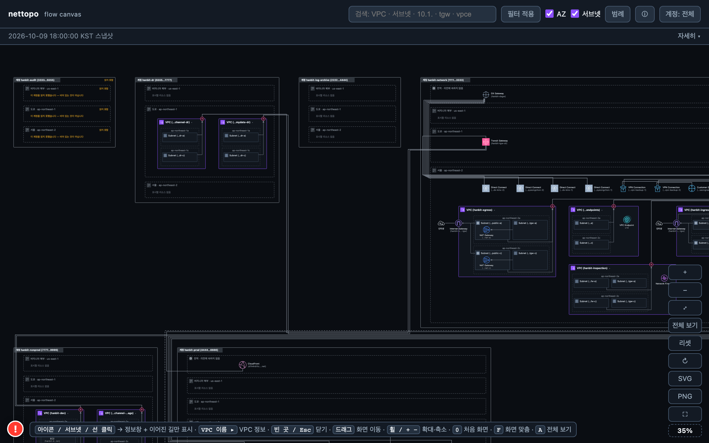
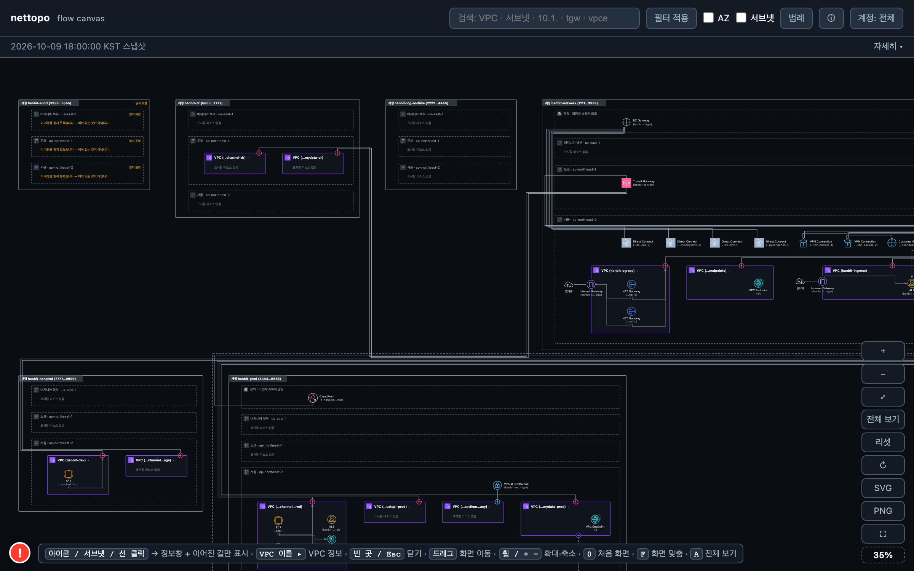

# 시나리오 A — 금융 「한빛카드」 (카드사 + 마이데이터)

시연·QA 용 **가상 고객 구성**입니다. 회사·계정·주소는 모두 가상이고(계정 ID 는 AWS 문서 예시 계열, IP 는 문서용 대역), 구성 모양은 AWS 공개 참조 아키텍처(Multi-VPC 백서, Security Reference Architecture 의 네트워크 계정, Transit Gateway 인터리전 피어링 블로그)와 국내 기업 관행을 따랐습니다. 리전당 VPC 를 가진 계정은 최대 3개입니다.

전산센터 2곳(성남 주센터, 대전 재해복구센터)에 카드 승인·정산 같은 핵심 시스템을 남기고, 모바일 채널·마이데이터·데이터 분석을 AWS 로 옮긴 카드사입니다. 중요정보는 서울 리전에만 두고, 도쿄 리전에는 비중요 채널의 재해복구용 최소 구성만 둡니다.

금융권 망분리 관행에 맞춰 **업무망 / 인터넷망(DMZ) / 개발망**을 나눕니다. 업무망과 인터넷망은 Transit Gateway 를 따로 두고, 그 사이는 Transit Gateway 피어링 하나로만 잇습니다. 개발망은 같은 업무망 Transit Gateway 안에서 라우팅 테이블로 격리합니다.

- 수집 결과 JSON(화면의 입력): `scenario-finance.json` — 아래 §4 의 리소스 목록은 이 파일에서 뽑았습니다.
- 기대 결과 화면: `scenario-finance.html`(브라우저에서 더블클릭으로 열림) · 스크린샷 `scenario-finance-overview.png`(전체) · `scenario-finance-compact.png`(AZ·서브넷 접기) — §6.

## 1. 계정

| 계정 이름 | 계정 ID | 역할 |
|---|---|---|
| hanbit-network | 111122223333 | 네트워크 허브. Transit Gateway 2대, Direct Connect, 중앙 방화벽(Network Firewall), 중앙 VPC 엔드포인트, 공유 서비스(AD) |
| hanbit-prod | 444455556666 | 운영 업무. 채널 VPC, 마이데이터 VPC, 대외연동(DMZ) VPC, 레거시 정산 VPC(가상 프라이빗 게이트웨이) |
| hanbit-nonprod | 777788889999 | 스테이지·개발 VPC |
| hanbit-dr | 555566667777 | 도쿄 재해복구 VPC 2개(인터넷 경로 없음) |
| hanbit-log-archive | 222233334444 | 로그 보관 전용. VPC 없음 — 수집은 성공했고 리소스가 0개 |
| hanbit-audit | 333344445555 | 감사 전용. 수집용 읽기 역할이 배포되지 않아 **모든 리전·종류를 읽지 못한** 계정 |

## 2. 리전

| 리전 | 코드 | 역할 |
|---|---|---|
| 서울 | ap-northeast-2 | 주 리전. 허브와 운영·개발 VPC 전부 |
| 도쿄 | ap-northeast-1 | 재해복구. Network 계정의 Transit Gateway 1대 + DR 계정 VPC 2개. 서울과 Transit Gateway 피어링 |
| 버지니아 북부 | us-east-1 | VPC 없음. CloudFront 같은 글로벌 리소스가 속한 자리로만 나타남 |

## 3. 구성 의도

- **Transit Gateway 2대 망분리** — 업무망(hanbit-tgw-biz)은 라우팅 테이블 4개(prod · nonprod · shared · onprem), 인터넷망(hanbit-tgw-dmz)은 2개(dmz · inspection). prod 라우팅 테이블에서 개발망 대역(10.30.0.0/16)은 블랙홀로 막아 두었습니다.
- **중앙 검사** — 인터넷망의 트래픽은 Inspection VPC 의 Network Firewall 엔드포인트를 지나 Ingress VPC 로 나갑니다. Inspection VPC 의 Transit Gateway 서브넷 라우팅 테이블은 기본 경로를 방화벽 엔드포인트(vpce-…)로 보내는데, 방화벽 엔드포인트는 수집 대상 리소스가 아니라서 라우팅 테이블에 「대상을 찾지 못한 참조」로 남습니다.
- **Direct Connect 이중화** — 서울 로케이션 2곳(KINX 가산, LG U+ 평촌) × 1Gbps 2회선. 전부 transit 가상 인터페이스로 Direct Connect 게이트웨이 1개에 모여 업무망 Transit Gateway 에 연결됩니다. 회선 1개(hanbit-dx-kinx-2)와 그 가상 인터페이스는 `down` 상태입니다.
- **Direct Connect 게이트웨이 아래 Transit Gateway 와 가상 프라이빗 게이트웨이가 함께** — 대전 재해복구센터는 private 가상 인터페이스로 같은 게이트웨이에 들어와 Prod 계정의 레거시 정산 VPC 에 붙은 가상 프라이빗 게이트웨이(VGW)로 갑니다. 게이트웨이는 Network 계정, VGW 는 Prod 계정 소유입니다.
- **백업 VPN** — 성남 센터 고객 게이트웨이 2대 → Site-to-Site VPN 2개 → 업무망 Transit Gateway.
- **다른 계정과의 연결** — Prod·Nonprod·DR 의 VPC 는 Network 계정이 Resource Access Manager 로 공유한 Transit Gateway 에 붙습니다(연결 리소스는 VPC 소유 계정에 있고, Transit Gateway 는 Network 계정에 있습니다). Prod 마이데이터 VPC 와 Network 공유 서비스 VPC 사이에 옛 VPC 피어링 연결 1개가 남아 있습니다. Prod 소유 CloudFront 배포의 원본은 Network 계정의 Ingress ALB 입니다.
- **제휴사 PrivateLink** — 마이데이터 VPC 에 인터페이스 엔드포인트 3개(신용평가사 · VAN · 마이데이터 중계기관). 제공자 계정은 수집 범위 밖이고, 중계기관 엔드포인트는 `pendingAcceptance`(수락 대기) 상태입니다.

**이 스냅샷에 없는 것(아직 수집 대상이 아닌 종류)**

- Resource Access Manager 공유 자체(어느 리소스를 어느 계정에 공유했는지) — Transit Gateway 연결이 다른 계정에 있다는 사실로만 보입니다.
- Route 53 Resolver 엔드포인트와 전달 규칙, Network Firewall 의 엔드포인트(vpce-…) 자체.
- AWS WAF web ACL — 별도 리소스가 아니라 ALB·CloudFront 항목의 한 줄로만 보입니다.

## 4. 리소스 목록 (수집 결과 JSON 과 같은 내용)

| 종류 | 개수 |
|---|---|
| VPC | 13 |
| 서브넷 | 30 |
| 라우팅 테이블 | 18 |
| 인터넷 게이트웨이 | 2 |
| NAT 게이트웨이 | 2 |
| VPC 엔드포인트 | 18 |
| 로드 밸런서 | 2 |
| EC2 인스턴스 | 5 |
| Network Firewall | 1 |
| 보안 그룹 | 12 |
| 네트워크 ACL | 13 |
| Transit Gateway | 3 |
| Transit Gateway 연결(attachment) | 17 |
| Transit Gateway 라우팅 테이블 | 7 |
| VPC 피어링 연결 | 1 |
| Direct Connect 연결 | 4 |
| Direct Connect 가상 인터페이스 | 5 |
| Direct Connect 게이트웨이 | 1 |
| 고객 게이트웨이 | 2 |
| Site-to-Site VPN 연결 | 2 |
| 가상 프라이빗 게이트웨이(VGW) | 1 |
| CloudFront 배포 | 1 |

### 4.1 계정 hanbit-network (111122223333)

#### 글로벌 (리전에 속하지 않음)

**Direct Connect 게이트웨이**

| 이름 | Amazon 쪽 ASN | 연결된 Transit Gateway | 연결된 VGW | 상대 리전 | 상대 계정 |
|---|---|---|---|---|---|
| hanbit-dxgw | 64600 | hanbit-tgw-biz | hanbit-settlement-vgw | ap-northeast-2 | hanbit-network, hanbit-prod |

#### 서울 (ap-northeast-2)

**VPC** (5)

| 이름 | CIDR | 서브넷 | 라우팅 테이블 | 보안 그룹 | 네트워크 ACL |
|---|---|---|---|---|---|
| hanbit-egress | 10.0.4.0/22 | 4 | 4 | 0 | 1 |
| hanbit-endpoints | 10.0.12.0/22 | 2 | 1 | 1 | 1 |
| hanbit-ingress | 10.0.8.0/22 | 2 | 1 | 1 | 1 |
| hanbit-inspection | 10.0.0.0/22 | 4 | 3 | 0 | 1 |
| hanbit-shared-services | 10.0.16.0/22 | 2 | 1 | 1 | 1 |

**서브넷** (14)

| 이름 | VPC | 가용 영역 | CIDR | 퍼블릭 IP 자동 할당 |
|---|---|---|---|---|
| hanbit-egress-public-a | hanbit-egress | ap-northeast-2a | 10.0.4.0/24 | 예 |
| hanbit-egress-public-c | hanbit-egress | ap-northeast-2c | 10.0.5.0/24 | 예 |
| hanbit-egress-tgw-a | hanbit-egress | ap-northeast-2a | 10.0.6.0/24 | 아니오 |
| hanbit-egress-tgw-c | hanbit-egress | ap-northeast-2c | 10.0.7.0/24 | 아니오 |
| hanbit-endpoints-a | hanbit-endpoints | ap-northeast-2a | 10.0.12.0/24 | 아니오 |
| hanbit-endpoints-c | hanbit-endpoints | ap-northeast-2c | 10.0.13.0/24 | 아니오 |
| hanbit-ingress-public-a | hanbit-ingress | ap-northeast-2a | 10.0.8.0/24 | 예 |
| hanbit-ingress-public-c | hanbit-ingress | ap-northeast-2c | 10.0.9.0/24 | 예 |
| hanbit-inspection-fw-a | hanbit-inspection | ap-northeast-2a | 10.0.2.0/24 | 아니오 |
| hanbit-inspection-fw-c | hanbit-inspection | ap-northeast-2c | 10.0.3.0/24 | 아니오 |
| hanbit-inspection-tgw-a | hanbit-inspection | ap-northeast-2a | 10.0.0.0/24 | 아니오 |
| hanbit-inspection-tgw-c | hanbit-inspection | ap-northeast-2c | 10.0.1.0/24 | 아니오 |
| hanbit-shared-a | hanbit-shared-services | ap-northeast-2a | 10.0.16.0/24 | 아니오 |
| hanbit-shared-c | hanbit-shared-services | ap-northeast-2c | 10.0.17.0/24 | 아니오 |

**라우팅 테이블** (10)

| 이름 | VPC | 메인 | 연결된 서브넷 | 라우트 (목적지 → 대상) |
|---|---|---|---|---|
| hanbit-egress-main-rtb | hanbit-egress | 메인 | (명시 연결 없음) | local 만 |
| hanbit-egress-public-rtb | hanbit-egress |  | hanbit-egress-public-c, hanbit-egress-public-a | 0.0.0.0/0 → 인터넷 게이트웨이 hanbit-egress-igw<br>10.0.0.0/8 → Transit Gateway hanbit-tgw-biz |
| hanbit-egress-tgw-a-rtb | hanbit-egress |  | hanbit-egress-tgw-a | 0.0.0.0/0 → NAT 게이트웨이 hanbit-egress-nat-a |
| hanbit-egress-tgw-c-rtb | hanbit-egress |  | hanbit-egress-tgw-c | 0.0.0.0/0 → NAT 게이트웨이 hanbit-egress-nat-c |
| hanbit-endpoints-rtb | hanbit-endpoints |  | hanbit-endpoints-a, hanbit-endpoints-c | 10.0.0.0/8 → Transit Gateway hanbit-tgw-biz |
| hanbit-ingress-public-rtb | hanbit-ingress |  | hanbit-ingress-public-c, hanbit-ingress-public-a | 0.0.0.0/0 → 인터넷 게이트웨이 hanbit-ingress-igw<br>10.10.32.0/22 → Transit Gateway hanbit-tgw-dmz |
| hanbit-inspection-fw-rtb | hanbit-inspection |  | hanbit-inspection-fw-c, hanbit-inspection-fw-a | 0.0.0.0/0 → Transit Gateway hanbit-tgw-dmz |
| hanbit-inspection-tgw-a-rtb | hanbit-inspection |  | hanbit-inspection-tgw-a | 0.0.0.0/0 → vpce-ddddb8888a3333b88 (방화벽 엔드포인트 · 수집 대상 아님) |
| hanbit-inspection-tgw-c-rtb | hanbit-inspection |  | hanbit-inspection-tgw-c | 0.0.0.0/0 → vpce-1111deeeeb7777ccc (방화벽 엔드포인트 · 수집 대상 아님) |
| hanbit-shared-rtb | hanbit-shared-services |  | hanbit-shared-a, hanbit-shared-c | 10.0.0.0/8 → Transit Gateway hanbit-tgw-biz<br>10.10.16.0/20 → VPC 피어링 연결 hanbit-mydata-shared-legacy (hanbit-prod 계정) |

**인터넷 게이트웨이** (2)

| 이름 | 연결된 VPC | 상태 |
|---|---|---|
| hanbit-egress-igw | hanbit-egress | attached |
| hanbit-ingress-igw | hanbit-ingress | attached |

**NAT 게이트웨이** (2)

| 이름 | 서브넷 | 탄력적 IP | 종류 |
|---|---|---|---|
| hanbit-egress-nat-a | hanbit-egress-public-a | 192.0.2.10 | public |
| hanbit-egress-nat-c | hanbit-egress-public-c | 192.0.2.11 | public |

**VPC 엔드포인트** (14)

| 이름 | VPC | 종류 | 서비스 | 서브넷 / 라우팅 테이블 | 상태 |
|---|---|---|---|---|---|
| hanbit-vpce-ec2messages | hanbit-endpoints | Interface | com.amazonaws.ap-northeast-2.ec2messages | hanbit-endpoints-a, hanbit-endpoints-c | available |
| hanbit-vpce-ecr.api | hanbit-endpoints | Interface | com.amazonaws.ap-northeast-2.ecr.api | hanbit-endpoints-a, hanbit-endpoints-c | available |
| hanbit-vpce-ecr.dkr | hanbit-endpoints | Interface | com.amazonaws.ap-northeast-2.ecr.dkr | hanbit-endpoints-a, hanbit-endpoints-c | available |
| hanbit-vpce-kms | hanbit-endpoints | Interface | com.amazonaws.ap-northeast-2.kms | hanbit-endpoints-a, hanbit-endpoints-c | available |
| hanbit-vpce-lambda | hanbit-endpoints | Interface | com.amazonaws.ap-northeast-2.lambda | hanbit-endpoints-a, hanbit-endpoints-c | available |
| hanbit-vpce-logs | hanbit-endpoints | Interface | com.amazonaws.ap-northeast-2.logs | hanbit-endpoints-a, hanbit-endpoints-c | available |
| hanbit-vpce-monitoring | hanbit-endpoints | Interface | com.amazonaws.ap-northeast-2.monitoring | hanbit-endpoints-a, hanbit-endpoints-c | available |
| hanbit-vpce-s3 | hanbit-endpoints | Interface | com.amazonaws.ap-northeast-2.s3 | hanbit-endpoints-a, hanbit-endpoints-c | available |
| hanbit-vpce-secretsmanager | hanbit-endpoints | Interface | com.amazonaws.ap-northeast-2.secretsmanager | hanbit-endpoints-a, hanbit-endpoints-c | available |
| hanbit-vpce-sns | hanbit-endpoints | Interface | com.amazonaws.ap-northeast-2.sns | hanbit-endpoints-a, hanbit-endpoints-c | available |
| hanbit-vpce-sqs | hanbit-endpoints | Interface | com.amazonaws.ap-northeast-2.sqs | hanbit-endpoints-a, hanbit-endpoints-c | available |
| hanbit-vpce-ssm | hanbit-endpoints | Interface | com.amazonaws.ap-northeast-2.ssm | hanbit-endpoints-a, hanbit-endpoints-c | available |
| hanbit-vpce-ssmmessages | hanbit-endpoints | Interface | com.amazonaws.ap-northeast-2.ssmmessages | hanbit-endpoints-a, hanbit-endpoints-c | available |
| hanbit-vpce-sts | hanbit-endpoints | Interface | com.amazonaws.ap-northeast-2.sts | hanbit-endpoints-a, hanbit-endpoints-c | available |

**로드 밸런서** (1)

| 이름 | 종류 | 스킴 | VPC | 서브넷 | 리스너 | 대상 그룹 | WAF |
|---|---|---|---|---|---|---|---|
| hanbit-ingress-alb | ALB | internet-facing | hanbit-ingress | hanbit-ingress-public-c, hanbit-ingress-public-a | HTTPS:443 | hanbit-extapi-tg | 있음 |

**EC2 인스턴스** (2)

| 이름 | 인스턴스 유형 | 서브넷 | 가용 영역 | 사설 IP | 상태 |
|---|---|---|---|---|---|
| hanbit-ad-1 | m6i.large | hanbit-shared-a | ap-northeast-2a | 10.0.16.21 | running |
| hanbit-ad-2 | m6i.large | hanbit-shared-c | ap-northeast-2c | 10.0.17.21 | running |

**Network Firewall** (1)

| 이름 | VPC | 서브넷 | 방화벽 엔드포인트 ID | 삭제 보호 |
|---|---|---|---|---|
| hanbit-nfw | hanbit-inspection | hanbit-inspection-fw-c, hanbit-inspection-fw-a | vpce-1111deeeeb7777ccc, vpce-ddddb8888a3333b88 | 예 |

**보안 그룹** (3)

| 이름 | VPC | 설명 | 인바운드 규칙 | 아웃바운드 규칙 | 다른 보안 그룹 참조 |
|---|---|---|---|---|---|
| hanbit-ad-sg | hanbit-shared-services | Active Directory domain controllers | 4 | 1 | - |
| hanbit-endpoints-sg | hanbit-endpoints | central interface endpoints | 1 | 1 | - |
| hanbit-ingress-alb-sg | hanbit-ingress | internet-facing ALB | 2 | 1 | - |

**네트워크 ACL** (5)

| ID | VPC | 기본 | 규칙 수 | 연결된 서브넷 수 |
|---|---|---|---|---|
| acl-1111cddddbffffc11 | hanbit-egress | 기본 | 4 | 4 |
| acl-9999c3333f0000c88 | hanbit-inspection | 기본 | 4 | 4 |
| acl-aaaadaaaab6666d00 | hanbit-shared-services | 기본 | 4 | 2 |
| acl-bbbbc9999f6666d99 | hanbit-ingress | 기본 | 4 | 2 |
| acl-bbbbddddda0000dee | hanbit-endpoints | 기본 | 4 | 2 |

**Transit Gateway** (2)

| 이름 | Amazon 쪽 ASN | 연결 수 | 라우팅 테이블 수 |
|---|---|---|---|
| hanbit-tgw-biz | 64512 | 12 | 4 |
| hanbit-tgw-dmz | 64513 | 4 | 2 |

**Transit Gateway 연결(attachment)** (9)

| 이름 | 종류 | 대상 | Transit Gateway | 상태 | 비고 |
|---|---|---|---|---|---|
| att-dxgw | Direct Connect 게이트웨이 | hanbit-dxgw | hanbit-tgw-biz | available | - |
| att-egress | VPC | hanbit-egress | hanbit-tgw-biz | available | - |
| att-endpoints | VPC | hanbit-endpoints | hanbit-tgw-biz | available | - |
| att-ingress | VPC | hanbit-ingress | hanbit-tgw-dmz | available | - |
| att-inspection | VPC | hanbit-inspection | hanbit-tgw-dmz | available | - |
| att-peer-biz-dmz | Transit Gateway 피어링 | 상대 Transit Gateway hanbit-tgw-dmz (ap-northeast-2) | hanbit-tgw-biz | available | - |
| att-shared | VPC | hanbit-shared-services | hanbit-tgw-biz | available | - |
| att-vpn-backup-1 | VPN | hanbit-vpn-backup-1 | hanbit-tgw-biz | available | - |
| att-vpn-backup-2 | VPN | hanbit-vpn-backup-2 | hanbit-tgw-biz | available | - |

**Transit Gateway 라우팅 테이블** (6)

| 이름 | Transit Gateway | 연결(association) | 전파(propagation) | 라우트 (목적지 → 연결) | 블랙홀 |
|---|---|---|---|---|---|
| hanbit-tgw-rtb-dmz | hanbit-tgw-dmz | att-extapi-prod, att-ingress | - | 0.0.0.0/0 (정적) → att-inspection<br>10.0.12.0/22 (정적) → att-peer-biz-dmz | - |
| hanbit-tgw-rtb-inspection | hanbit-tgw-dmz | att-inspection | att-extapi-prod, att-ingress | 10.0.8.0/22 → att-ingress<br>10.10.32.0/22 → att-extapi-prod | - |
| hanbit-tgw-rtb-nonprod | hanbit-tgw-biz | att-channel-stage, att-dev | att-shared, att-egress, att-endpoints | 10.0.16.0/22 → att-shared<br>0.0.0.0/0 (정적) → att-egress<br>10.0.12.0/22 → att-endpoints | 10.10.0.0/16, 10.50.0.0/16 |
| hanbit-tgw-rtb-onprem | hanbit-tgw-biz | att-vpn-backup-2, att-dxgw, att-vpn-backup-1 | att-shared, att-mydata-prod, att-channel-prod | 10.50.0.0/16 (정적) → att-peer-biz-dr<br>10.0.16.0/22 → att-shared<br>10.10.16.0/20 → att-mydata-prod<br>10.10.0.0/20 → att-channel-prod | 10.30.0.0/16 |
| hanbit-tgw-rtb-prod | hanbit-tgw-biz | att-mydata-prod, att-channel-prod | att-shared, att-egress, att-endpoints, att-vpn-backup-2, att-dxgw, att-vpn-backup-1 | 10.50.0.0/16 (정적) → att-peer-biz-dr<br>10.0.16.0/22 → att-shared<br>0.0.0.0/0 (정적) → att-egress<br>10.0.12.0/22 → att-endpoints<br>172.16.0.0/12 → att-vpn-backup-2<br>172.16.0.0/12 → att-dxgw<br>172.16.0.0/12 → att-vpn-backup-1<br>10.10.32.0/22 (정적) → att-peer-biz-dmz | 10.30.0.0/16 |
| hanbit-tgw-rtb-shared | hanbit-tgw-biz | att-shared, att-egress, att-endpoints | att-vpn-backup-2, att-dxgw, att-mydata-prod, att-channel-prod, att-vpn-backup-1, att-channel-stage, att-dev | 10.50.0.0/16 (정적) → att-peer-biz-dr<br>172.16.0.0/12 → att-vpn-backup-2<br>172.16.0.0/12 → att-dxgw<br>172.16.0.0/12 → att-vpn-backup-1<br>10.10.16.0/20 → att-mydata-prod<br>10.10.0.0/20 → att-channel-prod<br>10.30.0.0/20 → att-channel-stage<br>10.30.16.0/20 → att-dev | - |

**Direct Connect 연결** (4)

| 이름 | 로케이션 | 대역폭 | 제공자 | AWS 장비 | LAG | 상태 |
|---|---|---|---|---|---|---|
| hanbit-dx-kinx-1 | KINX Gasan, Seoul | 1Gbps | KINX | ICN51-A | - | available |
| hanbit-dx-kinx-2 | KINX Gasan, Seoul | 1Gbps | KINX | ICN51-B | - | down |
| hanbit-dx-pyeongchon-1 | LG U+ Pyeongchon, Seoul | 1Gbps | LG U+ | ICN50-A | - | available |
| hanbit-dx-pyeongchon-2 | LG U+ Pyeongchon, Seoul | 1Gbps | LG U+ | ICN50-B | - | available |

**Direct Connect 가상 인터페이스** (5)

| 이름 | 종류 | 연결 | VLAN | 고객 ASN | Amazon ASN | MTU | DX 게이트웨이 | VGW | 상태 |
|---|---|---|---|---|---|---|---|---|---|
| hanbit-settlement-private-vif | private | hanbit-dx-pyeongchon-1 | 200 | 65000 | 64600 | 1500 | hanbit-dxgw | hanbit-settlement-vgw | available |
| hanbit-transit-vif-1 | transit | hanbit-dx-kinx-1 | 100 | 65000 | 64600 | 8500 | hanbit-dxgw | - | available |
| hanbit-transit-vif-2 | transit | hanbit-dx-kinx-2 | 101 | 65000 | 64600 | 8500 | hanbit-dxgw | - | down |
| hanbit-transit-vif-3 | transit | hanbit-dx-pyeongchon-1 | 102 | 65000 | 64600 | 8500 | hanbit-dxgw | - | available |
| hanbit-transit-vif-4 | transit | hanbit-dx-pyeongchon-2 | 103 | 65000 | 64600 | 8500 | hanbit-dxgw | - | available |

**고객 게이트웨이** (2)

| 이름 | IP 주소 | BGP ASN | 장비 | 상태 |
|---|---|---|---|---|
| hanbit-cgw-seongnam-1 | 203.0.113.10 | 65001 | seongnam-fw-1 | available |
| hanbit-cgw-seongnam-2 | 203.0.113.11 | 65001 | seongnam-fw-2 | available |

**Site-to-Site VPN 연결** (2)

| 이름 | 고객 게이트웨이 | 연결 대상 | 터널 수 | 터널 바깥 IP | 라우팅 | 상태 |
|---|---|---|---|---|---|---|
| hanbit-vpn-backup-1 | hanbit-cgw-seongnam-1 | Transit Gateway hanbit-tgw-biz | 2 | 198.51.100.11, 198.51.100.12 | BGP | available |
| hanbit-vpn-backup-2 | hanbit-cgw-seongnam-2 | Transit Gateway hanbit-tgw-biz | 2 | 198.51.100.21, 198.51.100.22 | BGP | available |

#### 도쿄 (ap-northeast-1)

**Transit Gateway** (1)

| 이름 | Amazon 쪽 ASN | 연결 수 | 라우팅 테이블 수 |
|---|---|---|---|
| hanbit-tgw-dr | 64514 | 3 | 1 |

**Transit Gateway 연결(attachment)** (1)

| 이름 | 종류 | 대상 | Transit Gateway | 상태 | 비고 |
|---|---|---|---|---|---|
| att-peer-biz-dr | Transit Gateway 피어링 | 상대 Transit Gateway hanbit-tgw-biz (ap-northeast-2) | hanbit-tgw-dr | available | 상대 리전 응답에도 나옴: 111122223333/ap-northeast-2 |

**Transit Gateway 라우팅 테이블** (1)

| 이름 | Transit Gateway | 연결(association) | 전파(propagation) | 라우트 (목적지 → 연결) | 블랙홀 |
|---|---|---|---|---|---|
| hanbit-tgw-rtb-dr | hanbit-tgw-dr | att-channel-dr, att-mydata-dr, att-peer-biz-dr | att-channel-dr, att-mydata-dr | 10.0.0.0/8 (정적) → att-peer-biz-dr<br>10.50.0.0/20 → att-channel-dr<br>10.50.16.0/20 → att-mydata-dr | - |

### 4.2 계정 hanbit-log-archive (222233334444)

리소스 없음 — 모든 리전에서 수집은 성공했고(`ok`) 개수가 0 입니다. 화면에서는 빈 리전 3개로 나옵니다.

### 4.3 계정 hanbit-audit (333344445555)

모든 리전·종류를 **읽지 못했습니다** — 사유: `sts:AssumeRole` access_denied ("role NetworkReadOnlyRole is not deployed in this account"). 화면에서는 이 계정의 세 리전이 「읽지 못함」으로 표시됩니다.

### 4.4 계정 hanbit-prod (444455556666)

#### 글로벌 (리전에 속하지 않음)

**CloudFront 배포**

| 배포 도메인 | 대체 도메인 | 원본 | WAF | 가격 클래스 |
|---|---|---|---|---|
| d1h4nb1tch4nn3l.cloudfront.net | app.hanbitcard.example | hanbit-ingress-alb-dddda7777f.ap-northeast-2.elb.amazonaws.com = 로드 밸런서 hanbit-ingress-alb (hanbit-network 계정) | 있음 | PriceClass_200 |

#### 서울 (ap-northeast-2)

**VPC** (4)

| 이름 | CIDR | 서브넷 | 라우팅 테이블 | 보안 그룹 | 네트워크 ACL |
|---|---|---|---|---|---|
| hanbit-channel-prod | 10.10.0.0/20 | 2 | 1 | 2 | 1 |
| hanbit-extapi-prod | 10.10.32.0/22 | 2 | 1 | 1 | 1 |
| hanbit-mydata-prod | 10.10.16.0/20 | 2 | 1 | 1 | 1 |
| hanbit-settlement-legacy | 10.10.48.0/22 | 2 | 1 | 1 | 1 |

**서브넷** (8)

| 이름 | VPC | 가용 영역 | CIDR | 퍼블릭 IP 자동 할당 |
|---|---|---|---|---|
| hanbit-channel-prod-a | hanbit-channel-prod | ap-northeast-2a | 10.10.0.0/24 | 아니오 |
| hanbit-channel-prod-c | hanbit-channel-prod | ap-northeast-2c | 10.10.1.0/24 | 아니오 |
| hanbit-extapi-prod-a | hanbit-extapi-prod | ap-northeast-2a | 10.10.32.0/24 | 아니오 |
| hanbit-extapi-prod-c | hanbit-extapi-prod | ap-northeast-2c | 10.10.33.0/24 | 아니오 |
| hanbit-mydata-prod-a | hanbit-mydata-prod | ap-northeast-2a | 10.10.16.0/24 | 아니오 |
| hanbit-mydata-prod-c | hanbit-mydata-prod | ap-northeast-2c | 10.10.17.0/24 | 아니오 |
| hanbit-settlement-a | hanbit-settlement-legacy | ap-northeast-2a | 10.10.48.0/24 | 아니오 |
| hanbit-settlement-c | hanbit-settlement-legacy | ap-northeast-2c | 10.10.49.0/24 | 아니오 |

**라우팅 테이블** (4)

| 이름 | VPC | 메인 | 연결된 서브넷 | 라우트 (목적지 → 대상) |
|---|---|---|---|---|
| hanbit-channel-prod-rtb | hanbit-channel-prod |  | hanbit-channel-prod-c, hanbit-channel-prod-a | 0.0.0.0/0 → Transit Gateway hanbit-tgw-biz (hanbit-network 계정)<br>pl-78a54011 → VPC 엔드포인트 hanbit-channel-prod-s3 |
| hanbit-extapi-prod-rtb | hanbit-extapi-prod |  | hanbit-extapi-prod-a, hanbit-extapi-prod-c | 0.0.0.0/0 → Transit Gateway hanbit-tgw-dmz (hanbit-network 계정) |
| hanbit-mydata-prod-rtb | hanbit-mydata-prod |  | hanbit-mydata-prod-c, hanbit-mydata-prod-a | 0.0.0.0/0 → Transit Gateway hanbit-tgw-biz (hanbit-network 계정)<br>10.0.16.0/22 → VPC 피어링 연결 hanbit-mydata-shared-legacy |
| hanbit-settlement-rtb | hanbit-settlement-legacy |  | hanbit-settlement-a, hanbit-settlement-c | 172.16.0.0/12 → 가상 프라이빗 게이트웨이(VGW) hanbit-settlement-vgw |

**VPC 엔드포인트** (4)

| 이름 | VPC | 종류 | 서비스 | 서브넷 / 라우팅 테이블 | 상태 |
|---|---|---|---|---|---|
| hanbit-channel-prod-s3 | hanbit-channel-prod | Gateway | com.amazonaws.ap-northeast-2.s3 | hanbit-channel-prod-rtb | available |
| hanbit-vpce-credit-bureau | hanbit-mydata-prod | Interface | com.amazonaws.vpce.ap-northeast-2.vpce-svc-9999bbbbba9999bcc | hanbit-mydata-prod-c, hanbit-mydata-prod-a | available |
| hanbit-vpce-mydata-relay | hanbit-mydata-prod | Interface | com.amazonaws.vpce.ap-northeast-2.vpce-svc-0000e1111e1111bee | hanbit-mydata-prod-c, hanbit-mydata-prod-a | pendingAcceptance |
| hanbit-vpce-van | hanbit-mydata-prod | Interface | com.amazonaws.vpce.ap-northeast-2.vpce-svc-8888d2222c7777a44 | hanbit-mydata-prod-c, hanbit-mydata-prod-a | available |

**로드 밸런서** (1)

| 이름 | 종류 | 스킴 | VPC | 서브넷 | 리스너 | 대상 그룹 | WAF |
|---|---|---|---|---|---|---|---|
| hanbit-channel-alb | ALB | internal | hanbit-channel-prod | hanbit-channel-prod-c, hanbit-channel-prod-a | HTTPS:443 | hanbit-channel-app-tg | 없음 |

**EC2 인스턴스** (2)

| 이름 | 인스턴스 유형 | 서브넷 | 가용 영역 | 사설 IP | 상태 |
|---|---|---|---|---|---|
| hanbit-channel-app-1 | c6i.xlarge | hanbit-channel-prod-a | ap-northeast-2a | 10.10.0.41 | running |
| hanbit-channel-app-2 | c6i.xlarge | hanbit-channel-prod-c | ap-northeast-2c | 10.10.1.41 | running |

**보안 그룹** (5)

| 이름 | VPC | 설명 | 인바운드 규칙 | 아웃바운드 규칙 | 다른 보안 그룹 참조 |
|---|---|---|---|---|---|
| hanbit-channel-prod-alb-sg | hanbit-channel-prod | internal ALB for channel app | 1 | 1 | egress → hanbit-channel-prod-app-sg: tcp/8443-8443 |
| hanbit-channel-prod-app-sg | hanbit-channel-prod | hanbit-channel-prod application tier | 2 | 1 | - |
| hanbit-extapi-prod-app-sg | hanbit-extapi-prod | hanbit-extapi-prod application tier | 2 | 1 | - |
| hanbit-mydata-prod-app-sg | hanbit-mydata-prod | hanbit-mydata-prod application tier | 2 | 1 | - |
| hanbit-settlement-sg | hanbit-settlement-legacy | legacy settlement batch | 2 | 1 | - |

**네트워크 ACL** (4)

| ID | VPC | 기본 | 규칙 수 | 연결된 서브넷 수 |
|---|---|---|---|---|
| acl-9999a6666a7777a99 | hanbit-settlement-legacy | 기본 | 4 | 2 |
| acl-9999aaaaaf7777b77 | hanbit-channel-prod | 기본 | 4 | 2 |
| acl-bbbbb2222e9999cbb | hanbit-extapi-prod | 기본 | 4 | 2 |
| acl-dddda7777cddddf33 | hanbit-mydata-prod | 기본 | 4 | 2 |

**Transit Gateway 연결(attachment)** (3)

| 이름 | 종류 | 대상 | Transit Gateway | 상태 | 비고 |
|---|---|---|---|---|---|
| att-channel-prod | VPC | hanbit-channel-prod | hanbit-tgw-biz | available | Transit Gateway 는 hanbit-network 계정 소유(RAM 공유) |
| att-extapi-prod | VPC | hanbit-extapi-prod | hanbit-tgw-dmz | available | Transit Gateway 는 hanbit-network 계정 소유(RAM 공유) |
| att-mydata-prod | VPC | hanbit-mydata-prod | hanbit-tgw-biz | available | Transit Gateway 는 hanbit-network 계정 소유(RAM 공유) |

**VPC 피어링 연결** (1)

| 이름 | 요청자 VPC (계정 · 리전) | 요청자 CIDR | 수락자 VPC (계정 · 리전) | 수락자 CIDR | 상태 |
|---|---|---|---|---|---|
| hanbit-mydata-shared-legacy | hanbit-mydata-prod (hanbit-prod · ap-northeast-2) | 10.10.16.0/20 | hanbit-shared-services (hanbit-network · ap-northeast-2) | 10.0.16.0/22 | active |

**가상 프라이빗 게이트웨이(VGW)** (1)

| 이름 | 연결된 VPC | Amazon 쪽 ASN | 상태 |
|---|---|---|---|
| hanbit-settlement-vgw | hanbit-settlement-legacy | 65010 | available |

### 4.5 계정 hanbit-dr (555566667777)

#### 도쿄 (ap-northeast-1)

**VPC** (2)

| 이름 | CIDR | 서브넷 | 라우팅 테이블 | 보안 그룹 | 네트워크 ACL |
|---|---|---|---|---|---|
| hanbit-channel-dr | 10.50.0.0/20 | 2 | 1 | 1 | 1 |
| hanbit-mydata-dr | 10.50.16.0/20 | 2 | 1 | 1 | 1 |

**서브넷** (4)

| 이름 | VPC | 가용 영역 | CIDR | 퍼블릭 IP 자동 할당 |
|---|---|---|---|---|
| hanbit-channel-dr-a | hanbit-channel-dr | ap-northeast-1a | 10.50.0.0/24 | 아니오 |
| hanbit-channel-dr-c | hanbit-channel-dr | ap-northeast-1c | 10.50.1.0/24 | 아니오 |
| hanbit-mydata-dr-a | hanbit-mydata-dr | ap-northeast-1a | 10.50.16.0/24 | 아니오 |
| hanbit-mydata-dr-c | hanbit-mydata-dr | ap-northeast-1c | 10.50.17.0/24 | 아니오 |

**라우팅 테이블** (2)

| 이름 | VPC | 메인 | 연결된 서브넷 | 라우트 (목적지 → 대상) |
|---|---|---|---|---|
| hanbit-channel-dr-rtb | hanbit-channel-dr |  | hanbit-channel-dr-a, hanbit-channel-dr-c | 10.0.0.0/8 → Transit Gateway hanbit-tgw-dr (hanbit-network 계정) |
| hanbit-mydata-dr-rtb | hanbit-mydata-dr |  | hanbit-mydata-dr-a, hanbit-mydata-dr-c | 10.0.0.0/8 → Transit Gateway hanbit-tgw-dr (hanbit-network 계정) |

**보안 그룹** (2)

| 이름 | VPC | 설명 | 인바운드 규칙 | 아웃바운드 규칙 | 다른 보안 그룹 참조 |
|---|---|---|---|---|---|
| hanbit-channel-dr-app-sg | hanbit-channel-dr | hanbit-channel-dr application tier | 2 | 1 | - |
| hanbit-mydata-dr-app-sg | hanbit-mydata-dr | hanbit-mydata-dr application tier | 2 | 1 | - |

**네트워크 ACL** (2)

| ID | VPC | 기본 | 규칙 수 | 연결된 서브넷 수 |
|---|---|---|---|---|
| acl-1111e2222cddddd00 | hanbit-channel-dr | 기본 | 4 | 2 |
| acl-3333c3333dddddb77 | hanbit-mydata-dr | 기본 | 4 | 2 |

**Transit Gateway 연결(attachment)** (2)

| 이름 | 종류 | 대상 | Transit Gateway | 상태 | 비고 |
|---|---|---|---|---|---|
| att-channel-dr | VPC | hanbit-channel-dr | hanbit-tgw-dr | available | Transit Gateway 는 hanbit-network 계정 소유(RAM 공유) |
| att-mydata-dr | VPC | hanbit-mydata-dr | hanbit-tgw-dr | available | Transit Gateway 는 hanbit-network 계정 소유(RAM 공유) |

### 4.6 계정 hanbit-nonprod (777788889999)

#### 서울 (ap-northeast-2)

**VPC** (2)

| 이름 | CIDR | 서브넷 | 라우팅 테이블 | 보안 그룹 | 네트워크 ACL |
|---|---|---|---|---|---|
| hanbit-channel-stage | 10.30.0.0/20 | 2 | 1 | 1 | 1 |
| hanbit-dev | 10.30.16.0/20 | 2 | 1 | 1 | 1 |

**서브넷** (4)

| 이름 | VPC | 가용 영역 | CIDR | 퍼블릭 IP 자동 할당 |
|---|---|---|---|---|
| hanbit-channel-stage-a | hanbit-channel-stage | ap-northeast-2a | 10.30.0.0/24 | 아니오 |
| hanbit-channel-stage-c | hanbit-channel-stage | ap-northeast-2c | 10.30.1.0/24 | 아니오 |
| hanbit-dev-a | hanbit-dev | ap-northeast-2a | 10.30.16.0/24 | 아니오 |
| hanbit-dev-c | hanbit-dev | ap-northeast-2c | 10.30.17.0/24 | 아니오 |

**라우팅 테이블** (2)

| 이름 | VPC | 메인 | 연결된 서브넷 | 라우트 (목적지 → 대상) |
|---|---|---|---|---|
| hanbit-channel-stage-rtb | hanbit-channel-stage |  | hanbit-channel-stage-c, hanbit-channel-stage-a | 0.0.0.0/0 → Transit Gateway hanbit-tgw-biz (hanbit-network 계정) |
| hanbit-dev-rtb | hanbit-dev |  | hanbit-dev-a, hanbit-dev-c | 0.0.0.0/0 → Transit Gateway hanbit-tgw-biz (hanbit-network 계정) |

**EC2 인스턴스** (1)

| 이름 | 인스턴스 유형 | 서브넷 | 가용 영역 | 사설 IP | 상태 |
|---|---|---|---|---|---|
| hanbit-dev-bastion | t3.medium | hanbit-dev-a | ap-northeast-2a | 10.30.16.15 | running |

**보안 그룹** (2)

| 이름 | VPC | 설명 | 인바운드 규칙 | 아웃바운드 규칙 | 다른 보안 그룹 참조 |
|---|---|---|---|---|---|
| hanbit-channel-stage-app-sg | hanbit-channel-stage | hanbit-channel-stage application tier | 2 | 1 | - |
| hanbit-dev-app-sg | hanbit-dev | hanbit-dev application tier | 2 | 1 | - |

**네트워크 ACL** (2)

| ID | VPC | 기본 | 규칙 수 | 연결된 서브넷 수 |
|---|---|---|---|---|
| acl-4444e1111e4444d33 | hanbit-channel-stage | 기본 | 4 | 2 |
| acl-7777daaaaabbbbbee | hanbit-dev | 기본 | 4 | 2 |

**Transit Gateway 연결(attachment)** (2)

| 이름 | 종류 | 대상 | Transit Gateway | 상태 | 비고 |
|---|---|---|---|---|---|
| att-channel-stage | VPC | hanbit-channel-stage | hanbit-tgw-biz | available | Transit Gateway 는 hanbit-network 계정 소유(RAM 공유) |
| att-dev | VPC | hanbit-dev | hanbit-tgw-biz | available | Transit Gateway 는 hanbit-network 계정 소유(RAM 공유) |

## 5. 계정과 리전을 넘는 연결

이 시나리오가 특별히 보여 주려는 것입니다. 실제 테스트 계정(188·575)에는 아직 둘 다 없습니다.

**계정을 넘는 연결 26개**

- CloudFront 원본: CloudFront 배포 d1h4nb1tch4nn3l.cloudfront.net (hanbit-prod) → 로드 밸런서 hanbit-ingress-alb (hanbit-network · ap-northeast-2)
- VPC 피어링: VPC 피어링 연결 hanbit-mydata-shared-legacy (hanbit-prod · ap-northeast-2) → VPC hanbit-shared-services (hanbit-network · ap-northeast-2)
- 라우트: Transit Gateway 라우팅 테이블 hanbit-tgw-rtb-dr (hanbit-network · ap-northeast-1) → Transit Gateway 연결(attachment) att-channel-dr (hanbit-dr · ap-northeast-1)
- 라우트: Transit Gateway 라우팅 테이블 hanbit-tgw-rtb-dr (hanbit-network · ap-northeast-1) → Transit Gateway 연결(attachment) att-mydata-dr (hanbit-dr · ap-northeast-1)
- 라우트: Transit Gateway 라우팅 테이블 hanbit-tgw-rtb-inspection (hanbit-network · ap-northeast-2) → Transit Gateway 연결(attachment) att-extapi-prod (hanbit-prod · ap-northeast-2)
- 라우트: Transit Gateway 라우팅 테이블 hanbit-tgw-rtb-onprem (hanbit-network · ap-northeast-2) → Transit Gateway 연결(attachment) att-channel-prod (hanbit-prod · ap-northeast-2)
- 라우트: Transit Gateway 라우팅 테이블 hanbit-tgw-rtb-onprem (hanbit-network · ap-northeast-2) → Transit Gateway 연결(attachment) att-mydata-prod (hanbit-prod · ap-northeast-2)
- 라우트: Transit Gateway 라우팅 테이블 hanbit-tgw-rtb-shared (hanbit-network · ap-northeast-2) → Transit Gateway 연결(attachment) att-channel-prod (hanbit-prod · ap-northeast-2)
- 라우트: Transit Gateway 라우팅 테이블 hanbit-tgw-rtb-shared (hanbit-network · ap-northeast-2) → Transit Gateway 연결(attachment) att-channel-stage (hanbit-nonprod · ap-northeast-2)
- 라우트: Transit Gateway 라우팅 테이블 hanbit-tgw-rtb-shared (hanbit-network · ap-northeast-2) → Transit Gateway 연결(attachment) att-dev (hanbit-nonprod · ap-northeast-2)
- 라우트: Transit Gateway 라우팅 테이블 hanbit-tgw-rtb-shared (hanbit-network · ap-northeast-2) → Transit Gateway 연결(attachment) att-mydata-prod (hanbit-prod · ap-northeast-2)
- 라우트: 라우팅 테이블 hanbit-channel-dr-rtb (hanbit-dr · ap-northeast-1) → Transit Gateway hanbit-tgw-dr (hanbit-network · ap-northeast-1)
- 라우트: 라우팅 테이블 hanbit-channel-prod-rtb (hanbit-prod · ap-northeast-2) → Transit Gateway hanbit-tgw-biz (hanbit-network · ap-northeast-2)
- 라우트: 라우팅 테이블 hanbit-channel-stage-rtb (hanbit-nonprod · ap-northeast-2) → Transit Gateway hanbit-tgw-biz (hanbit-network · ap-northeast-2)
- 라우트: 라우팅 테이블 hanbit-dev-rtb (hanbit-nonprod · ap-northeast-2) → Transit Gateway hanbit-tgw-biz (hanbit-network · ap-northeast-2)
- 라우트: 라우팅 테이블 hanbit-extapi-prod-rtb (hanbit-prod · ap-northeast-2) → Transit Gateway hanbit-tgw-dmz (hanbit-network · ap-northeast-2)
- 라우트: 라우팅 테이블 hanbit-mydata-dr-rtb (hanbit-dr · ap-northeast-1) → Transit Gateway hanbit-tgw-dr (hanbit-network · ap-northeast-1)
- 라우트: 라우팅 테이블 hanbit-mydata-prod-rtb (hanbit-prod · ap-northeast-2) → Transit Gateway hanbit-tgw-biz (hanbit-network · ap-northeast-2)
- 라우트: 라우팅 테이블 hanbit-shared-rtb (hanbit-network · ap-northeast-2) → VPC 피어링 연결 hanbit-mydata-shared-legacy (hanbit-prod · ap-northeast-2)
- 연결: Transit Gateway 연결(attachment) att-channel-dr (hanbit-dr · ap-northeast-1) → Transit Gateway hanbit-tgw-dr (hanbit-network · ap-northeast-1)
- 연결: Transit Gateway 연결(attachment) att-channel-prod (hanbit-prod · ap-northeast-2) → Transit Gateway hanbit-tgw-biz (hanbit-network · ap-northeast-2)
- 연결: Transit Gateway 연결(attachment) att-channel-stage (hanbit-nonprod · ap-northeast-2) → Transit Gateway hanbit-tgw-biz (hanbit-network · ap-northeast-2)
- 연결: Transit Gateway 연결(attachment) att-dev (hanbit-nonprod · ap-northeast-2) → Transit Gateway hanbit-tgw-biz (hanbit-network · ap-northeast-2)
- 연결: Transit Gateway 연결(attachment) att-extapi-prod (hanbit-prod · ap-northeast-2) → Transit Gateway hanbit-tgw-dmz (hanbit-network · ap-northeast-2)
- 연결: Transit Gateway 연결(attachment) att-mydata-dr (hanbit-dr · ap-northeast-1) → Transit Gateway hanbit-tgw-dr (hanbit-network · ap-northeast-1)
- 연결: Transit Gateway 연결(attachment) att-mydata-prod (hanbit-prod · ap-northeast-2) → Transit Gateway hanbit-tgw-biz (hanbit-network · ap-northeast-2)

**리전을 넘는 연결 4개**

- 라우트: Transit Gateway 라우팅 테이블 hanbit-tgw-rtb-onprem (hanbit-network · ap-northeast-2) → Transit Gateway 연결(attachment) att-peer-biz-dr (hanbit-network · ap-northeast-1)
- 라우트: Transit Gateway 라우팅 테이블 hanbit-tgw-rtb-prod (hanbit-network · ap-northeast-2) → Transit Gateway 연결(attachment) att-peer-biz-dr (hanbit-network · ap-northeast-1)
- 라우트: Transit Gateway 라우팅 테이블 hanbit-tgw-rtb-shared (hanbit-network · ap-northeast-2) → Transit Gateway 연결(attachment) att-peer-biz-dr (hanbit-network · ap-northeast-1)
- 연결: Transit Gateway 연결(attachment) att-peer-biz-dr (hanbit-network · ap-northeast-1) → Transit Gateway hanbit-tgw-biz (hanbit-network · ap-northeast-2)

## 6. 기대 결과 화면

수집 결과 JSON 을 렌더러에 넣어 만든 HTML 이 `scenario-finance.html` 입니다. 파일 하나로 완결되어 있어(외부 요청 없음) 내려받아 더블클릭하면 브라우저에서 바로 열립니다. 아이콘·서브넷·선을 누르면 정보창이 뜨고, 위쪽 AZ·서브넷 체크박스로 펼침·접음을 바꿀 수 있습니다. 아래 두 장은 그 화면을 그대로 찍은 것입니다 — 전체 화면(AZ·서브넷 펼침)과 접은 화면(AZ·서브넷 끔).





## 7. 시연에서 볼 것

1. 계정 6개 중 선이 있는 계정 4개, 없는 계정 2개. Log Archive(읽었는데 리소스 없음)와 Audit(권한이 없어 못 읽음)이 **다르게** 표시되는지.
2. 업무망·인터넷망 Transit Gateway 2대와 그 사이 피어링 1개.
3. Direct Connect 게이트웨이 하나에 Transit Gateway(Network 계정)와 VGW(Prod 계정)가 함께 걸린 모양, 4회선은 「Direct Connect ×4」 아이콘 하나로 묶여 보이고, 누르면 정보창 목록에서 `down` 인 1회선을 찾을 수 있습니다.
4. 서울↔도쿄 Transit Gateway 피어링 1개와 도쿄 DR VPC 2개.
5. 경로: 채널 앱 서버 → 업무망 Transit Gateway(prod) → Direct Connect 게이트웨이 → 성남. 마이데이터 → 신용평가사는 PrivateLink 엔드포인트 직결(Transit Gateway 를 거치지 않음).
6. 막힌 곳: prod↔nonprod 블랙홀, 수락 대기 PrivateLink, 도쿄 DR 에 인터넷 경로 없음.

## 8. HTML 다시 만들기 (JSON 을 바꿨을 때)

저장소의 `renderer/` 폴더에서 두 줄을 실행하면 같은 HTML 이 다시 나옵니다:

```bash
IN=../docs/demo/scenario-finance.json OUT=../out/fixture-finance.js node adapt-engine-snapshot.mjs
FIX=../out/fixture-finance.js OUT=../out/scenario-finance.html node build-standalone.mjs
# → out/scenario-finance.html 을 브라우저에서 더블클릭(file://)으로 엽니다
```
