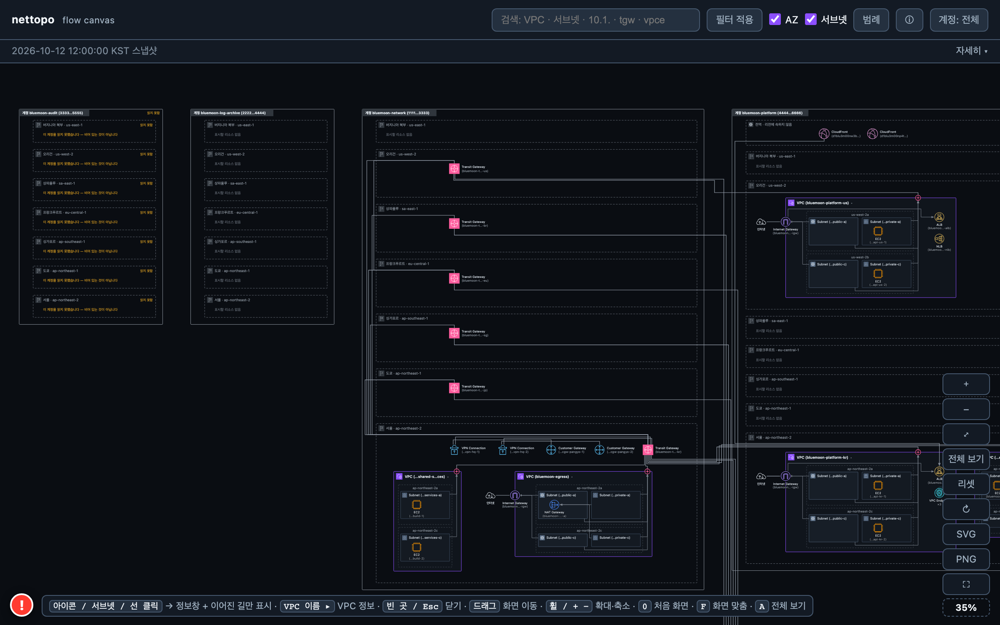
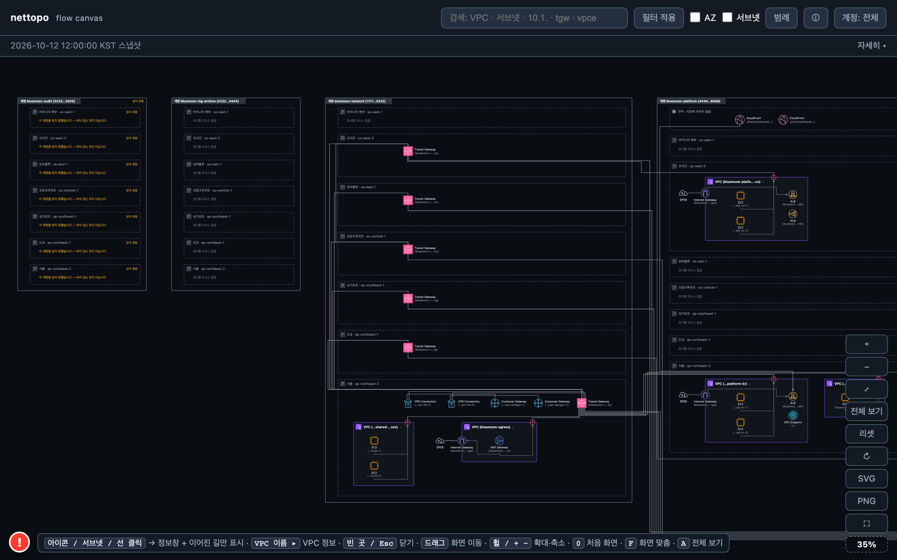

# 시나리오 B — 게임사 「블루문 게임즈」 (글로벌 라이브 서비스)

시연·QA 용 **가상 고객 구성**입니다. 회사·계정·주소는 모두 가상이고(계정 ID 는 AWS 문서 예시 계열, IP 는 문서용 대역), 구성 모양은 AWS 공개 참조 아키텍처(Multi-VPC 백서, Security Reference Architecture 의 네트워크 계정, Transit Gateway 인터리전 피어링 블로그)와 국내 기업 관행을 따랐습니다. 리전당 VPC 를 가진 계정은 최대 3개입니다.

판교 본사에서 라이브 타이틀 3개를 운영하는 게임사입니다. 플레이어 지연을 줄이기 위해 게임 서버는 **6개 리전**(서울·오레곤·도쿄·싱가포르·프랑크푸르트·상파울루)에 두고, 계정·결제·인증 같은 공통 플랫폼은 서울·오레곤 두 리전에 둡니다. 데이터 레이크는 서울 한 곳입니다.

온프레미스 데이터센터는 없고 본사 사무실만 Site-to-Site VPN 으로 붙습니다. 타이틀 계정은 **대륙별**(APAC · AMER · EMEA)이라 한 계정이 여러 리전에 걸칩니다.

- 수집 결과 JSON(화면의 입력): `scenario-game.json` — 아래 §4 의 리소스 목록은 이 파일에서 뽑았습니다.
- 기대 결과 화면: `scenario-game.html`(브라우저에서 더블클릭으로 열림) · 스크린샷 `scenario-game-overview.png`(전체) · `scenario-game-compact.png`(AZ·서브넷 접기) — §6.

## 1. 계정

| 계정 이름 | 계정 ID | 역할 |
|---|---|---|
| bluemoon-network | 111122223333 | 네트워크 허브. 리전마다 Transit Gateway 1대(6대), 리전 간 피어링 6개, 서울 Egress VPC·공유 서비스(빌드 팜) |
| bluemoon-platform | 444455556666 | 공통 플랫폼. 서울·오레곤 플랫폼 VPC(공개 ALB + API 서버), 서울 데이터 레이크·스테이지 VPC, CloudFront 2개 |
| bluemoon-title-apac | 555566667777 | 서울·도쿄·싱가포르 라이브 VPC + 서울 QA VPC. 도쿄에서 일본 퍼블리셔와 VPC 피어링 |
| bluemoon-title-amer | 777788889999 | 오레곤·상파울루 라이브 VPC |
| bluemoon-title-emea | 888899990000 | 프랑크푸르트 라이브 VPC |
| bluemoon-log-archive | 222233334444 | 로그 보관 전용. VPC 없음 |
| bluemoon-audit | 333344445555 | 감사 전용. 읽기 역할 미배포 — 전부 읽지 못함 |

## 2. 리전

| 리전 | 코드 | 역할 |
|---|---|---|
| 서울 | ap-northeast-2 | 플랫폼 주 리전 · 데이터 레이크 · 게임 KR · 본사 VPN. 다른 5개 리전 Transit Gateway 와 전부 피어링 |
| 오레곤 | us-west-2 | 플랫폼 부 리전 · 게임 NA · 북미 퍼블리셔용 PrivateLink 제공 NLB. 서울·프랑크푸르트와 피어링 |
| 도쿄 | ap-northeast-1 | 게임 JP · 일본 퍼블리셔 VPC 피어링(상대 계정은 수집 범위 밖) |
| 싱가포르 | ap-southeast-1 | 게임 SEA |
| 프랑크푸르트 | eu-central-1 | 게임 EU. 서울·오레곤과 피어링 |
| 상파울루 | sa-east-1 | 게임 LATAM |
| 버지니아 북부 | us-east-1 | VPC 없음. CloudFront 2개가 속한 글로벌 자리 |

## 3. 구성 의도

- **리전마다 Transit Gateway 1대, 피어링 6개** — 서울-{오레곤·도쿄·싱가포르·프랑크푸르트·상파울루} 5 + 오레곤-프랑크푸르트 1. Transit Gateway 피어링은 한 번만 건너갈 수 있으므로(중계 불가) 오레곤 플랫폼은 서울과 프랑크푸르트에서만 바로 갑니다.
- **라우팅 테이블 live · platform · shared** — live 는 같은 리전 플랫폼과 서울 플랫폼·데이터 레이크로만 가고, 다른 타이틀 리전으로는 경로가 없습니다. 서울 밖 live 테이블에서는 QA 대역(10.10.240.0/20)을 블랙홀로 막았습니다.
- **플레이어 트래픽** — 리전마다 인터넷 대면 Network Load Balancer(UDP 7777)가 게임 서버 앞에 섭니다. 실제 서비스에서는 그 앞에 AWS Global Accelerator 가 있지만, Global Accelerator 는 아직 수집 대상이 아니어서 이 스냅샷에는 없습니다.
- **게임 VPC 는 자기 NAT 게이트웨이로 인터넷에 나갑니다**(리전 간 피어링으로 서울 Egress 를 쓰지 않음). 서울 Egress VPC 는 플랫폼·QA·공유 서비스용입니다.
- **다른 계정과의 연결** — 모든 라이브·플랫폼 VPC 는 Network 계정의 Transit Gateway 에 붙습니다(연결 리소스는 VPC 소유 계정, Transit Gateway 는 Network 계정). 도쿄 라이브 VPC 는 조직 밖 일본 퍼블리셔 계정의 VPC 와 피어링되어 있어 상대 VPC 는 「수집 범위 밖」으로만 보입니다.
- **PrivateLink 제공** — 오레곤 플랫폼 VPC 의 내부 NLB 가 북미 퍼블리셔에게 VPC 엔드포인트 서비스로 제공됩니다. 엔드포인트 서비스 자체는 수집 대상이 아니라 NLB 만 보입니다.
- **CloudFront 2개**(Platform 소유, 글로벌) — 런처·웹 API 배포의 원본은 서울 플랫폼 ALB, 패치 배포의 원본은 S3 버킷(S3 원본은 선으로 그리지 않음).

**이 스냅샷에 없는 것(아직 수집 대상이 아닌 종류)**

- AWS Global Accelerator(플레이어 트래픽 진입점) — 종류가 아직 없어 화면에 없습니다.
- VPC 엔드포인트 서비스(PrivateLink 제공자 쪽) — 제공 NLB 만 보입니다.
- Resource Access Manager 공유 자체, Route 53 레코드.

## 4. 리소스 목록 (수집 결과 JSON 과 같은 내용)

| 종류 | 개수 |
|---|---|
| VPC | 13 |
| 서브넷 | 44 |
| 라우팅 테이블 | 22 |
| 인터넷 게이트웨이 | 9 |
| NAT 게이트웨이 | 7 |
| VPC 엔드포인트 | 9 |
| 로드 밸런서 | 9 |
| EC2 인스턴스 | 19 |
| 보안 그룹 | 22 |
| 네트워크 ACL | 13 |
| Transit Gateway | 6 |
| Transit Gateway 연결(attachment) | 21 |
| Transit Gateway 라우팅 테이블 | 9 |
| VPC 피어링 연결 | 1 |
| 고객 게이트웨이 | 2 |
| Site-to-Site VPN 연결 | 2 |
| CloudFront 배포 | 2 |

### 4.1 계정 bluemoon-network (111122223333)

#### 서울 (ap-northeast-2)

**VPC** (2)

| 이름 | CIDR | 서브넷 | 라우팅 테이블 | 보안 그룹 | 네트워크 ACL |
|---|---|---|---|---|---|
| bluemoon-egress | 10.0.4.0/22 | 4 | 2 | 1 | 1 |
| bluemoon-shared-services | 10.0.16.0/22 | 2 | 1 | 1 | 1 |

**서브넷** (6)

| 이름 | VPC | 가용 영역 | CIDR | 퍼블릭 IP 자동 할당 |
|---|---|---|---|---|
| bluemoon-egress-private-a | bluemoon-egress | ap-northeast-2a | 10.0.6.0/24 | 아니오 |
| bluemoon-egress-private-c | bluemoon-egress | ap-northeast-2c | 10.0.7.0/24 | 아니오 |
| bluemoon-egress-public-a | bluemoon-egress | ap-northeast-2a | 10.0.4.0/24 | 예 |
| bluemoon-egress-public-c | bluemoon-egress | ap-northeast-2c | 10.0.5.0/24 | 예 |
| bluemoon-shared-services-a | bluemoon-shared-services | ap-northeast-2a | 10.0.16.0/24 | 아니오 |
| bluemoon-shared-services-c | bluemoon-shared-services | ap-northeast-2c | 10.0.17.0/24 | 아니오 |

**라우팅 테이블** (3)

| 이름 | VPC | 메인 | 연결된 서브넷 | 라우트 (목적지 → 대상) |
|---|---|---|---|---|
| bluemoon-egress-private-rtb | bluemoon-egress |  | bluemoon-egress-private-a, bluemoon-egress-private-c | 0.0.0.0/0 → NAT 게이트웨이 bluemoon-egress-nat-a<br>10.0.0.0/8 → Transit Gateway bluemoon-tgw-kr |
| bluemoon-egress-public-rtb | bluemoon-egress |  | bluemoon-egress-public-c, bluemoon-egress-public-a | 0.0.0.0/0 → 인터넷 게이트웨이 bluemoon-egress-igw<br>10.0.0.0/8 → Transit Gateway bluemoon-tgw-kr |
| bluemoon-shared-services-rtb | bluemoon-shared-services |  | bluemoon-shared-services-c, bluemoon-shared-services-a | 0.0.0.0/0 → Transit Gateway bluemoon-tgw-kr |

**인터넷 게이트웨이** (1)

| 이름 | 연결된 VPC | 상태 |
|---|---|---|
| bluemoon-egress-igw | bluemoon-egress | attached |

**NAT 게이트웨이** (1)

| 이름 | 서브넷 | 탄력적 IP | 종류 |
|---|---|---|---|
| bluemoon-egress-nat-a | bluemoon-egress-public-a | 192.0.2.94 | public |

**EC2 인스턴스** (2)

| 이름 | 인스턴스 유형 | 서브넷 | 가용 영역 | 사설 IP | 상태 |
|---|---|---|---|---|---|
| bluemoon-build-1 | c6i.2xlarge | bluemoon-shared-services-a | ap-northeast-2a | 10.0.16.31 | running |
| bluemoon-build-2 | c6i.2xlarge | bluemoon-shared-services-c | ap-northeast-2c | 10.0.17.31 | running |

**보안 그룹** (2)

| 이름 | VPC | 설명 | 인바운드 규칙 | 아웃바운드 규칙 | 다른 보안 그룹 참조 |
|---|---|---|---|---|---|
| bluemoon-egress-app-sg | bluemoon-egress | bluemoon-egress servers | 2 | 1 | - |
| bluemoon-shared-services-app-sg | bluemoon-shared-services | bluemoon-shared-services application tier | 2 | 1 | - |

**네트워크 ACL** (2)

| ID | VPC | 기본 | 규칙 수 | 연결된 서브넷 수 |
|---|---|---|---|---|
| acl-4444cccccf1111f00 | bluemoon-shared-services | 기본 | 4 | 2 |
| acl-ddddfaaaadeeeed44 | bluemoon-egress | 기본 | 4 | 4 |

**Transit Gateway** (1)

| 이름 | Amazon 쪽 ASN | 연결 수 | 라우팅 테이블 수 |
|---|---|---|---|
| bluemoon-tgw-kr | 64512 | 14 | 3 |

**Transit Gateway 연결(attachment)** (8)

| 이름 | 종류 | 대상 | Transit Gateway | 상태 | 비고 |
|---|---|---|---|---|---|
| att-egress | VPC | bluemoon-egress | bluemoon-tgw-kr | available | - |
| att-peer-kr-br | Transit Gateway 피어링 | 상대 Transit Gateway bluemoon-tgw-br (sa-east-1) | bluemoon-tgw-kr | available | 상대 리전 응답에도 나옴: 111122223333/sa-east-1 |
| att-peer-kr-eu | Transit Gateway 피어링 | 상대 Transit Gateway bluemoon-tgw-eu (eu-central-1) | bluemoon-tgw-kr | available | 상대 리전 응답에도 나옴: 111122223333/eu-central-1 |
| att-peer-kr-sg | Transit Gateway 피어링 | 상대 Transit Gateway bluemoon-tgw-sg (ap-southeast-1) | bluemoon-tgw-kr | available | 상대 리전 응답에도 나옴: 111122223333/ap-southeast-1 |
| att-peer-kr-us | Transit Gateway 피어링 | 상대 Transit Gateway bluemoon-tgw-us (us-west-2) | bluemoon-tgw-kr | available | 상대 리전 응답에도 나옴: 111122223333/us-west-2 |
| att-shared | VPC | bluemoon-shared-services | bluemoon-tgw-kr | available | - |
| att-vpn-hq-1 | VPN | bluemoon-vpn-hq-1 | bluemoon-tgw-kr | available | - |
| att-vpn-hq-2 | VPN | bluemoon-vpn-hq-2 | bluemoon-tgw-kr | available | - |

**Transit Gateway 라우팅 테이블** (3)

| 이름 | Transit Gateway | 연결(association) | 전파(propagation) | 라우트 (목적지 → 연결) | 블랙홀 |
|---|---|---|---|---|---|
| bluemoon-tgw-rtb-kr-live | bluemoon-tgw-kr | att-live-kr | att-live-kr | 0.0.0.0/0 (정적) → att-egress<br>10.101.0.0/20 (정적) → att-peer-kr-us<br>10.100.16.0/20 → att-datalake<br>10.100.0.0/20 → att-platform-kr | - |
| bluemoon-tgw-rtb-kr-platform | bluemoon-tgw-kr | att-datalake, att-platform-stage, att-platform-kr | att-live-kr | 10.11.0.0/20 (정적) → att-peer-kr-jp<br>10.0.16.0/22 → att-shared<br>0.0.0.0/0 (정적) → att-egress<br>10.20.0.0/20 (정적) → att-peer-kr-us<br>10.30.0.0/20 (정적) → att-peer-kr-eu<br>10.12.0.0/20 (정적) → att-peer-kr-sg<br>10.21.0.0/20 (정적) → att-peer-kr-br<br>10.10.0.0/20 → att-live-kr<br>10.10.240.0/20 → att-qa | - |
| bluemoon-tgw-rtb-kr-shared | bluemoon-tgw-kr | att-shared, att-egress, att-qa | att-live-kr, att-datalake, att-platform-stage, att-platform-kr | 10.100.16.0/20 → att-datalake<br>10.100.32.0/20 → att-platform-stage<br>10.100.0.0/20 → att-platform-kr<br>10.10.0.0/20 → att-live-kr<br>10.10.240.0/20 → att-qa | - |

**고객 게이트웨이** (2)

| 이름 | IP 주소 | BGP ASN | 장비 | 상태 |
|---|---|---|---|---|
| bluemoon-cgw-pangyo-1 | 203.0.113.21 | 65011 | pangyo-fw-1 | available |
| bluemoon-cgw-pangyo-2 | 203.0.113.22 | 65011 | pangyo-fw-2 | available |

**Site-to-Site VPN 연결** (2)

| 이름 | 고객 게이트웨이 | 연결 대상 | 터널 수 | 터널 바깥 IP | 라우팅 | 상태 |
|---|---|---|---|---|---|---|
| bluemoon-vpn-hq-1 | bluemoon-cgw-pangyo-1 | Transit Gateway bluemoon-tgw-kr | 2 | 198.51.100.31, 198.51.100.32 | BGP | available |
| bluemoon-vpn-hq-2 | bluemoon-cgw-pangyo-2 | Transit Gateway bluemoon-tgw-kr | 2 | 198.51.100.41, 198.51.100.42 | BGP | available |

#### 오레곤 (us-west-2)

**Transit Gateway** (1)

| 이름 | Amazon 쪽 ASN | 연결 수 | 라우팅 테이블 수 |
|---|---|---|---|
| bluemoon-tgw-us | 64513 | 4 | 2 |

**Transit Gateway 라우팅 테이블** (2)

| 이름 | Transit Gateway | 연결(association) | 전파(propagation) | 라우트 (목적지 → 연결) | 블랙홀 |
|---|---|---|---|---|---|
| bluemoon-tgw-rtb-us-live | bluemoon-tgw-us | att-live-us | att-live-us | 10.100.0.0/20 (정적), 10.100.16.0/20 (정적) → att-peer-kr-us<br>10.101.0.0/20 → att-platform-us | 10.10.240.0/20 |
| bluemoon-tgw-rtb-us-platform | bluemoon-tgw-us | att-platform-us | att-live-us | 10.10.0.0/20 (정적) → att-peer-kr-us<br>10.30.0.0/20 (정적) → att-peer-us-eu<br>10.20.0.0/20 → att-live-us | - |

#### 도쿄 (ap-northeast-1)

**Transit Gateway** (1)

| 이름 | Amazon 쪽 ASN | 연결 수 | 라우팅 테이블 수 |
|---|---|---|---|
| bluemoon-tgw-jp | 64514 | 2 | 1 |

**Transit Gateway 연결(attachment)** (1)

| 이름 | 종류 | 대상 | Transit Gateway | 상태 | 비고 |
|---|---|---|---|---|---|
| att-peer-kr-jp | Transit Gateway 피어링 | 상대 Transit Gateway bluemoon-tgw-kr (ap-northeast-2) | bluemoon-tgw-jp | available | 상대 리전 응답에도 나옴: 111122223333/ap-northeast-2 |

**Transit Gateway 라우팅 테이블** (1)

| 이름 | Transit Gateway | 연결(association) | 전파(propagation) | 라우트 (목적지 → 연결) | 블랙홀 |
|---|---|---|---|---|---|
| bluemoon-tgw-rtb-jp-live | bluemoon-tgw-jp | att-live-jp | att-live-jp | 10.100.0.0/20 (정적), 10.100.16.0/20 (정적) → att-peer-kr-jp | 10.10.240.0/20 |

#### 싱가포르 (ap-southeast-1)

**Transit Gateway** (1)

| 이름 | Amazon 쪽 ASN | 연결 수 | 라우팅 테이블 수 |
|---|---|---|---|
| bluemoon-tgw-sg | 64515 | 2 | 1 |

**Transit Gateway 라우팅 테이블** (1)

| 이름 | Transit Gateway | 연결(association) | 전파(propagation) | 라우트 (목적지 → 연결) | 블랙홀 |
|---|---|---|---|---|---|
| bluemoon-tgw-rtb-sg-live | bluemoon-tgw-sg | att-live-sg | att-live-sg | 10.100.0.0/20 (정적), 10.100.16.0/20 (정적) → att-peer-kr-sg | 10.10.240.0/20 |

#### 프랑크푸르트 (eu-central-1)

**Transit Gateway** (1)

| 이름 | Amazon 쪽 ASN | 연결 수 | 라우팅 테이블 수 |
|---|---|---|---|
| bluemoon-tgw-eu | 64516 | 3 | 1 |

**Transit Gateway 연결(attachment)** (1)

| 이름 | 종류 | 대상 | Transit Gateway | 상태 | 비고 |
|---|---|---|---|---|---|
| att-peer-us-eu | Transit Gateway 피어링 | 상대 Transit Gateway bluemoon-tgw-us (us-west-2) | bluemoon-tgw-eu | available | 상대 리전 응답에도 나옴: 111122223333/us-west-2 |

**Transit Gateway 라우팅 테이블** (1)

| 이름 | Transit Gateway | 연결(association) | 전파(propagation) | 라우트 (목적지 → 연결) | 블랙홀 |
|---|---|---|---|---|---|
| bluemoon-tgw-rtb-eu-live | bluemoon-tgw-eu | att-live-eu | att-live-eu | 10.100.0.0/20 (정적), 10.100.16.0/20 (정적) → att-peer-kr-eu<br>10.101.0.0/20 (정적) → att-peer-us-eu | 10.10.240.0/20 |

#### 상파울루 (sa-east-1)

**Transit Gateway** (1)

| 이름 | Amazon 쪽 ASN | 연결 수 | 라우팅 테이블 수 |
|---|---|---|---|
| bluemoon-tgw-br | 64517 | 2 | 1 |

**Transit Gateway 라우팅 테이블** (1)

| 이름 | Transit Gateway | 연결(association) | 전파(propagation) | 라우트 (목적지 → 연결) | 블랙홀 |
|---|---|---|---|---|---|
| bluemoon-tgw-rtb-br-live | bluemoon-tgw-br | att-live-br | att-live-br | 10.100.0.0/20 (정적), 10.100.16.0/20 (정적) → att-peer-kr-br | 10.10.240.0/20 |

### 4.2 계정 bluemoon-log-archive (222233334444)

리소스 없음 — 모든 리전에서 수집은 성공했고(`ok`) 개수가 0 입니다. 화면에서는 빈 리전 3개로 나옵니다.

### 4.3 계정 bluemoon-audit (333344445555)

모든 리전·종류를 **읽지 못했습니다** — 사유: `sts:AssumeRole` access_denied ("role NetworkReadOnlyRole is not deployed in this account"). 화면에서는 이 계정의 세 리전이 「읽지 못함」으로 표시됩니다.

### 4.4 계정 bluemoon-platform (444455556666)

#### 글로벌 (리전에 속하지 않음)

**CloudFront 배포**

| 배포 도메인 | 대체 도메인 | 원본 | WAF | 가격 클래스 |
|---|---|---|---|---|
| d1blu3m00nw3b.cloudfront.net | api.bluemoon.example | bluemoon-platform-kr-alb-eeeeebbbba.ap-northeast-2.elb.amazonaws.com = 로드 밸런서 bluemoon-platform-kr-alb | 있음 | PriceClass_200 |
| d1blu3m00np4tch.cloudfront.net | patch.bluemoon.example | bluemoon-patch-origin.s3.ap-northeast-2.amazonaws.com | 없음 | PriceClass_All |

#### 서울 (ap-northeast-2)

**VPC** (3)

| 이름 | CIDR | 서브넷 | 라우팅 테이블 | 보안 그룹 | 네트워크 ACL |
|---|---|---|---|---|---|
| bluemoon-datalake | 10.100.16.0/20 | 2 | 1 | 1 | 1 |
| bluemoon-platform-kr | 10.100.0.0/20 | 4 | 2 | 2 | 1 |
| bluemoon-platform-stage | 10.100.32.0/20 | 2 | 1 | 1 | 1 |

**서브넷** (8)

| 이름 | VPC | 가용 영역 | CIDR | 퍼블릭 IP 자동 할당 |
|---|---|---|---|---|
| bluemoon-datalake-a | bluemoon-datalake | ap-northeast-2a | 10.100.16.0/24 | 아니오 |
| bluemoon-datalake-c | bluemoon-datalake | ap-northeast-2c | 10.100.17.0/24 | 아니오 |
| bluemoon-platform-kr-private-a | bluemoon-platform-kr | ap-northeast-2a | 10.100.2.0/24 | 아니오 |
| bluemoon-platform-kr-private-c | bluemoon-platform-kr | ap-northeast-2c | 10.100.3.0/24 | 아니오 |
| bluemoon-platform-kr-public-a | bluemoon-platform-kr | ap-northeast-2a | 10.100.0.0/24 | 예 |
| bluemoon-platform-kr-public-c | bluemoon-platform-kr | ap-northeast-2c | 10.100.1.0/24 | 예 |
| bluemoon-platform-stage-a | bluemoon-platform-stage | ap-northeast-2a | 10.100.32.0/24 | 아니오 |
| bluemoon-platform-stage-c | bluemoon-platform-stage | ap-northeast-2c | 10.100.33.0/24 | 아니오 |

**라우팅 테이블** (4)

| 이름 | VPC | 메인 | 연결된 서브넷 | 라우트 (목적지 → 대상) |
|---|---|---|---|---|
| bluemoon-datalake-rtb | bluemoon-datalake |  | bluemoon-datalake-a, bluemoon-datalake-c | 0.0.0.0/0 → Transit Gateway bluemoon-tgw-kr (bluemoon-network 계정) |
| bluemoon-platform-kr-private-rtb | bluemoon-platform-kr |  | bluemoon-platform-kr-private-a, bluemoon-platform-kr-private-c | 10.0.0.0/8 → Transit Gateway bluemoon-tgw-kr (bluemoon-network 계정) |
| bluemoon-platform-kr-public-rtb | bluemoon-platform-kr |  | bluemoon-platform-kr-public-c, bluemoon-platform-kr-public-a | 0.0.0.0/0 → 인터넷 게이트웨이 bluemoon-platform-kr-igw<br>10.0.0.0/8 → Transit Gateway bluemoon-tgw-kr (bluemoon-network 계정) |
| bluemoon-platform-stage-rtb | bluemoon-platform-stage |  | bluemoon-platform-stage-a, bluemoon-platform-stage-c | 0.0.0.0/0 → Transit Gateway bluemoon-tgw-kr (bluemoon-network 계정) |

**인터넷 게이트웨이** (1)

| 이름 | 연결된 VPC | 상태 |
|---|---|---|
| bluemoon-platform-kr-igw | bluemoon-platform-kr | attached |

**VPC 엔드포인트** (3)

| 이름 | VPC | 종류 | 서비스 | 서브넷 / 라우팅 테이블 | 상태 |
|---|---|---|---|---|---|
| bluemoon-vpce-ec2messages | bluemoon-platform-kr | Interface | com.amazonaws.ap-northeast-2.ec2messages | bluemoon-platform-kr-private-a, bluemoon-platform-kr-private-c | available |
| bluemoon-vpce-ssm | bluemoon-platform-kr | Interface | com.amazonaws.ap-northeast-2.ssm | bluemoon-platform-kr-private-a, bluemoon-platform-kr-private-c | available |
| bluemoon-vpce-ssmmessages | bluemoon-platform-kr | Interface | com.amazonaws.ap-northeast-2.ssmmessages | bluemoon-platform-kr-private-a, bluemoon-platform-kr-private-c | available |

**로드 밸런서** (1)

| 이름 | 종류 | 스킴 | VPC | 서브넷 | 리스너 | 대상 그룹 | WAF |
|---|---|---|---|---|---|---|---|
| bluemoon-platform-kr-alb | ALB | internet-facing | bluemoon-platform-kr | bluemoon-platform-kr-public-c, bluemoon-platform-kr-public-a | HTTPS:443 | bluemoon-platform-kr-tg | 있음 |

**EC2 인스턴스** (3)

| 이름 | 인스턴스 유형 | 서브넷 | 가용 영역 | 사설 IP | 상태 |
|---|---|---|---|---|---|
| bluemoon-api-kr-1 | m6i.xlarge | bluemoon-platform-kr-private-a | ap-northeast-2a | 10.100.2.11 | running |
| bluemoon-api-kr-2 | m6i.xlarge | bluemoon-platform-kr-private-c | ap-northeast-2c | 10.100.3.11 | running |
| bluemoon-ingest-1 | r6i.2xlarge | bluemoon-datalake-a | ap-northeast-2a | 10.100.16.21 | running |

**보안 그룹** (4)

| 이름 | VPC | 설명 | 인바운드 규칙 | 아웃바운드 규칙 | 다른 보안 그룹 참조 |
|---|---|---|---|---|---|
| bluemoon-datalake-app-sg | bluemoon-datalake | bluemoon-datalake application tier | 2 | 1 | - |
| bluemoon-platform-kr-alb-sg | bluemoon-platform-kr | internet-facing ALB | 2 | 1 | egress → bluemoon-platform-kr-app-sg: tcp/8080-8080 |
| bluemoon-platform-kr-app-sg | bluemoon-platform-kr | bluemoon-platform-kr servers | 2 | 1 | - |
| bluemoon-platform-stage-app-sg | bluemoon-platform-stage | bluemoon-platform-stage application tier | 2 | 1 | - |

**네트워크 ACL** (3)

| ID | VPC | 기본 | 규칙 수 | 연결된 서브넷 수 |
|---|---|---|---|---|
| acl-0000f6666b1111aaa | bluemoon-platform-kr | 기본 | 4 | 4 |
| acl-bbbbd1111aaaaae66 | bluemoon-platform-stage | 기본 | 4 | 2 |
| acl-eeeedccccc0000c55 | bluemoon-datalake | 기본 | 4 | 2 |

**Transit Gateway 연결(attachment)** (3)

| 이름 | 종류 | 대상 | Transit Gateway | 상태 | 비고 |
|---|---|---|---|---|---|
| att-datalake | VPC | bluemoon-datalake | bluemoon-tgw-kr | available | Transit Gateway 는 bluemoon-network 계정 소유(RAM 공유) |
| att-platform-kr | VPC | bluemoon-platform-kr | bluemoon-tgw-kr | available | Transit Gateway 는 bluemoon-network 계정 소유(RAM 공유) |
| att-platform-stage | VPC | bluemoon-platform-stage | bluemoon-tgw-kr | available | Transit Gateway 는 bluemoon-network 계정 소유(RAM 공유) |

#### 오레곤 (us-west-2)

**VPC** (1)

| 이름 | CIDR | 서브넷 | 라우팅 테이블 | 보안 그룹 | 네트워크 ACL |
|---|---|---|---|---|---|
| bluemoon-platform-us | 10.101.0.0/20 | 4 | 2 | 3 | 1 |

**서브넷** (4)

| 이름 | VPC | 가용 영역 | CIDR | 퍼블릭 IP 자동 할당 |
|---|---|---|---|---|
| bluemoon-platform-us-private-a | bluemoon-platform-us | us-west-2a | 10.101.2.0/24 | 아니오 |
| bluemoon-platform-us-private-c | bluemoon-platform-us | us-west-2b | 10.101.3.0/24 | 아니오 |
| bluemoon-platform-us-public-a | bluemoon-platform-us | us-west-2a | 10.101.0.0/24 | 예 |
| bluemoon-platform-us-public-c | bluemoon-platform-us | us-west-2b | 10.101.1.0/24 | 예 |

**라우팅 테이블** (2)

| 이름 | VPC | 메인 | 연결된 서브넷 | 라우트 (목적지 → 대상) |
|---|---|---|---|---|
| bluemoon-platform-us-private-rtb | bluemoon-platform-us |  | bluemoon-platform-us-private-c, bluemoon-platform-us-private-a | 10.0.0.0/8 → Transit Gateway bluemoon-tgw-us (bluemoon-network 계정) |
| bluemoon-platform-us-public-rtb | bluemoon-platform-us |  | bluemoon-platform-us-public-a, bluemoon-platform-us-public-c | 0.0.0.0/0 → 인터넷 게이트웨이 bluemoon-platform-us-igw<br>10.0.0.0/8 → Transit Gateway bluemoon-tgw-us (bluemoon-network 계정) |

**인터넷 게이트웨이** (1)

| 이름 | 연결된 VPC | 상태 |
|---|---|---|
| bluemoon-platform-us-igw | bluemoon-platform-us | attached |

**로드 밸런서** (2)

| 이름 | 종류 | 스킴 | VPC | 서브넷 | 리스너 | 대상 그룹 | WAF |
|---|---|---|---|---|---|---|---|
| bluemoon-partner-nlb | NLB | internal | bluemoon-platform-us | bluemoon-platform-us-private-c, bluemoon-platform-us-private-a | TCP:443 | bluemoon-partner-tg | - |
| bluemoon-platform-us-alb | ALB | internet-facing | bluemoon-platform-us | bluemoon-platform-us-public-a, bluemoon-platform-us-public-c | HTTPS:443 | bluemoon-platform-us-tg | 있음 |

**EC2 인스턴스** (2)

| 이름 | 인스턴스 유형 | 서브넷 | 가용 영역 | 사설 IP | 상태 |
|---|---|---|---|---|---|
| bluemoon-api-us-1 | m6i.xlarge | bluemoon-platform-us-private-a | us-west-2a | 10.101.2.11 | running |
| bluemoon-api-us-2 | m6i.xlarge | bluemoon-platform-us-private-c | us-west-2b | 10.101.3.11 | running |

**보안 그룹** (3)

| 이름 | VPC | 설명 | 인바운드 규칙 | 아웃바운드 규칙 | 다른 보안 그룹 참조 |
|---|---|---|---|---|---|
| bluemoon-partner-nlb-sg | bluemoon-platform-us | PrivateLink provider NLB | 1 | 1 | - |
| bluemoon-platform-us-alb-sg | bluemoon-platform-us | internet-facing ALB | 2 | 1 | egress → bluemoon-platform-us-app-sg: tcp/8080-8080 |
| bluemoon-platform-us-app-sg | bluemoon-platform-us | bluemoon-platform-us servers | 2 | 1 | - |

**네트워크 ACL** (1)

| ID | VPC | 기본 | 규칙 수 | 연결된 서브넷 수 |
|---|---|---|---|---|
| acl-2222ebbbbbaaaafee | bluemoon-platform-us | 기본 | 4 | 4 |

**Transit Gateway 연결(attachment)** (1)

| 이름 | 종류 | 대상 | Transit Gateway | 상태 | 비고 |
|---|---|---|---|---|---|
| att-platform-us | VPC | bluemoon-platform-us | bluemoon-tgw-us | available | Transit Gateway 는 bluemoon-network 계정 소유(RAM 공유) |

### 4.5 계정 bluemoon-title-apac (555566667777)

#### 서울 (ap-northeast-2)

**VPC** (2)

| 이름 | CIDR | 서브넷 | 라우팅 테이블 | 보안 그룹 | 네트워크 ACL |
|---|---|---|---|---|---|
| bluemoon-live-kr | 10.10.0.0/20 | 4 | 2 | 2 | 1 |
| bluemoon-qa | 10.10.240.0/20 | 2 | 1 | 1 | 1 |

**서브넷** (6)

| 이름 | VPC | 가용 영역 | CIDR | 퍼블릭 IP 자동 할당 |
|---|---|---|---|---|
| bluemoon-live-kr-private-a | bluemoon-live-kr | ap-northeast-2a | 10.10.2.0/24 | 아니오 |
| bluemoon-live-kr-private-c | bluemoon-live-kr | ap-northeast-2c | 10.10.3.0/24 | 아니오 |
| bluemoon-live-kr-public-a | bluemoon-live-kr | ap-northeast-2a | 10.10.0.0/24 | 예 |
| bluemoon-live-kr-public-c | bluemoon-live-kr | ap-northeast-2c | 10.10.1.0/24 | 예 |
| bluemoon-qa-a | bluemoon-qa | ap-northeast-2a | 10.10.240.0/24 | 아니오 |
| bluemoon-qa-c | bluemoon-qa | ap-northeast-2c | 10.10.241.0/24 | 아니오 |

**라우팅 테이블** (3)

| 이름 | VPC | 메인 | 연결된 서브넷 | 라우트 (목적지 → 대상) |
|---|---|---|---|---|
| bluemoon-live-kr-private-rtb | bluemoon-live-kr |  | bluemoon-live-kr-private-c, bluemoon-live-kr-private-a | 0.0.0.0/0 → NAT 게이트웨이 bluemoon-live-kr-nat-a<br>10.0.0.0/8 → Transit Gateway bluemoon-tgw-kr (bluemoon-network 계정) |
| bluemoon-live-kr-public-rtb | bluemoon-live-kr |  | bluemoon-live-kr-public-c, bluemoon-live-kr-public-a | 0.0.0.0/0 → 인터넷 게이트웨이 bluemoon-live-kr-igw<br>10.0.0.0/8 → Transit Gateway bluemoon-tgw-kr (bluemoon-network 계정) |
| bluemoon-qa-rtb | bluemoon-qa |  | bluemoon-qa-a, bluemoon-qa-c | 0.0.0.0/0 → Transit Gateway bluemoon-tgw-kr (bluemoon-network 계정) |

**인터넷 게이트웨이** (1)

| 이름 | 연결된 VPC | 상태 |
|---|---|---|
| bluemoon-live-kr-igw | bluemoon-live-kr | attached |

**NAT 게이트웨이** (1)

| 이름 | 서브넷 | 탄력적 IP | 종류 |
|---|---|---|---|
| bluemoon-live-kr-nat-a | bluemoon-live-kr-public-a | 192.0.2.120 | public |

**VPC 엔드포인트** (1)

| 이름 | VPC | 종류 | 서비스 | 서브넷 / 라우팅 테이블 | 상태 |
|---|---|---|---|---|---|
| bluemoon-live-kr-s3 | bluemoon-live-kr | Gateway | com.amazonaws.ap-northeast-2.s3 | bluemoon-live-kr-private-rtb | available |

**로드 밸런서** (1)

| 이름 | 종류 | 스킴 | VPC | 서브넷 | 리스너 | 대상 그룹 | WAF |
|---|---|---|---|---|---|---|---|
| bluemoon-live-kr-nlb | NLB | internet-facing | bluemoon-live-kr | bluemoon-live-kr-public-c, bluemoon-live-kr-public-a | UDP:7777, TCP:7778 | bluemoon-live-kr-tg | - |

**EC2 인스턴스** (2)

| 이름 | 인스턴스 유형 | 서브넷 | 가용 영역 | 사설 IP | 상태 |
|---|---|---|---|---|---|
| bluemoon-live-kr-game-1 | c6i.4xlarge | bluemoon-live-kr-private-a | ap-northeast-2a | 10.10.2.21 | running |
| bluemoon-live-kr-game-2 | c6i.4xlarge | bluemoon-live-kr-private-c | ap-northeast-2c | 10.10.3.21 | running |

**보안 그룹** (3)

| 이름 | VPC | 설명 | 인바운드 규칙 | 아웃바운드 규칙 | 다른 보안 그룹 참조 |
|---|---|---|---|---|---|
| bluemoon-live-kr-app-sg | bluemoon-live-kr | bluemoon-live-kr servers | 2 | 1 | - |
| bluemoon-live-kr-nlb-sg | bluemoon-live-kr | game traffic NLB (UDP) | 1 | 1 | - |
| bluemoon-qa-app-sg | bluemoon-qa | bluemoon-qa application tier | 2 | 1 | - |

**네트워크 ACL** (2)

| ID | VPC | 기본 | 규칙 수 | 연결된 서브넷 수 |
|---|---|---|---|---|
| acl-3333e1111c4444bee | bluemoon-live-kr | 기본 | 4 | 4 |
| acl-dddde5555d9999a99 | bluemoon-qa | 기본 | 4 | 2 |

**Transit Gateway 연결(attachment)** (2)

| 이름 | 종류 | 대상 | Transit Gateway | 상태 | 비고 |
|---|---|---|---|---|---|
| att-live-kr | VPC | bluemoon-live-kr | bluemoon-tgw-kr | available | Transit Gateway 는 bluemoon-network 계정 소유(RAM 공유) |
| att-qa | VPC | bluemoon-qa | bluemoon-tgw-kr | available | Transit Gateway 는 bluemoon-network 계정 소유(RAM 공유) |

#### 도쿄 (ap-northeast-1)

**VPC** (1)

| 이름 | CIDR | 서브넷 | 라우팅 테이블 | 보안 그룹 | 네트워크 ACL |
|---|---|---|---|---|---|
| bluemoon-live-jp | 10.11.0.0/20 | 4 | 2 | 2 | 1 |

**서브넷** (4)

| 이름 | VPC | 가용 영역 | CIDR | 퍼블릭 IP 자동 할당 |
|---|---|---|---|---|
| bluemoon-live-jp-private-a | bluemoon-live-jp | ap-northeast-1a | 10.11.2.0/24 | 아니오 |
| bluemoon-live-jp-private-c | bluemoon-live-jp | ap-northeast-1c | 10.11.3.0/24 | 아니오 |
| bluemoon-live-jp-public-a | bluemoon-live-jp | ap-northeast-1a | 10.11.0.0/24 | 예 |
| bluemoon-live-jp-public-c | bluemoon-live-jp | ap-northeast-1c | 10.11.1.0/24 | 예 |

**라우팅 테이블** (2)

| 이름 | VPC | 메인 | 연결된 서브넷 | 라우트 (목적지 → 대상) |
|---|---|---|---|---|
| bluemoon-live-jp-private-rtb | bluemoon-live-jp |  | bluemoon-live-jp-private-c, bluemoon-live-jp-private-a | 0.0.0.0/0 → NAT 게이트웨이 bluemoon-live-jp-nat-a<br>10.0.0.0/8 → Transit Gateway bluemoon-tgw-jp (bluemoon-network 계정) |
| bluemoon-live-jp-public-rtb | bluemoon-live-jp |  | bluemoon-live-jp-public-c, bluemoon-live-jp-public-a | 0.0.0.0/0 → 인터넷 게이트웨이 bluemoon-live-jp-igw<br>10.0.0.0/8 → Transit Gateway bluemoon-tgw-jp (bluemoon-network 계정) |

**인터넷 게이트웨이** (1)

| 이름 | 연결된 VPC | 상태 |
|---|---|---|
| bluemoon-live-jp-igw | bluemoon-live-jp | attached |

**NAT 게이트웨이** (1)

| 이름 | 서브넷 | 탄력적 IP | 종류 |
|---|---|---|---|
| bluemoon-live-jp-nat-a | bluemoon-live-jp-public-a | 192.0.2.123 | public |

**VPC 엔드포인트** (1)

| 이름 | VPC | 종류 | 서비스 | 서브넷 / 라우팅 테이블 | 상태 |
|---|---|---|---|---|---|
| bluemoon-live-jp-s3 | bluemoon-live-jp | Gateway | com.amazonaws.ap-northeast-1.s3 | bluemoon-live-jp-private-rtb | available |

**로드 밸런서** (1)

| 이름 | 종류 | 스킴 | VPC | 서브넷 | 리스너 | 대상 그룹 | WAF |
|---|---|---|---|---|---|---|---|
| bluemoon-live-jp-nlb | NLB | internet-facing | bluemoon-live-jp | bluemoon-live-jp-public-c, bluemoon-live-jp-public-a | UDP:7777, TCP:7778 | bluemoon-live-jp-tg | - |

**EC2 인스턴스** (2)

| 이름 | 인스턴스 유형 | 서브넷 | 가용 영역 | 사설 IP | 상태 |
|---|---|---|---|---|---|
| bluemoon-live-jp-game-1 | c6i.4xlarge | bluemoon-live-jp-private-a | ap-northeast-1a | 10.11.2.21 | running |
| bluemoon-live-jp-game-2 | c6i.4xlarge | bluemoon-live-jp-private-c | ap-northeast-1c | 10.11.3.21 | running |

**보안 그룹** (2)

| 이름 | VPC | 설명 | 인바운드 규칙 | 아웃바운드 규칙 | 다른 보안 그룹 참조 |
|---|---|---|---|---|---|
| bluemoon-live-jp-app-sg | bluemoon-live-jp | bluemoon-live-jp servers | 2 | 1 | - |
| bluemoon-live-jp-nlb-sg | bluemoon-live-jp | game traffic NLB (UDP) | 1 | 1 | - |

**네트워크 ACL** (1)

| ID | VPC | 기본 | 규칙 수 | 연결된 서브넷 수 |
|---|---|---|---|---|
| acl-aaaab7777affffacc | bluemoon-live-jp | 기본 | 4 | 4 |

**Transit Gateway 연결(attachment)** (1)

| 이름 | 종류 | 대상 | Transit Gateway | 상태 | 비고 |
|---|---|---|---|---|---|
| att-live-jp | VPC | bluemoon-live-jp | bluemoon-tgw-jp | available | Transit Gateway 는 bluemoon-network 계정 소유(RAM 공유) |

**VPC 피어링 연결** (1)

| 이름 | 요청자 VPC (계정 · 리전) | 요청자 CIDR | 수락자 VPC (계정 · 리전) | 수락자 CIDR | 상태 |
|---|---|---|---|---|---|
| bluemoon-jp-publisher-peering | bluemoon-live-jp (bluemoon-title-apac · ap-northeast-1) | 10.11.0.0/20 | vpc-7777fddddbdddde00 (999900001111 · 수집 범위 밖 · ap-northeast-1) | 172.20.0.0/16 | active |

#### 싱가포르 (ap-southeast-1)

**VPC** (1)

| 이름 | CIDR | 서브넷 | 라우팅 테이블 | 보안 그룹 | 네트워크 ACL |
|---|---|---|---|---|---|
| bluemoon-live-sg | 10.12.0.0/20 | 4 | 2 | 2 | 1 |

**서브넷** (4)

| 이름 | VPC | 가용 영역 | CIDR | 퍼블릭 IP 자동 할당 |
|---|---|---|---|---|
| bluemoon-live-sg-private-a | bluemoon-live-sg | ap-southeast-1a | 10.12.2.0/24 | 아니오 |
| bluemoon-live-sg-private-c | bluemoon-live-sg | ap-southeast-1b | 10.12.3.0/24 | 아니오 |
| bluemoon-live-sg-public-a | bluemoon-live-sg | ap-southeast-1a | 10.12.0.0/24 | 예 |
| bluemoon-live-sg-public-c | bluemoon-live-sg | ap-southeast-1b | 10.12.1.0/24 | 예 |

**라우팅 테이블** (2)

| 이름 | VPC | 메인 | 연결된 서브넷 | 라우트 (목적지 → 대상) |
|---|---|---|---|---|
| bluemoon-live-sg-private-rtb | bluemoon-live-sg |  | bluemoon-live-sg-private-a, bluemoon-live-sg-private-c | 0.0.0.0/0 → NAT 게이트웨이 bluemoon-live-sg-nat-a<br>10.0.0.0/8 → Transit Gateway bluemoon-tgw-sg (bluemoon-network 계정) |
| bluemoon-live-sg-public-rtb | bluemoon-live-sg |  | bluemoon-live-sg-public-c, bluemoon-live-sg-public-a | 0.0.0.0/0 → 인터넷 게이트웨이 bluemoon-live-sg-igw<br>10.0.0.0/8 → Transit Gateway bluemoon-tgw-sg (bluemoon-network 계정) |

**인터넷 게이트웨이** (1)

| 이름 | 연결된 VPC | 상태 |
|---|---|---|
| bluemoon-live-sg-igw | bluemoon-live-sg | attached |

**NAT 게이트웨이** (1)

| 이름 | 서브넷 | 탄력적 IP | 종류 |
|---|---|---|---|
| bluemoon-live-sg-nat-a | bluemoon-live-sg-public-a | 192.0.2.126 | public |

**VPC 엔드포인트** (1)

| 이름 | VPC | 종류 | 서비스 | 서브넷 / 라우팅 테이블 | 상태 |
|---|---|---|---|---|---|
| bluemoon-live-sg-s3 | bluemoon-live-sg | Gateway | com.amazonaws.ap-southeast-1.s3 | bluemoon-live-sg-private-rtb | available |

**로드 밸런서** (1)

| 이름 | 종류 | 스킴 | VPC | 서브넷 | 리스너 | 대상 그룹 | WAF |
|---|---|---|---|---|---|---|---|
| bluemoon-live-sg-nlb | NLB | internet-facing | bluemoon-live-sg | bluemoon-live-sg-public-c, bluemoon-live-sg-public-a | UDP:7777, TCP:7778 | bluemoon-live-sg-tg | - |

**EC2 인스턴스** (2)

| 이름 | 인스턴스 유형 | 서브넷 | 가용 영역 | 사설 IP | 상태 |
|---|---|---|---|---|---|
| bluemoon-live-sg-game-1 | c6i.4xlarge | bluemoon-live-sg-private-a | ap-southeast-1a | 10.12.2.21 | running |
| bluemoon-live-sg-game-2 | c6i.4xlarge | bluemoon-live-sg-private-c | ap-southeast-1b | 10.12.3.21 | running |

**보안 그룹** (2)

| 이름 | VPC | 설명 | 인바운드 규칙 | 아웃바운드 규칙 | 다른 보안 그룹 참조 |
|---|---|---|---|---|---|
| bluemoon-live-sg-app-sg | bluemoon-live-sg | bluemoon-live-sg servers | 2 | 1 | - |
| bluemoon-live-sg-nlb-sg | bluemoon-live-sg | game traffic NLB (UDP) | 1 | 1 | - |

**네트워크 ACL** (1)

| ID | VPC | 기본 | 규칙 수 | 연결된 서브넷 수 |
|---|---|---|---|---|
| acl-ffffb6666eaaaac66 | bluemoon-live-sg | 기본 | 4 | 4 |

**Transit Gateway 연결(attachment)** (1)

| 이름 | 종류 | 대상 | Transit Gateway | 상태 | 비고 |
|---|---|---|---|---|---|
| att-live-sg | VPC | bluemoon-live-sg | bluemoon-tgw-sg | available | Transit Gateway 는 bluemoon-network 계정 소유(RAM 공유) |

### 4.6 계정 bluemoon-title-amer (777788889999)

#### 오레곤 (us-west-2)

**VPC** (1)

| 이름 | CIDR | 서브넷 | 라우팅 테이블 | 보안 그룹 | 네트워크 ACL |
|---|---|---|---|---|---|
| bluemoon-live-us | 10.20.0.0/20 | 4 | 2 | 2 | 1 |

**서브넷** (4)

| 이름 | VPC | 가용 영역 | CIDR | 퍼블릭 IP 자동 할당 |
|---|---|---|---|---|
| bluemoon-live-us-private-a | bluemoon-live-us | us-west-2a | 10.20.2.0/24 | 아니오 |
| bluemoon-live-us-private-c | bluemoon-live-us | us-west-2b | 10.20.3.0/24 | 아니오 |
| bluemoon-live-us-public-a | bluemoon-live-us | us-west-2a | 10.20.0.0/24 | 예 |
| bluemoon-live-us-public-c | bluemoon-live-us | us-west-2b | 10.20.1.0/24 | 예 |

**라우팅 테이블** (2)

| 이름 | VPC | 메인 | 연결된 서브넷 | 라우트 (목적지 → 대상) |
|---|---|---|---|---|
| bluemoon-live-us-private-rtb | bluemoon-live-us |  | bluemoon-live-us-private-a, bluemoon-live-us-private-c | 0.0.0.0/0 → NAT 게이트웨이 bluemoon-live-us-nat-a<br>10.0.0.0/8 → Transit Gateway bluemoon-tgw-us (bluemoon-network 계정) |
| bluemoon-live-us-public-rtb | bluemoon-live-us |  | bluemoon-live-us-public-a, bluemoon-live-us-public-c | 0.0.0.0/0 → 인터넷 게이트웨이 bluemoon-live-us-igw<br>10.0.0.0/8 → Transit Gateway bluemoon-tgw-us (bluemoon-network 계정) |

**인터넷 게이트웨이** (1)

| 이름 | 연결된 VPC | 상태 |
|---|---|---|
| bluemoon-live-us-igw | bluemoon-live-us | attached |

**NAT 게이트웨이** (1)

| 이름 | 서브넷 | 탄력적 IP | 종류 |
|---|---|---|---|
| bluemoon-live-us-nat-a | bluemoon-live-us-public-a | 192.0.2.150 | public |

**VPC 엔드포인트** (1)

| 이름 | VPC | 종류 | 서비스 | 서브넷 / 라우팅 테이블 | 상태 |
|---|---|---|---|---|---|
| bluemoon-live-us-s3 | bluemoon-live-us | Gateway | com.amazonaws.us-west-2.s3 | bluemoon-live-us-private-rtb | available |

**로드 밸런서** (1)

| 이름 | 종류 | 스킴 | VPC | 서브넷 | 리스너 | 대상 그룹 | WAF |
|---|---|---|---|---|---|---|---|
| bluemoon-live-us-nlb | NLB | internet-facing | bluemoon-live-us | bluemoon-live-us-public-a, bluemoon-live-us-public-c | UDP:7777, TCP:7778 | bluemoon-live-us-tg | - |

**EC2 인스턴스** (2)

| 이름 | 인스턴스 유형 | 서브넷 | 가용 영역 | 사설 IP | 상태 |
|---|---|---|---|---|---|
| bluemoon-live-us-game-1 | c6i.4xlarge | bluemoon-live-us-private-a | us-west-2a | 10.20.2.21 | running |
| bluemoon-live-us-game-2 | c6i.4xlarge | bluemoon-live-us-private-c | us-west-2b | 10.20.3.21 | running |

**보안 그룹** (2)

| 이름 | VPC | 설명 | 인바운드 규칙 | 아웃바운드 규칙 | 다른 보안 그룹 참조 |
|---|---|---|---|---|---|
| bluemoon-live-us-app-sg | bluemoon-live-us | bluemoon-live-us servers | 2 | 1 | - |
| bluemoon-live-us-nlb-sg | bluemoon-live-us | game traffic NLB (UDP) | 1 | 1 | - |

**네트워크 ACL** (1)

| ID | VPC | 기본 | 규칙 수 | 연결된 서브넷 수 |
|---|---|---|---|---|
| acl-2222b7777cddddecc | bluemoon-live-us | 기본 | 4 | 4 |

**Transit Gateway 연결(attachment)** (1)

| 이름 | 종류 | 대상 | Transit Gateway | 상태 | 비고 |
|---|---|---|---|---|---|
| att-live-us | VPC | bluemoon-live-us | bluemoon-tgw-us | available | Transit Gateway 는 bluemoon-network 계정 소유(RAM 공유) |

#### 상파울루 (sa-east-1)

**VPC** (1)

| 이름 | CIDR | 서브넷 | 라우팅 테이블 | 보안 그룹 | 네트워크 ACL |
|---|---|---|---|---|---|
| bluemoon-live-br | 10.21.0.0/20 | 4 | 2 | 2 | 1 |

**서브넷** (4)

| 이름 | VPC | 가용 영역 | CIDR | 퍼블릭 IP 자동 할당 |
|---|---|---|---|---|
| bluemoon-live-br-private-a | bluemoon-live-br | sa-east-1a | 10.21.2.0/24 | 아니오 |
| bluemoon-live-br-private-c | bluemoon-live-br | sa-east-1c | 10.21.3.0/24 | 아니오 |
| bluemoon-live-br-public-a | bluemoon-live-br | sa-east-1a | 10.21.0.0/24 | 예 |
| bluemoon-live-br-public-c | bluemoon-live-br | sa-east-1c | 10.21.1.0/24 | 예 |

**라우팅 테이블** (2)

| 이름 | VPC | 메인 | 연결된 서브넷 | 라우트 (목적지 → 대상) |
|---|---|---|---|---|
| bluemoon-live-br-private-rtb | bluemoon-live-br |  | bluemoon-live-br-private-c, bluemoon-live-br-private-a | 0.0.0.0/0 → NAT 게이트웨이 bluemoon-live-br-nat-a<br>10.0.0.0/8 → Transit Gateway bluemoon-tgw-br (bluemoon-network 계정) |
| bluemoon-live-br-public-rtb | bluemoon-live-br |  | bluemoon-live-br-public-a, bluemoon-live-br-public-c | 0.0.0.0/0 → 인터넷 게이트웨이 bluemoon-live-br-igw<br>10.0.0.0/8 → Transit Gateway bluemoon-tgw-br (bluemoon-network 계정) |

**인터넷 게이트웨이** (1)

| 이름 | 연결된 VPC | 상태 |
|---|---|---|
| bluemoon-live-br-igw | bluemoon-live-br | attached |

**NAT 게이트웨이** (1)

| 이름 | 서브넷 | 탄력적 IP | 종류 |
|---|---|---|---|
| bluemoon-live-br-nat-a | bluemoon-live-br-public-a | 192.0.2.153 | public |

**VPC 엔드포인트** (1)

| 이름 | VPC | 종류 | 서비스 | 서브넷 / 라우팅 테이블 | 상태 |
|---|---|---|---|---|---|
| bluemoon-live-br-s3 | bluemoon-live-br | Gateway | com.amazonaws.sa-east-1.s3 | bluemoon-live-br-private-rtb | available |

**로드 밸런서** (1)

| 이름 | 종류 | 스킴 | VPC | 서브넷 | 리스너 | 대상 그룹 | WAF |
|---|---|---|---|---|---|---|---|
| bluemoon-live-br-nlb | NLB | internet-facing | bluemoon-live-br | bluemoon-live-br-public-a, bluemoon-live-br-public-c | UDP:7777, TCP:7778 | bluemoon-live-br-tg | - |

**EC2 인스턴스** (2)

| 이름 | 인스턴스 유형 | 서브넷 | 가용 영역 | 사설 IP | 상태 |
|---|---|---|---|---|---|
| bluemoon-live-br-game-1 | c6i.4xlarge | bluemoon-live-br-private-a | sa-east-1a | 10.21.2.21 | running |
| bluemoon-live-br-game-2 | c6i.4xlarge | bluemoon-live-br-private-c | sa-east-1c | 10.21.3.21 | running |

**보안 그룹** (2)

| 이름 | VPC | 설명 | 인바운드 규칙 | 아웃바운드 규칙 | 다른 보안 그룹 참조 |
|---|---|---|---|---|---|
| bluemoon-live-br-app-sg | bluemoon-live-br | bluemoon-live-br servers | 2 | 1 | - |
| bluemoon-live-br-nlb-sg | bluemoon-live-br | game traffic NLB (UDP) | 1 | 1 | - |

**네트워크 ACL** (1)

| ID | VPC | 기본 | 규칙 수 | 연결된 서브넷 수 |
|---|---|---|---|---|
| acl-3333eeeeee2222c88 | bluemoon-live-br | 기본 | 4 | 4 |

**Transit Gateway 연결(attachment)** (1)

| 이름 | 종류 | 대상 | Transit Gateway | 상태 | 비고 |
|---|---|---|---|---|---|
| att-live-br | VPC | bluemoon-live-br | bluemoon-tgw-br | available | Transit Gateway 는 bluemoon-network 계정 소유(RAM 공유) |

### 4.7 계정 bluemoon-title-emea (888899990000)

#### 프랑크푸르트 (eu-central-1)

**VPC** (1)

| 이름 | CIDR | 서브넷 | 라우팅 테이블 | 보안 그룹 | 네트워크 ACL |
|---|---|---|---|---|---|
| bluemoon-live-eu | 10.30.0.0/20 | 4 | 2 | 2 | 1 |

**서브넷** (4)

| 이름 | VPC | 가용 영역 | CIDR | 퍼블릭 IP 자동 할당 |
|---|---|---|---|---|
| bluemoon-live-eu-private-a | bluemoon-live-eu | eu-central-1a | 10.30.2.0/24 | 아니오 |
| bluemoon-live-eu-private-c | bluemoon-live-eu | eu-central-1b | 10.30.3.0/24 | 아니오 |
| bluemoon-live-eu-public-a | bluemoon-live-eu | eu-central-1a | 10.30.0.0/24 | 예 |
| bluemoon-live-eu-public-c | bluemoon-live-eu | eu-central-1b | 10.30.1.0/24 | 예 |

**라우팅 테이블** (2)

| 이름 | VPC | 메인 | 연결된 서브넷 | 라우트 (목적지 → 대상) |
|---|---|---|---|---|
| bluemoon-live-eu-private-rtb | bluemoon-live-eu |  | bluemoon-live-eu-private-c, bluemoon-live-eu-private-a | 0.0.0.0/0 → NAT 게이트웨이 bluemoon-live-eu-nat-a<br>10.0.0.0/8 → Transit Gateway bluemoon-tgw-eu (bluemoon-network 계정) |
| bluemoon-live-eu-public-rtb | bluemoon-live-eu |  | bluemoon-live-eu-public-a, bluemoon-live-eu-public-c | 0.0.0.0/0 → 인터넷 게이트웨이 bluemoon-live-eu-igw<br>10.0.0.0/8 → Transit Gateway bluemoon-tgw-eu (bluemoon-network 계정) |

**인터넷 게이트웨이** (1)

| 이름 | 연결된 VPC | 상태 |
|---|---|---|
| bluemoon-live-eu-igw | bluemoon-live-eu | attached |

**NAT 게이트웨이** (1)

| 이름 | 서브넷 | 탄력적 IP | 종류 |
|---|---|---|---|
| bluemoon-live-eu-nat-a | bluemoon-live-eu-public-a | 192.0.2.180 | public |

**VPC 엔드포인트** (1)

| 이름 | VPC | 종류 | 서비스 | 서브넷 / 라우팅 테이블 | 상태 |
|---|---|---|---|---|---|
| bluemoon-live-eu-s3 | bluemoon-live-eu | Gateway | com.amazonaws.eu-central-1.s3 | bluemoon-live-eu-private-rtb | available |

**로드 밸런서** (1)

| 이름 | 종류 | 스킴 | VPC | 서브넷 | 리스너 | 대상 그룹 | WAF |
|---|---|---|---|---|---|---|---|
| bluemoon-live-eu-nlb | NLB | internet-facing | bluemoon-live-eu | bluemoon-live-eu-public-a, bluemoon-live-eu-public-c | UDP:7777, TCP:7778 | bluemoon-live-eu-tg | - |

**EC2 인스턴스** (2)

| 이름 | 인스턴스 유형 | 서브넷 | 가용 영역 | 사설 IP | 상태 |
|---|---|---|---|---|---|
| bluemoon-live-eu-game-1 | c6i.4xlarge | bluemoon-live-eu-private-a | eu-central-1a | 10.30.2.21 | running |
| bluemoon-live-eu-game-2 | c6i.4xlarge | bluemoon-live-eu-private-c | eu-central-1b | 10.30.3.21 | running |

**보안 그룹** (2)

| 이름 | VPC | 설명 | 인바운드 규칙 | 아웃바운드 규칙 | 다른 보안 그룹 참조 |
|---|---|---|---|---|---|
| bluemoon-live-eu-app-sg | bluemoon-live-eu | bluemoon-live-eu servers | 2 | 1 | - |
| bluemoon-live-eu-nlb-sg | bluemoon-live-eu | game traffic NLB (UDP) | 1 | 1 | - |

**네트워크 ACL** (1)

| ID | VPC | 기본 | 규칙 수 | 연결된 서브넷 수 |
|---|---|---|---|---|
| acl-0000baaaac9999fee | bluemoon-live-eu | 기본 | 4 | 4 |

**Transit Gateway 연결(attachment)** (1)

| 이름 | 종류 | 대상 | Transit Gateway | 상태 | 비고 |
|---|---|---|---|---|---|
| att-live-eu | VPC | bluemoon-live-eu | bluemoon-tgw-eu | available | Transit Gateway 는 bluemoon-network 계정 소유(RAM 공유) |

## 5. 계정과 리전을 넘는 연결

이 시나리오가 특별히 보여 주려는 것입니다. 실제 테스트 계정(188·575)에는 아직 둘 다 없습니다.

**계정을 넘는 연결 41개**

- 라우트: Transit Gateway 라우팅 테이블 bluemoon-tgw-rtb-kr-live (bluemoon-network · ap-northeast-2) → Transit Gateway 연결(attachment) att-datalake (bluemoon-platform · ap-northeast-2)
- 라우트: Transit Gateway 라우팅 테이블 bluemoon-tgw-rtb-kr-live (bluemoon-network · ap-northeast-2) → Transit Gateway 연결(attachment) att-platform-kr (bluemoon-platform · ap-northeast-2)
- 라우트: Transit Gateway 라우팅 테이블 bluemoon-tgw-rtb-kr-platform (bluemoon-network · ap-northeast-2) → Transit Gateway 연결(attachment) att-live-kr (bluemoon-title-apac · ap-northeast-2)
- 라우트: Transit Gateway 라우팅 테이블 bluemoon-tgw-rtb-kr-platform (bluemoon-network · ap-northeast-2) → Transit Gateway 연결(attachment) att-qa (bluemoon-title-apac · ap-northeast-2)
- 라우트: Transit Gateway 라우팅 테이블 bluemoon-tgw-rtb-kr-shared (bluemoon-network · ap-northeast-2) → Transit Gateway 연결(attachment) att-datalake (bluemoon-platform · ap-northeast-2)
- 라우트: Transit Gateway 라우팅 테이블 bluemoon-tgw-rtb-kr-shared (bluemoon-network · ap-northeast-2) → Transit Gateway 연결(attachment) att-live-kr (bluemoon-title-apac · ap-northeast-2)
- 라우트: Transit Gateway 라우팅 테이블 bluemoon-tgw-rtb-kr-shared (bluemoon-network · ap-northeast-2) → Transit Gateway 연결(attachment) att-platform-kr (bluemoon-platform · ap-northeast-2)
- 라우트: Transit Gateway 라우팅 테이블 bluemoon-tgw-rtb-kr-shared (bluemoon-network · ap-northeast-2) → Transit Gateway 연결(attachment) att-platform-stage (bluemoon-platform · ap-northeast-2)
- 라우트: Transit Gateway 라우팅 테이블 bluemoon-tgw-rtb-kr-shared (bluemoon-network · ap-northeast-2) → Transit Gateway 연결(attachment) att-qa (bluemoon-title-apac · ap-northeast-2)
- 라우트: Transit Gateway 라우팅 테이블 bluemoon-tgw-rtb-us-live (bluemoon-network · us-west-2) → Transit Gateway 연결(attachment) att-platform-us (bluemoon-platform · us-west-2)
- 라우트: Transit Gateway 라우팅 테이블 bluemoon-tgw-rtb-us-platform (bluemoon-network · us-west-2) → Transit Gateway 연결(attachment) att-live-us (bluemoon-title-amer · us-west-2)
- 라우트: 라우팅 테이블 bluemoon-datalake-rtb (bluemoon-platform · ap-northeast-2) → Transit Gateway bluemoon-tgw-kr (bluemoon-network · ap-northeast-2)
- 라우트: 라우팅 테이블 bluemoon-live-br-private-rtb (bluemoon-title-amer · sa-east-1) → Transit Gateway bluemoon-tgw-br (bluemoon-network · sa-east-1)
- 라우트: 라우팅 테이블 bluemoon-live-br-public-rtb (bluemoon-title-amer · sa-east-1) → Transit Gateway bluemoon-tgw-br (bluemoon-network · sa-east-1)
- 라우트: 라우팅 테이블 bluemoon-live-eu-private-rtb (bluemoon-title-emea · eu-central-1) → Transit Gateway bluemoon-tgw-eu (bluemoon-network · eu-central-1)
- 라우트: 라우팅 테이블 bluemoon-live-eu-public-rtb (bluemoon-title-emea · eu-central-1) → Transit Gateway bluemoon-tgw-eu (bluemoon-network · eu-central-1)
- 라우트: 라우팅 테이블 bluemoon-live-jp-private-rtb (bluemoon-title-apac · ap-northeast-1) → Transit Gateway bluemoon-tgw-jp (bluemoon-network · ap-northeast-1)
- 라우트: 라우팅 테이블 bluemoon-live-jp-public-rtb (bluemoon-title-apac · ap-northeast-1) → Transit Gateway bluemoon-tgw-jp (bluemoon-network · ap-northeast-1)
- 라우트: 라우팅 테이블 bluemoon-live-kr-private-rtb (bluemoon-title-apac · ap-northeast-2) → Transit Gateway bluemoon-tgw-kr (bluemoon-network · ap-northeast-2)
- 라우트: 라우팅 테이블 bluemoon-live-kr-public-rtb (bluemoon-title-apac · ap-northeast-2) → Transit Gateway bluemoon-tgw-kr (bluemoon-network · ap-northeast-2)
- 라우트: 라우팅 테이블 bluemoon-live-sg-private-rtb (bluemoon-title-apac · ap-southeast-1) → Transit Gateway bluemoon-tgw-sg (bluemoon-network · ap-southeast-1)
- 라우트: 라우팅 테이블 bluemoon-live-sg-public-rtb (bluemoon-title-apac · ap-southeast-1) → Transit Gateway bluemoon-tgw-sg (bluemoon-network · ap-southeast-1)
- 라우트: 라우팅 테이블 bluemoon-live-us-private-rtb (bluemoon-title-amer · us-west-2) → Transit Gateway bluemoon-tgw-us (bluemoon-network · us-west-2)
- 라우트: 라우팅 테이블 bluemoon-live-us-public-rtb (bluemoon-title-amer · us-west-2) → Transit Gateway bluemoon-tgw-us (bluemoon-network · us-west-2)
- 라우트: 라우팅 테이블 bluemoon-platform-kr-private-rtb (bluemoon-platform · ap-northeast-2) → Transit Gateway bluemoon-tgw-kr (bluemoon-network · ap-northeast-2)
- 라우트: 라우팅 테이블 bluemoon-platform-kr-public-rtb (bluemoon-platform · ap-northeast-2) → Transit Gateway bluemoon-tgw-kr (bluemoon-network · ap-northeast-2)
- 라우트: 라우팅 테이블 bluemoon-platform-stage-rtb (bluemoon-platform · ap-northeast-2) → Transit Gateway bluemoon-tgw-kr (bluemoon-network · ap-northeast-2)
- 라우트: 라우팅 테이블 bluemoon-platform-us-private-rtb (bluemoon-platform · us-west-2) → Transit Gateway bluemoon-tgw-us (bluemoon-network · us-west-2)
- 라우트: 라우팅 테이블 bluemoon-platform-us-public-rtb (bluemoon-platform · us-west-2) → Transit Gateway bluemoon-tgw-us (bluemoon-network · us-west-2)
- 라우트: 라우팅 테이블 bluemoon-qa-rtb (bluemoon-title-apac · ap-northeast-2) → Transit Gateway bluemoon-tgw-kr (bluemoon-network · ap-northeast-2)
- 연결: Transit Gateway 연결(attachment) att-datalake (bluemoon-platform · ap-northeast-2) → Transit Gateway bluemoon-tgw-kr (bluemoon-network · ap-northeast-2)
- 연결: Transit Gateway 연결(attachment) att-live-br (bluemoon-title-amer · sa-east-1) → Transit Gateway bluemoon-tgw-br (bluemoon-network · sa-east-1)
- 연결: Transit Gateway 연결(attachment) att-live-eu (bluemoon-title-emea · eu-central-1) → Transit Gateway bluemoon-tgw-eu (bluemoon-network · eu-central-1)
- 연결: Transit Gateway 연결(attachment) att-live-jp (bluemoon-title-apac · ap-northeast-1) → Transit Gateway bluemoon-tgw-jp (bluemoon-network · ap-northeast-1)
- 연결: Transit Gateway 연결(attachment) att-live-kr (bluemoon-title-apac · ap-northeast-2) → Transit Gateway bluemoon-tgw-kr (bluemoon-network · ap-northeast-2)
- 연결: Transit Gateway 연결(attachment) att-live-sg (bluemoon-title-apac · ap-southeast-1) → Transit Gateway bluemoon-tgw-sg (bluemoon-network · ap-southeast-1)
- 연결: Transit Gateway 연결(attachment) att-live-us (bluemoon-title-amer · us-west-2) → Transit Gateway bluemoon-tgw-us (bluemoon-network · us-west-2)
- 연결: Transit Gateway 연결(attachment) att-platform-kr (bluemoon-platform · ap-northeast-2) → Transit Gateway bluemoon-tgw-kr (bluemoon-network · ap-northeast-2)
- 연결: Transit Gateway 연결(attachment) att-platform-stage (bluemoon-platform · ap-northeast-2) → Transit Gateway bluemoon-tgw-kr (bluemoon-network · ap-northeast-2)
- 연결: Transit Gateway 연결(attachment) att-platform-us (bluemoon-platform · us-west-2) → Transit Gateway bluemoon-tgw-us (bluemoon-network · us-west-2)
- 연결: Transit Gateway 연결(attachment) att-qa (bluemoon-title-apac · ap-northeast-2) → Transit Gateway bluemoon-tgw-kr (bluemoon-network · ap-northeast-2)

**리전을 넘는 연결 13개**

- 라우트: Transit Gateway 라우팅 테이블 bluemoon-tgw-rtb-br-live (bluemoon-network · sa-east-1) → Transit Gateway 연결(attachment) att-peer-kr-br (bluemoon-network · ap-northeast-2)
- 라우트: Transit Gateway 라우팅 테이블 bluemoon-tgw-rtb-eu-live (bluemoon-network · eu-central-1) → Transit Gateway 연결(attachment) att-peer-kr-eu (bluemoon-network · ap-northeast-2)
- 라우트: Transit Gateway 라우팅 테이블 bluemoon-tgw-rtb-kr-platform (bluemoon-network · ap-northeast-2) → Transit Gateway 연결(attachment) att-peer-kr-jp (bluemoon-network · ap-northeast-1)
- 라우트: Transit Gateway 라우팅 테이블 bluemoon-tgw-rtb-sg-live (bluemoon-network · ap-southeast-1) → Transit Gateway 연결(attachment) att-peer-kr-sg (bluemoon-network · ap-northeast-2)
- 라우트: Transit Gateway 라우팅 테이블 bluemoon-tgw-rtb-us-live (bluemoon-network · us-west-2) → Transit Gateway 연결(attachment) att-peer-kr-us (bluemoon-network · ap-northeast-2)
- 라우트: Transit Gateway 라우팅 테이블 bluemoon-tgw-rtb-us-platform (bluemoon-network · us-west-2) → Transit Gateway 연결(attachment) att-peer-kr-us (bluemoon-network · ap-northeast-2)
- 라우트: Transit Gateway 라우팅 테이블 bluemoon-tgw-rtb-us-platform (bluemoon-network · us-west-2) → Transit Gateway 연결(attachment) att-peer-us-eu (bluemoon-network · eu-central-1)
- 연결: Transit Gateway 연결(attachment) att-peer-kr-br (bluemoon-network · ap-northeast-2) → Transit Gateway bluemoon-tgw-br (bluemoon-network · sa-east-1)
- 연결: Transit Gateway 연결(attachment) att-peer-kr-eu (bluemoon-network · ap-northeast-2) → Transit Gateway bluemoon-tgw-eu (bluemoon-network · eu-central-1)
- 연결: Transit Gateway 연결(attachment) att-peer-kr-jp (bluemoon-network · ap-northeast-1) → Transit Gateway bluemoon-tgw-kr (bluemoon-network · ap-northeast-2)
- 연결: Transit Gateway 연결(attachment) att-peer-kr-sg (bluemoon-network · ap-northeast-2) → Transit Gateway bluemoon-tgw-sg (bluemoon-network · ap-southeast-1)
- 연결: Transit Gateway 연결(attachment) att-peer-kr-us (bluemoon-network · ap-northeast-2) → Transit Gateway bluemoon-tgw-us (bluemoon-network · us-west-2)
- 연결: Transit Gateway 연결(attachment) att-peer-us-eu (bluemoon-network · eu-central-1) → Transit Gateway bluemoon-tgw-us (bluemoon-network · us-west-2)

**수집 범위 밖 상대와의 연결**

- VPC 피어링 bluemoon-jp-publisher-peering: 수락자 계정 999900001111 은 수집 대상이 아니어서 상대 VPC 가 화면에 「범위 밖」으로만 나옵니다.

## 6. 기대 결과 화면

수집 결과 JSON 을 렌더러에 넣어 만든 HTML 이 `scenario-game.html` 입니다. 파일 하나로 완결되어 있어(외부 요청 없음) 내려받아 더블클릭하면 브라우저에서 바로 열립니다. 아이콘·서브넷·선을 누르면 정보창이 뜨고, 위쪽 AZ·서브넷 체크박스로 펼침·접음을 바꿀 수 있습니다. 아래 두 장은 그 화면을 그대로 찍은 것입니다 — 전체 화면(AZ·서브넷 펼침)과 접은 화면(AZ·서브넷 끔).





## 7. 시연에서 볼 것

1. Transit Gateway 6대와 리전 간 피어링 6개가 세계 지도처럼 보이는지. 계정 하나(APAC)가 세 리전에 걸쳐 가로로 길게 나오는지.
2. 리전이 없는 글로벌 리소스(CloudFront 2개)가 계정 상자 맨 위 전역 줄에 서는지.
3. 범위 밖 상대와의 피어링(도쿄)이 「상대 미상」으로 정직하게 표시되는지.
4. 경로: 상파울루 게임 서버 → sa-east-1 Transit Gateway → 피어링 → 서울 Transit Gateway(platform) → 서울 플랫폼 VPC. 홉 4개.
5. Log Archive·Audit 두 계정은 선이 없어야 하고, 둘의 이유(리소스 없음 / 못 읽음)가 달라야 합니다.

## 8. HTML 다시 만들기 (JSON 을 바꿨을 때)

저장소의 `renderer/` 폴더에서 두 줄을 실행하면 같은 HTML 이 다시 나옵니다:

```bash
IN=../docs/demo/scenario-game.json OUT=../out/fixture-game.js node adapt-engine-snapshot.mjs
FIX=../out/fixture-game.js OUT=../out/scenario-game.html node build-standalone.mjs
# → out/scenario-game.html 을 브라우저에서 더블클릭(file://)으로 엽니다
```
